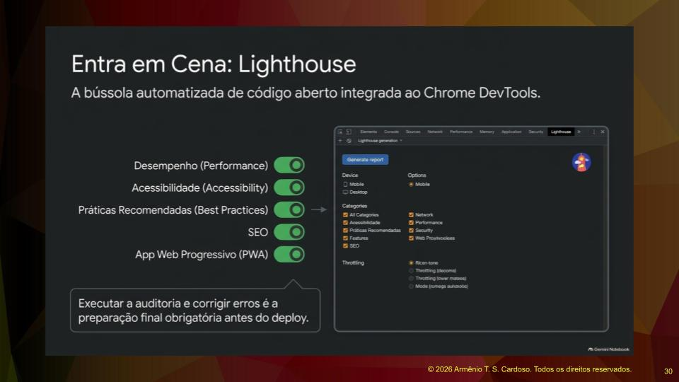
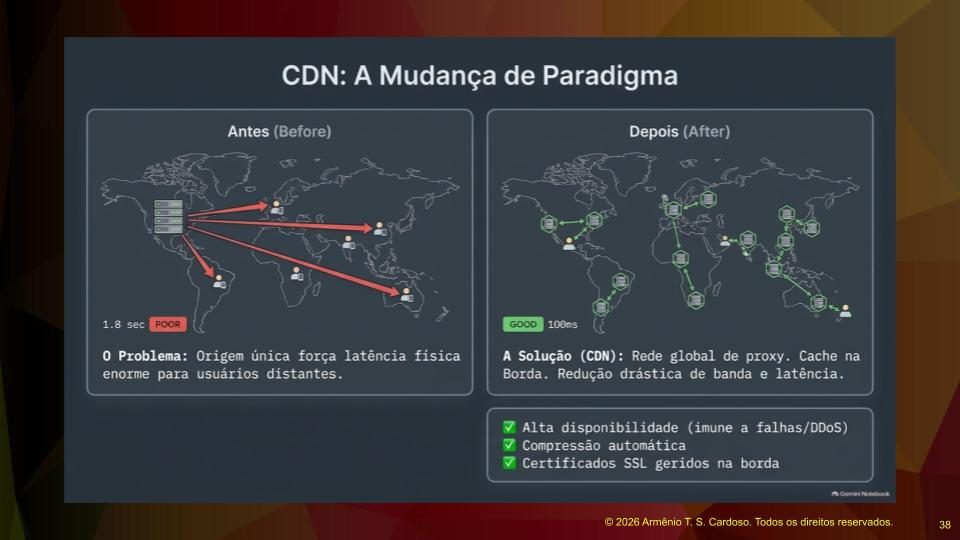
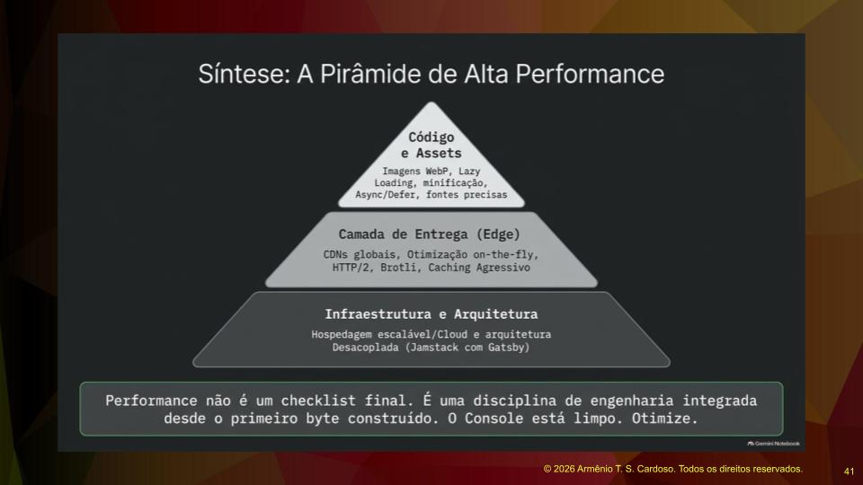

# A Epidemia da "Web Obesa": Como Auditar e Salvar a Performance da sua Aplicação

Seja bem-vindo a mais uma edição da nossa newsletter **Notas de Aulas**. Nesta edição, vamos tirar o jaleco de programador e vestir o de auditor. O diagnóstico que temos pela frente não é dos melhores: nossa web está doente, e o sintoma principal é a lentidão.

A web cresceu de forma assustadora, mas você sabia que o conteúdo real (o texto e a estrutura HTML) representa uma fração minúscula do que trafegamos pela rede? Hoje, cerca de **61% do peso da web é composto por imagens**, seguidas de perto pelo JavaScript, fontes e CSS.

Estamos construindo a chamada **"Web Obesa"**. Para você ter uma ideia, uma página web média hoje beira os 2 megabytes e exige mais de 70 requisições HTTP para carregar. Mas por que isso importa no seu dia a dia como Engenheiro de Software?

O custo da lentidão é altíssimo. Em mercados emergentes, o tempo de carregamento em redes móveis pode chegar a 20 segundos. Para o usuário, isso custa dinheiro (dados móveis). Para os negócios, considerando que **55% do tráfego web vem de celulares**, a lentidão significa abandono de carrinho, queda nas taxas de conversão e penalizações severas de SEO. E há um custo invisível: a internet já consome cerca de 10% da eletricidade global, rivalizando com a indústria da aviação em emissão de carbono.

Construir aplicações rápidas não é apenas um capricho técnico; é uma necessidade de negócios e uma responsabilidade global. Vamos entender como resolver isso.

---

## A Bolha do Desenvolvedor vs. A Realidade do Usuário

Antes de falarmos de código, precisamos quebrar alguns mitos que habitam as mesas de desenvolvimento. Existe uma divergência clara entre o que nós, engenheiros, acreditamos e o que o usuário vive.

1. **O Mito do Dispositivo de Última Geração:** Nós testamos nossas aplicações em MacBooks potentes e Wi-Fi de alta velocidade. A realidade? O crescimento global da web ocorre em smartphones intermediários conectados a redes 3G ou 4G instáveis.
2. **O Mito do Usuário Paciente:** "Ninguém abriu chamado reclamando da velocidade". Acredite: os usuários não reclamam, eles simplesmente fecham a aba e vão para o concorrente.
3. **O Mito da Otimização Prematura:** Dizer que "otimização prematura é a raiz de todos os males" pode valer para lógicas complexas de back-end, mas no front-end, a performance é o que determina se o usuário vai sequer ver o seu software funcionar.

A resiliência e a performance devem ser tratadas como **fundamentos de engenharia**, e não como detalhes que o navegador moderno vai resolver magicamente.

---

## O Raio-X da Aplicação: Auditando com o Lighthouse

Para tratar a lentidão, precisamos de um diagnóstico preciso. É aqui que entra o **Google Lighthouse**, uma ferramenta de auditoria integrada ao Chrome que deveria ser o melhor amigo de todo desenvolvedor web, seja você fã de React, Next.js ou mantenedor de um sistema legado.

**Regra de ouro:** Nunca confie no teste de performance rodando no seu `localhost` em ambiente de desenvolvimento. Ali, o seu JavaScript não está minificado (compactado) e os recursos não estão otimizados. O teste real deve ser feito na sua URL de *staging* ou produção (na Vercel, Netlify, AWS etc).

### Entendendo as Métricas de Experiência (Core Web Vitals)

O Lighthouse não mede apenas "tempo de carregamento", ele mede a **percepção do usuário**:

- **FCP (First Contentful Paint):** Quanto tempo demora para o primeiro elemento (texto ou imagem) aparecer na tela branca?
- **LCP (Largest Contentful Paint):** Quanto tempo demora para o *maior* elemento visível "acima da dobra" (a área visível sem rolar a página) renderizar? Geralmente, é o seu banner principal.
- **TBT (Total Blocking Time):** O tempo em que a página fica "congelada", impedindo o usuário de clicar ou digitar, geralmente porque a *thread* principal está ocupada processando um JavaScript pesado.
- **CLS (Cumulative Layout Shift):** Mede a estabilidade visual. Sabe quando você vai clicar em um botão e a página "pula" porque uma imagem carregou atrasada? O CLS penaliza exatamente isso.

---

## A Dieta da Aplicação: Ganhos Rápidos de Otimização

Você rodou o Lighthouse e a nota foi vermelha. Por onde começar? Aqui estão as práticas de engenharia que trazem os maiores e mais rápidos impactos:

### 1. Descentralize com uma CDN
Hospedar sua aplicação em um único servidor (mesmo que seja um VPS robusto) força a latência física. Se seu servidor está em São Paulo e o usuário em Tóquio, a física exige seu pedágio. A solução é usar uma **CDN (Content Delivery Network)**. Ela distribui seu conteúdo em dezenas de servidores ao redor do mundo (na "borda"), reduzindo a latência, comprimindo dados automaticamente e garantindo alta disponibilidade.

### 2. Otimização Implacável de Imagens
Se as imagens são as grandes vilãs, ataque-as primeiro. Nunca carregue uma imagem de 5000 pixels se a div onde ela será exibida tem apenas 600 pixels de largura. Redimensione previamente, utilize formatos modernos (como WebP ou AVIF) e evite embutir imagens pesadas em Base64 no seu CSS.

### 3. Minificação, Defer e Gzip
O código que escrevemos é cheio de espaços e quebras de linha para facilitar a *nossa* leitura. O navegador não precisa disso.

- **Minifique** seu JavaScript e CSS no processo de *build*. O jQuery original, por exemplo, cai de 250kb para um quinto desse tamanho ao ser minificado.
- Use o atributo `defer` na chamada dos seus scripts para garantir que eles não bloqueiem a renderização do HTML.
- Ative a compressão **Gzip** ou **Brotli** no seu servidor (Tomcat, Apache, Nginx). Isso reduz drasticamente o peso dos dados trafegados na rede.

---

## As Três Camadas da Alta Performance

Para finalizar nosso raciocínio de hoje, quero que você visualize a otimização de performance dividida em três grandes camadas de responsabilidade:

1. **Código e Ativos (A Base):** É aqui que você tem controle absoluto. Minificação, tamanho das imagens, chamadas de API eficientes, uso de arquiteturas modernas como *Jamstack* (que já entrega arquivos estáticos altamente otimizados).
2. **Entrega (O Meio):** A forma como o código chega ao usuário. É a escolha inteligente da sua CDN, do uso do protocolo HTTP/2 (que permite baixar vários arquivos na mesma conexão simultaneamente) e do cache de borda.
3. **Infraestrutura (O Topo):** O hardware por trás de tudo. Em grandes corporações, você talvez só possa fazer recomendações, mas em projetos independentes, escolher uma nuvem escalável em vez de uma hospedagem compartilhada barata (que sofre com "vizinhos barulhentos" roubando recursos) é uma decisão crítica.

---

## Resumo Executivo

A performance de uma aplicação web não é um *checklist* que você faz na véspera do lançamento. **Ela é uma disciplina contínua de engenharia.**

Desde o primeiro byte escrito, devemos considerar o ambiente real do usuário. Ferramentas como o Lighthouse devem estar integradas ao seu fluxo de trabalho (e até nas suas esteiras de CI/CD), garantindo que cada nova *feature* adicionada não destrua a experiência, a acessibilidade ou a velocidade do seu software. Aplicações leves convertem mais, retêm mais usuários e são mais gentis com o planeta.

### 💬 Agora eu quero ouvir de você!

Qual foi a última vez que você rodou o Lighthouse no seu projeto principal em produção? Qual foi a sua nota no mobile e qual tem sido o seu maior gargalo (Imagens, JavaScript de terceiros, Fontes)?

**Deixe seu relato nos comentários abaixo e vamos debater soluções!** Até a próxima!