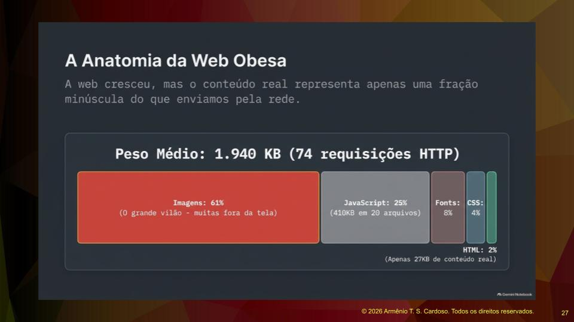
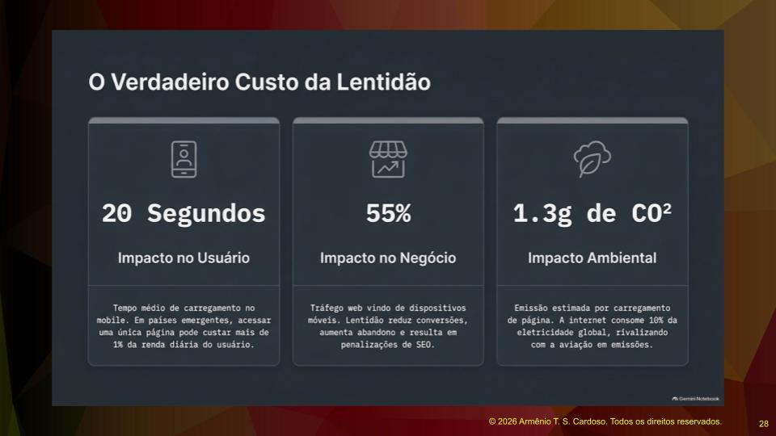
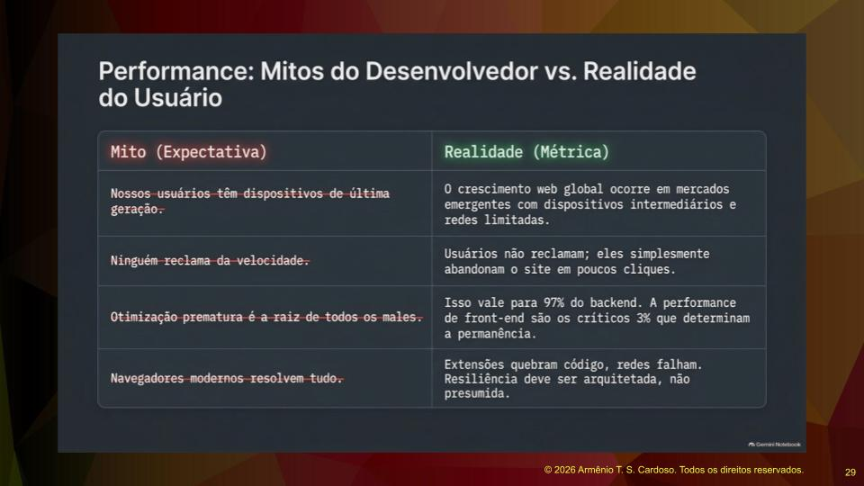
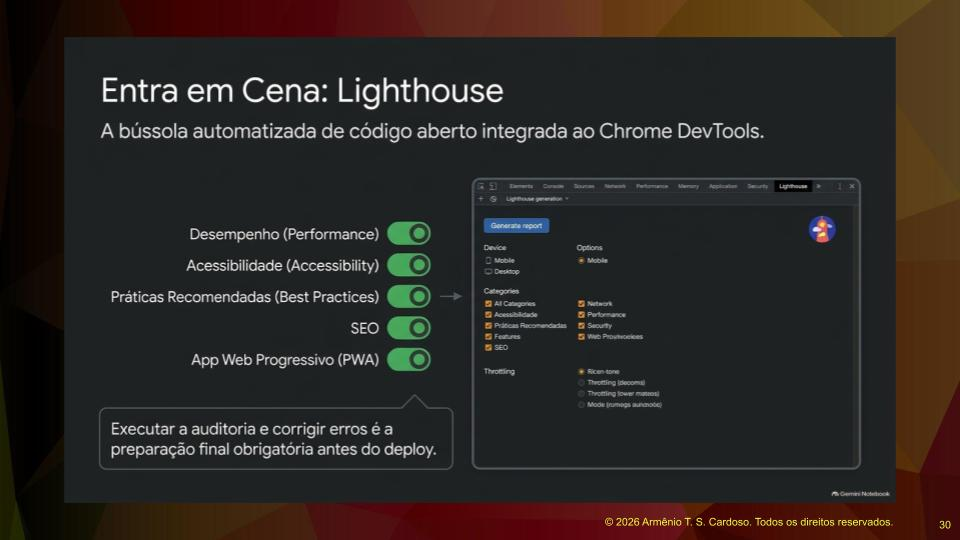
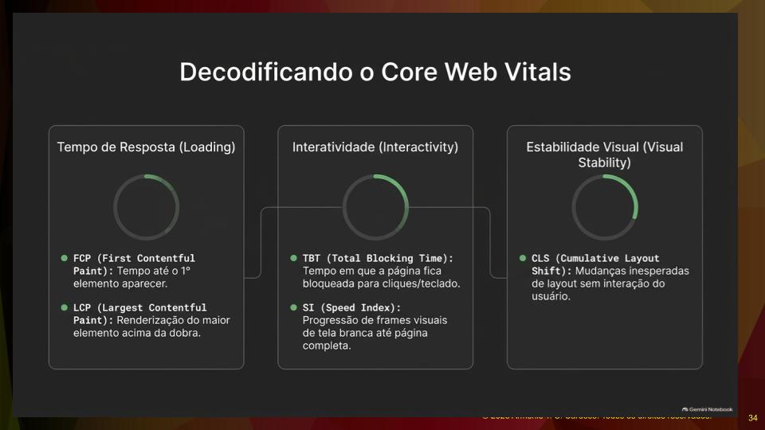
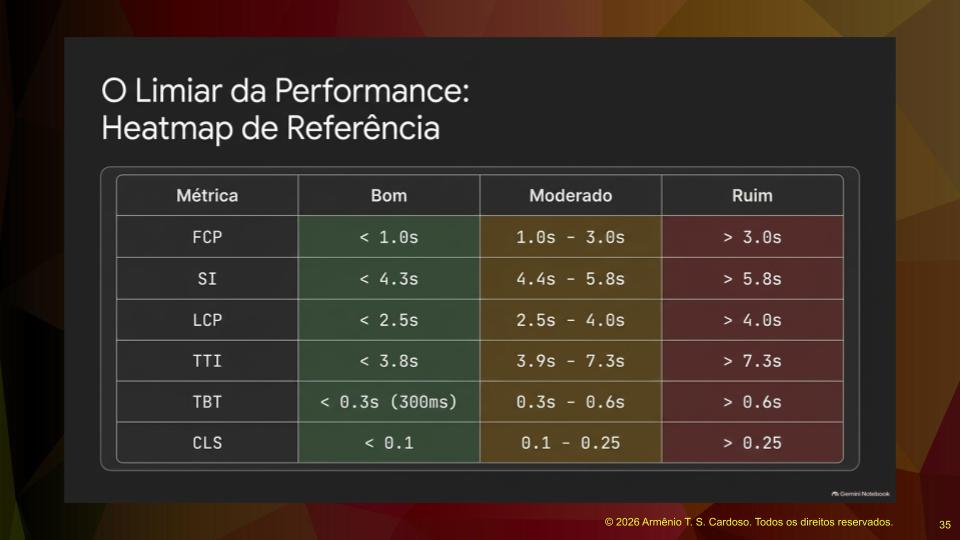
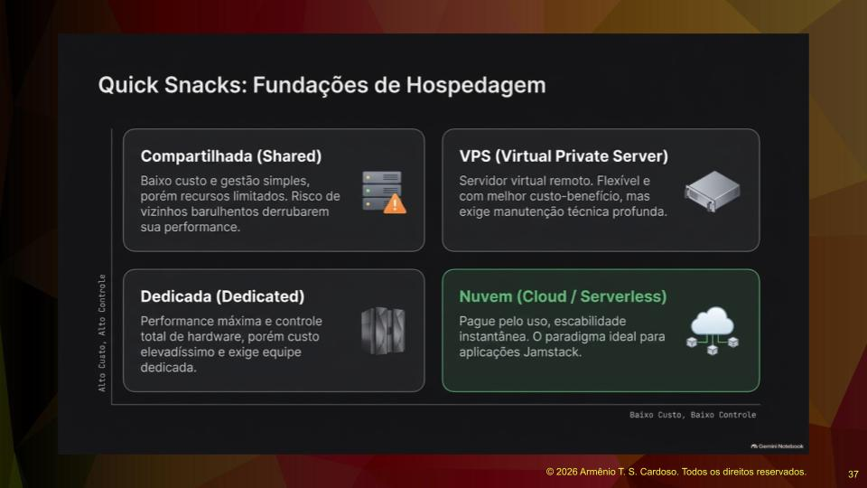
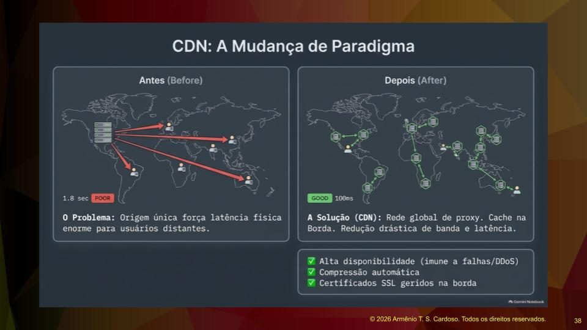
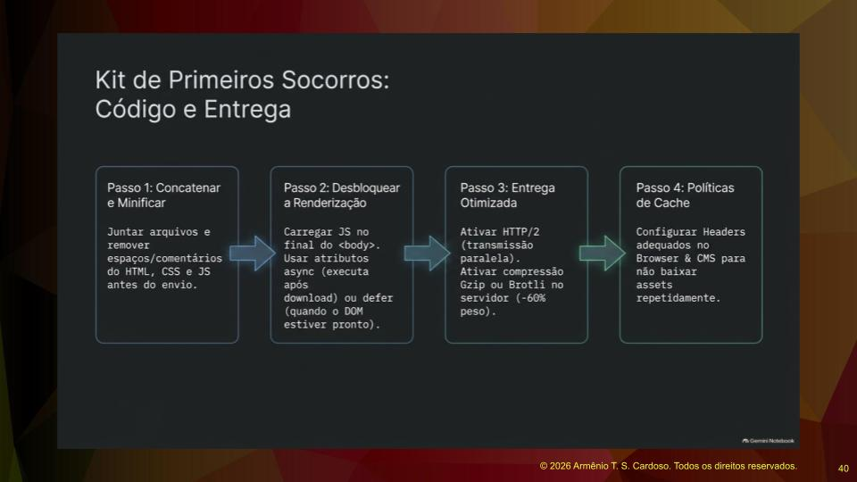
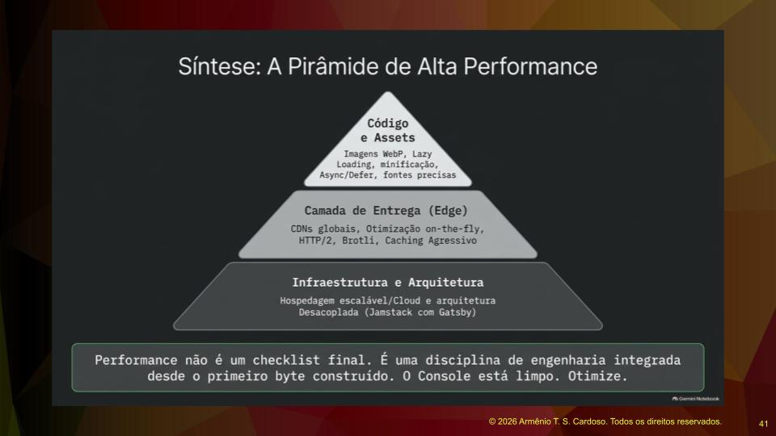

## A Anatomia da Web Obesa e o Impacto da Lentidão

A web cresceu significativamente, mas o conteúdo real representa apenas uma fração minúscula do que enviamos pela rede.

Atualmente, cerca de sessenta e um por cento do peso da web é composto por imagens, tornando-as as grandes vilãs da performance, seguidas pelo Javascript, fontes e CSS. O HTML em si representa uma parcela muito pequena.

O custo da lentidão para o usuário final é alto. Em países emergentes, o tempo médio de carregamento em dispositivos móveis pode chegar a vinte segundos. Acessar uma única página pode custar mais de um por cento da renda diária do usuário devido à lentidão da rede. No aspecto dos negócios, considerando que cinquenta e cinco por cento do tráfego web vem de dispositivos móveis, a lentidão reduz conversões, aumenta o abandono de páginas e resulta em penalizações de SEO.

Existe também um impacto ambiental que raramente é considerado. A emissão estimada de carbono por carregamento de página é significativa, e a internet consome cerca de dez por cento da eletricidade global, rivalizando com a indústria da aviação. O ponto principal de todas essas estatísticas é ilustrar a necessidade de construirmos aplicações eficientes e rápidas, focando no impacto positivo para o usuário e para o negócio.

## Mitos do Desenvolvedor versus Realidade do Usuário

Existem divergências claras entre o que os desenvolvedores acreditam e a realidade dos usuários. O primeiro mito é a crença de que os usuários possuem dispositivos de última geração. A realidade é que o crescimento global da web ocorre em mercados emergentes, com dispositivos intermediários e redes limitadas.

Outro mito comum é achar que ninguém reclama da velocidade. Na realidade, os usuários não reclamam, eles simplesmente abandonam o site. Há também o mito de que a otimização prematura é a raiz de todos os males. Embora isso possa ser verdade para grande parte do back-end, a performance do front-end é crítica e determina a permanência do usuário na página.

Por fim, existe o mito de que os navegadores modernos resolvem todos os problemas de performance. A realidade mostra que extensões quebram o código e as redes falham frequentemente. A resiliência deve ser tratada como um detalhe fundamental da engenharia, e não como algo presumido.

## Utilizando o Lighthouse para Auditoria

O Lighthouse é uma ferramenta de performance integrada às ferramentas de desenvolvedor do Google Chrome. Seu uso é fundamental e deve ser aplicado em qualquer projeto web, seja utilizando React, Next.js ou fazendo ajustes em um front-end legado.

Para executar a auditoria, configuramos a ferramenta para analisar a navegação em um dispositivo desktop ou mobile, marcando opções como desempenho, acessibilidade e práticas recomendadas. É crucial compreender que rodar o teste no ambiente de desenvolvimento local resultará em uma performance ruim, pois o código não está otimizado. O teste real deve ser feito após o processo de publicação no Netlify, Vercel ou em outra nuvem.

No ambiente de desenvolvimento, o Javascript não está minificado. A minificação é um processo que poupa muito tempo de carregamento. Como exemplo, a biblioteca jQuery em sua versão normal possui muitos espaços em branco, tabulações e quebras de linha, resultando em um arquivo de duzentos e cinquenta kilobytes. A versão minificada, que remove todos esses caracteres desnecessários, tem um quinto desse tamanho. Ferramentas Jamstack fazem essa minificação automaticamente ao gerar o build para produção, mas é possível incluir uma ferramenta de minificação externa no processo de build da aplicação.

## Métricas de Performance e Experiência do Usuário

O Lighthouse avalia o tempo de resposta, a interatividade e a estabilidade visual da página através de métricas específicas. O First Contentful Paint mede o tempo até o primeiro elemento aparecer na tela. O Largest Contentful Paint avalia a renderização do maior elemento visível acima da dobra da página, ou seja, a parte visível antes da rolagem, que frequentemente é uma imagem.

O Total Blocking Time mede o tempo em que a página fica bloqueada para cliques e uso do teclado, impedindo a interação do usuário. Em aplicações estáticas da arquitetura Jamstack, esse tempo costuma ser zero, mas passa a existir caso seja feito um fetch para carregar dados de uma API. O Speed Index avalia a progressão de frames visuais desde a tela branca até a página estar completa.

A estabilidade visual é avaliada para evitar aquelas mudanças repentinas de layout durante o carregamento, algo que prejudica muito a experiência. O tratamento adequado de imagens ajuda a manter o layout estável. A ferramenta apresenta um mapa de calor com cores indicando o que está bom, moderado ou ruim, e fornece links com sugestões detalhadas para melhorar cada item problemático.

## Acessibilidade e Boas Práticas

A acessibilidade pode ser tratada de forma objetiva através da ferramenta. No desenvolvimento de aplicações para o público em geral, é necessário prestar muita atenção na pontuação de acessibilidade. Ações simples, como a inclusão de atributos específicos no HTML, resolvem a maioria dos apontamentos feitos pelo Lighthouse. O objetivo é alcançar a nota máxima tanto em acessibilidade quanto em boas práticas.

A arquitetura Jamstack propicia alcançar uma nota perfeita no Lighthouse. Isso não é um mito, mas o resultado de toda a arquitetura de geração de sites estáticos, otimização de imagens e injeção de dados via GraphQL ou qualquer outra ferramenta de apoio, resultando em aplicações robustas e extremamente leves.

## Ganhos Rápidos para Otimização

Existem práticas de ganhos rápidos que devem ser aplicadas sempre que possível e a primeira delas diz respeito à hospedagem. Uma hospedagem compartilhada tem baixo custo e gestão simples, mas possui recursos limitados e o risco de vizinhos barulhentos derrubarem a performance da sua aplicação. Um servidor virtual privado oferece melhor custo-benefício e flexibilidade, mas exige manutenção técnica. A hospedagem dedicada entrega performance máxima e controle total de hardware, porém com custo elevadíssimo. A melhor opção costuma ser a nuvem, onde se paga pelo uso e se obtém escalabilidade instantânea.

O uso de uma Content Delivery Network é essencial. Ter uma origem única força a latência física para usuários distantes. A solução é distribuir o conteúdo por vários pontos geográficos. Uma rede global faz o cache, reduz drasticamente a banda de comunicação e a latência, além de oferecer alta disponibilidade, compressão automática e certificados SSL na borda.

Como as imagens representam a maior parte do peso da página, é vital reduzir suas proporções. Não se deve carregar uma imagem com cinco mil pixels de largura se o espaço de exibição é de apenas seiscentos pixels. É necessário redimensionar as imagens previamente, privilegiar formatos de última geração, evitar a codificação Base64 no CSS e utilizar ferramentas de transformação de imagens.

O passo a passo para a performance total inclui concatenar e minificar o código Javascript. Em seguida, deve-se carregar o Javascript no final do corpo do documento HTML ou utilizar o atributo *defer*, garantindo que a página seja renderizada antes do carregamento dos scripts. A utilização do protocolo HTTP/2 acelera a carga abrindo múltiplas threads de comunicação.

A ativação da compressão Gzip nos servidores diminui drasticamente o peso dos dados trafegados. Para quem trabalha com Java, aplicações JSP e Servlets, o servidor Tomcat permite ativar essa compressão nativamente, assim como o servidor Apache. O último passo é garantir o uso de cache nas bordas através da CDN.

## As Camadas da Performance

A performance exige o tratamento de várias camadas. A principal delas, que é de nossa total responsabilidade, está no código e nos ativos de software, como imagens e scripts. Essa é a primeira camada que devemos tornar eficiente.

A segunda camada é a de entrega. A escolha de plataformas como o Netlify serve como modelo, mas exige pesquisa de mercado para avaliar a relação custo-benefício e os recursos oferecidos por diferentes provedores de nuvem.

A última camada é a infraestrutura, que geralmente está fora do controle direto do desenvolvedor em grandes empresas, restando apenas a possibilidade de fazer recomendações. No entanto, para pequenos negócios ou projetos independentes, a decisão sobre hospedagem escalável e infraestrutura em nuvem recai sobre o desenvolvedor.

A performance não é um checklist final feito apenas na entrega do projeto. É uma disciplina de engenharia integrada desde o primeiro byte construído. O Lighthouse deve ser utilizado continuamente ao longo do processo, a cada nova versão publicada, garantindo que a aplicação se mantenha rápida e eficiente.

## Referências

1. **CORREIA, Thiago de Almeida; COUTO, Thiciane.** Teste de performance em aplicações Web: garantindo o desempenho de uma aplicação. *Interfaces Científicas – Exatas e Tecnológicas*, v. 1, n. 3, p. 23–30, 2015. Disponível em: [https://doi.org/10.17564/2359-4942.2015v1n3p23-30](https://doi.org/10.17564/2359-4942.2015v1n3p23-30).

2. **GOOGLE.** Como entender o Core Web Vitals e os resultados da pesquisa do Google. Google for Developers. Disponível em: [https://developers.google.com/search/docs/appearance/core-web-vitals?hl=pt-BR](https://developers.google.com/search/docs/appearance/core-web-vitals?hl=pt-BR).

3. **GOOGLE.** Introdução ao Lighthouse. Chrome for Developers. Disponível em: [https://developer.chrome.com/docs/lighthouse/overview?hl=pt-br](https://developer.chrome.com/docs/lighthouse/overview?hl=pt-br).

4. **WEB.DEV.** Auditoria de desempenho. Disponível em: [https://web.dev/articles/performance-audit?hl=pt-BR](https://web.dev/articles/performance-audit?hl=pt-BR).

5. **GOOGLE.** Sobre o PageSpeed Insights. Google for Developers. Disponível em: [https://developers.google.com/speed/docs/insights/v5/about?hl=pt-br](https://developers.google.com/speed/docs/insights/v5/about?hl=pt-br).

6. **OSMANI, Addy.** Engenharia de desempenho da Web na era da IA. O'Reilly Media, 2026. Disponível em: [O'Reilly Media](https://www.oreilly.com/library/view/engenharia-de-desempenho/0642572331740/).
