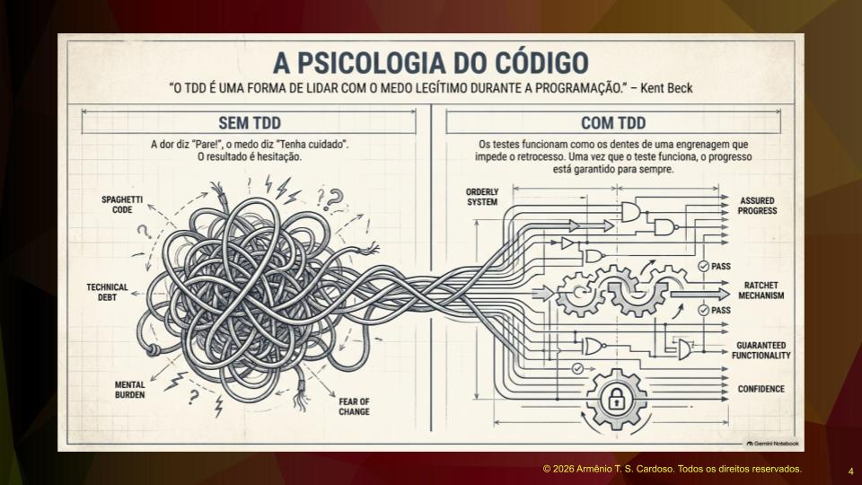

# TDD na Prática: Transformando o "Medo de Quebrar o Código" no Motor do seu Desenvolvimento

Se você já programou profissionalmente, com certeza já sentiu aquele frio na barriga ao alterar uma linha de código em um sistema complexo. O medo de consertar um bug e acabar criando outros três é universal na Engenharia de Software.

Como diz Kent Beck, um dos criadores do Manifesto Ágil e pai do tema do nosso artigo de hoje: *"A dor diz para parar e o medo diz para ter cuidado"*. O resultado disso? Hesitação, ansiedade, código espaguete e um acúmulo perigoso de débitos técnicos.

Hoje, vamos falar sobre psicologia e comportamento aplicados ao código. Vamos desmistificar o **Test-Driven Development (TDD)** e entender como ele funciona como os dentes de uma engrenagem: empurrando seu desenvolvimento para a frente e impedindo qualquer retrocesso.

## O Pacto da Equipe e a Inversão do Jogo

No dia a dia do mercado, existe uma prática muito comum: escrever o código primeiro e testar depois. É tentador, pois parece mais fácil. O problema é que, quando o prazo aperta (e ele sempre aperta), o teste é a primeira coisa a ser descartada. "Deixa para lá, na minha máquina está funcionando".

Na minha equipe, temos um pacto inegociável: toda demanda entregue precisa ter evidências de que o teste foi feito. Mas o TDD propõe uma inversão de jogo ainda mais radical e disciplinada: **você não pode fugir do teste, porque ele deve ser escrito antes do código.**

---

## O Coração do TDD: O Ciclo Vermelho, Verde e Refatoração

O TDD não é apenas "fazer testes". É um fluxo de trabalho contínuo baseado em um ciclo de três etapas fundamentais:

1. **🔴 Vermelho (A Falha e a Intenção):** Você escreve o teste para uma funcionalidade que ainda não existe. Obviamente, ele vai falhar. O objetivo aqui é psicológico e de design: você está definindo *o que* espera que o software faça antes de se preocupar em *como* ele fará.
2. **🟢 Verde (Pragmatismo e Sucesso):** Você escreve o código da forma mais enxuta, simples (e até "feia") possível, apenas para fazer o teste passar. Não é hora de sofisticação. A meta é ver a barra ficar verde.
3. **🔵 Refatoração (Evolução do Design):** Com o teste passando e garantindo que a regra de negócio funciona, você volta ao código para limpá-lo. Melhora nomes de variáveis, otimiza algoritmos e corrige vulnerabilidades (como trocar um *Statement* simples por um *PreparedStatement* para evitar SQL Injection). A regra de ouro? O teste tem que continuar verde.

Pense nisso como brincar com blocos de montar: primeiro você empilha de um jeito simples para a estrutura ficar de pé (Verde) e, depois, assenta as peças nos devidos lugares para que a construção fique sólida e bonita (Refatoração).

> 🖼️ **\[ESPAÇO PARA IMAGEM]**
> *Sugestão de Imagem:* Um infográfico circular simples e moderno mostrando o ciclo infinito do TDD. Três setas formando um círculo: a primeira vermelha (escrita "Test Fails"), a segunda verde (escrita "Test Passes"), e a terceira azul ou amarela (escrita "Refactor").

---

## TDD vs. Teste Unitário: Qual a diferença?

Muitos desenvolvedores confundem os dois conceitos.

O **Teste Unitário** é uma categoria de teste. É a prática de usar ferramentas (como JUnit no Java, Jest no React, ou Jasmine no JavaScript puro) para automatizar a verificação de uma unidade de código. Você pode muito bem fazer testes unitários no final do desenvolvimento.

Já o **TDD** é um *conjunto de práticas*, uma metodologia. Ele dita o ritmo: o teste vem antes, guiando o design do sistema. O TDD é conceitual, agnóstico e universal — funciona em qualquer linguagem ou ecossistema.

---

## Estudo de Caso: O Jogo da Forca

Imagine que vamos construir um Jogo da Forca consumindo palavras da API do IBGE. Como aplicar o TDD?

Você não começa desenhando a tela. Você começa pelo planejamento e pelas regras de negócio. Usando IA ou sua própria experiência, você divide o problema em pequenas tarefas. O tamanho ideal de uma tarefa é o equivalente a um método ou função.

Vamos testar a criação do **teclado virtual**:
- **Isolamento:** Simulamos o navegador.
- **Vermelho:** Escrevemos um teste (usando o *describe* do Jasmine, por exemplo) esperando que a função retorne 26 botões. A função não existe, o teste quebra.
- **Verde:** Fazemos um *loop* simples no alfabeto e renderizamos os botões em tela. O teste passa.
- **Refatoração:** Limpamos o código, ajustamos a performance e garantimos que o ambiente de teste seja limpo ao final (o estado antes e depois do teste deve ser o mesmo).

---

## A Ilusão da "Bala de Prata" e a Escada do Mindset

O TDD traz benefícios reais. No famoso caso do sistema financeiro WyCash, relatado por Kent Beck, a equipe conseguiu adaptar a arquitetura do sistema para suportar múltiplas moedas em tempo recorde e sem pânico, tudo graças à rede de proteção dos testes.

Contudo, **TDD não é bala de prata**. Ele garante o funcionamento interno da sua unidade, mas não substitui fundamentos de arquitetura, segurança da informação e processamento paralelo.

Hoje, com o boom das Inteligências Artificiais gerando código a rodo, os fundamentos são mais essenciais do que nunca. Um desenvolvedor sem base teórica, usando IA, apenas produzirá uma montanha de código na direção errada. O retrabalho será doloroso.

> 🖼️ **\[ESPAÇO PARA IMAGEM]**
> *Sugestão de Imagem:* Uma ilustração de uma escada com três degraus representando o "Mindset do TDD". Degrau 1 (Base): "Começar Simples". Degrau 2 (Meio): "Testes Automatizados (Rede de Proteção)". Degrau 3 (Topo): "Refatoração e Evolução do Design".

Para dominar a engenharia de software moderna, suba a escada do mindset do TDD:
1. Comece de forma simples, sem tentar prever o futuro.
2. Escreva testes para ser dono da sua própria confiança e gerenciar o medo.
3. Use a refatoração para melhorar seu software passo a passo.

---

### 🗣️ Agora eu quero ouvir de você!

No seu dia a dia atual (ou nos seus projetos de estudo), você costuma escrever os testes **antes** do código, **depois** do código, ou confessa que às vezes eles ficam "para a próxima sprint"?

Deixe sua experiência nos comentários abaixo e vamos debater como podemos melhorar nossa cultura de qualidade de software!

*Até a próxima aula!* 🚀