Tudo começa com as ideias de um autor chamado Kent Beck, um dos signatários do Manifesto Ágil. Ele é muito atuante na filosofia e no desenvolvimento de técnicas na área de Engenharia de Software, sendo um nome essencial para se conhecer, ler seus artigos e livros.

Segundo Kent Beck, sem o TDD, a dor diz para parar e o medo diz para ter cuidado, resultando na hesitação do desenvolvedor. Sem o TDD, o programador enfrenta indeterminações, ansiedades, código espaguete, débitos técnicos, carga cognitiva e medo de mudanças. Estamos falando de psicologia e comportamento aplicados à Engenharia de Software.

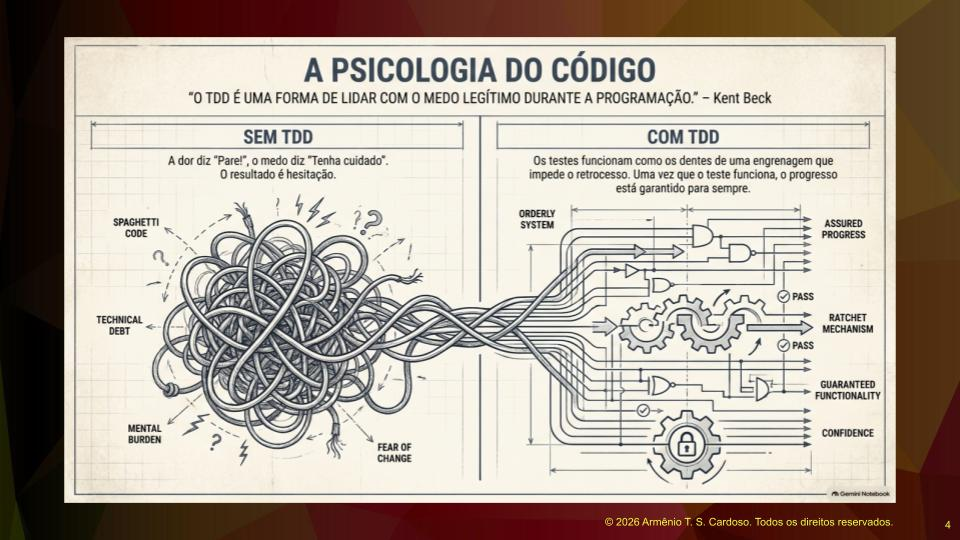

Com o TDD, os testes funcionam como os dentes de uma engrenagem que empurram o desenvolvimento para a frente e impedem o retrocesso. Uma vez que o teste funcione, o progresso é garantido. O TDD é uma forma de lidar com o medo legítimo durante a programação: aquele medo diante do desconhecido, de prazos apertados e de regras de negócios mal definidas.

## Estratégias de Teste e o Pacto da Equipe

Existe a prática de realizar o teste depois do desenvolvimento. É mais fácil de escrever porque já se sabe o que será testado. Porém, o risco é esquecer ou, com o tempo espremido, simplesmente deixar para lá.

Na minha equipe, temos um pacto. Toda demanda entregue precisa ter como anexo do card ou ticket as evidências de que o teste foi feito. O próprio desenvolvedor precisa se comprometer a testar o que construiu. Os colegas são criativos, colocam capturas de tela ou vídeos com os cliques e as coisas acontecendo. Isso é o que chamamos de teste exploratório. Além disso, é importante fazer os testes unitários dos algoritmos produzidos.

O problema é que, quando o tempo aperta, o desenvolvedor faz apenas o que é estritamente cobrado e deixa o resto para depois, e a chance de não fazer é grande. No TDD, não tem como fugir. Para adotar o método, é necessário fazer o teste antes de escrever o código. Primeiro fazemos o teste unitário e depois escrevemos o código para o teste passar. Isso exige disciplina, reduz o custo de manutenção e garante a confiança do desenvolvedor para alterar e incrementar o sistema, invertendo o jogo.

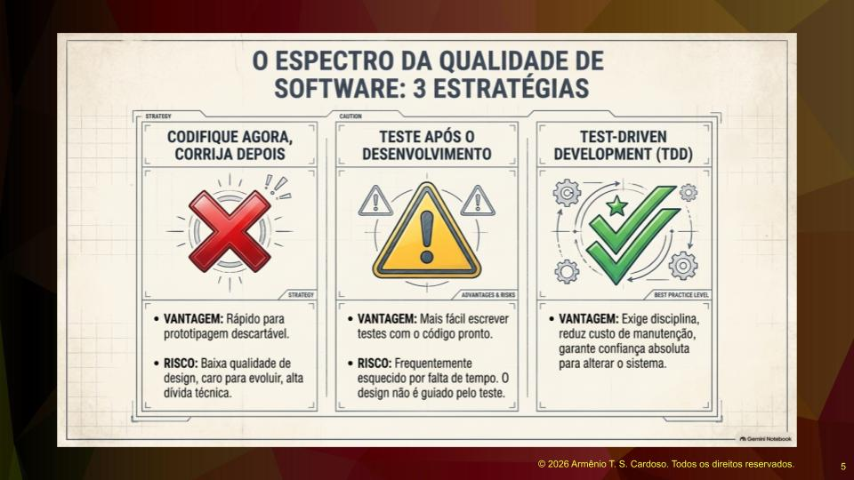

## O Ciclo do TDD e a Refatoração

Existe uma técnica chamada Test First, que significa testar primeiro. O TDD se apropriou dessa ideia e acrescentou a refatoração, criando um ciclo que pode ser chamado de Vermelho, Verde e Refatoração.

No TDD, primeiro fazemos o teste. Ele vai falhar porque o código ainda não existe, essa é a etapa Vermelha. Em seguida, escrevemos o código focado em fazer o teste passar, essa é a etapa Verde. Depois que o teste passa, voltamos ao código para verificar melhorias, essa é a etapa de refatoração.

Na refatoração, ajustamos nomes de variáveis, melhoramos algoritmos, verificamos a declaração de métodos e testamos todos os parâmetros. O código fica mais legível, performático e completo. Após isso, o ciclo recomeça com uma nova funcionalidade.

## Diferença entre Teste Unitário e TDD

O teste unitário é uma categoria de teste que usa ferramentas de software que automatizam o teste de uma unidade funcional ou unidade de código. A definição do que é uma unidade varia para cada desenvolvedor. Em um sistema com um menu de opções, cada opção, incluindo a de sair, pode ser um teste de uma unidade funcional.

Se a unidade de código for muito pequena, dará mais trabalho. O ideal é agrupar partes que têm coesão entre si, formando uma unidade que permita dar um passo no desenvolvimento.

O teste unitário é a prática de criar testes automatizados, geralmente feita após escrever o código. Nós podemos fazer testes quando criamos a classe conta corrente com os métodos depositar, sacar e consultar saldo, logo depois criamos um método main para testar cada uma dessas unidades funcionais. A questão é que implementar os testes dessa forma não garante o uso de um modelo, não garante o isolamento da unidade funcional, nem automatiza de forma sistemática a execução dos testes.

A técnica profissional exige o uso de uma ferramenta.

O TDD, por sua vez, é um conjunto de práticas onde se escreve o teste antes do código e se executa esses testes continuamente à medida que novas funcionalidades são adicionadas.

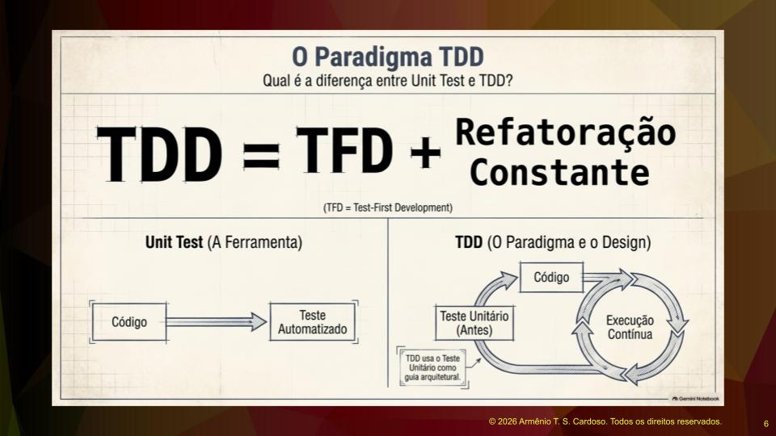

## Detalhando o Ciclo Vermelho, Verde e Refatoração

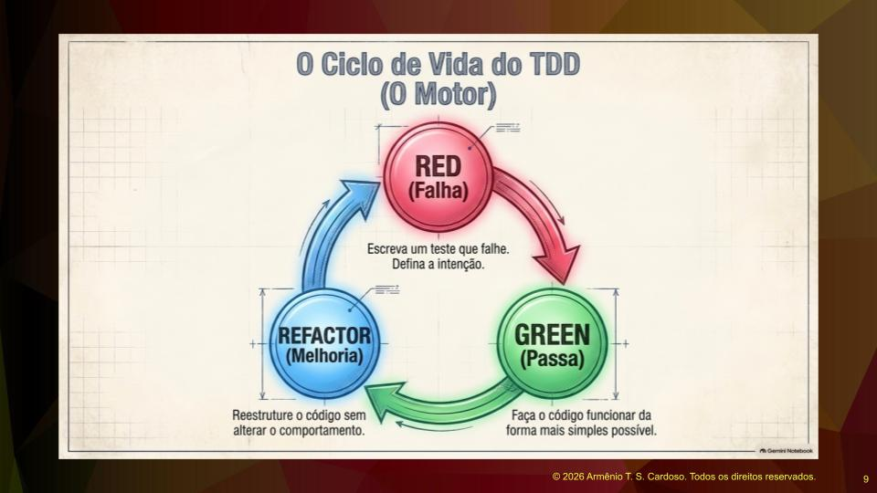

O Vermelho representa a falha. Escrevemos o teste e ele falha porque o código não existe. Aqui definimos a intenção e o que queremos que o software faça. O objetivo é psicológico, definindo como o código será construído no futuro.

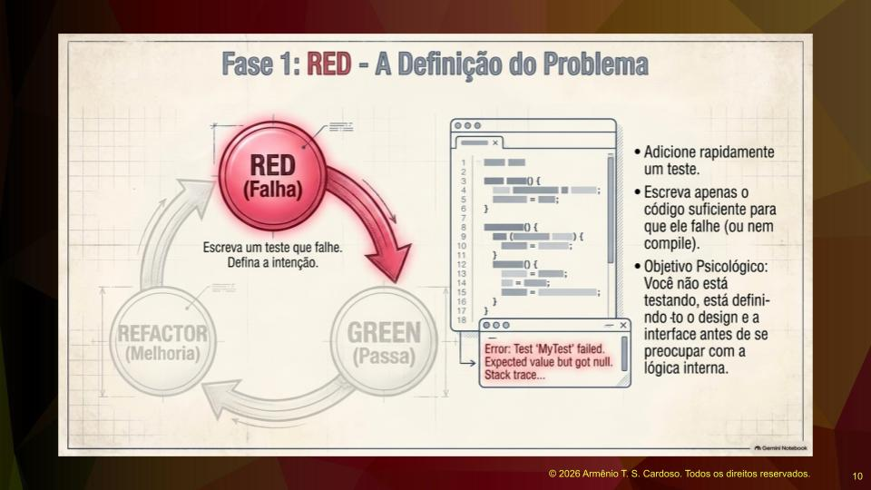

O Verde é pragmatismo e sucesso. Escrevemos o código da forma mais enxuta e simples possível para que ele passe no teste. Não nos preocupamos com elegância ou sofisticação neste momento. Executamos os testes e fazemos pequenos ajustes até a barra ficar verde.

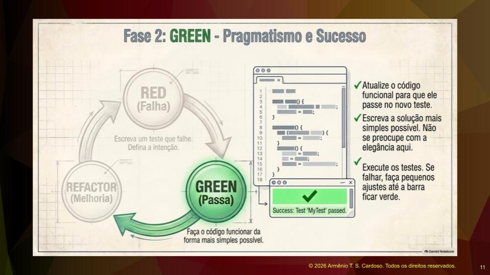

Refatoração é a evolução do design e do código. É uma reestruturação disciplinada para melhorar a qualidade e a clareza. Identificamos problemas de vulnerabilidade. Por exemplo, se na etapa Verde usamos um Statement para executar instruções do banco de dados, na etapa Refatoração percebemos a vulnerabilidade (possível SQL Injection) e trocamos por um PreparedStatement. A regra de ouro da refatoração é reter a semântica comportamental, ou seja, o teste deve continuar passando.

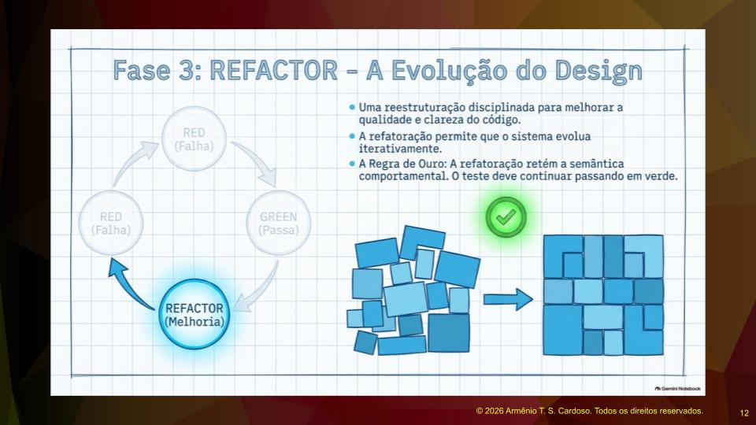

A analogia é como brincar com blocos de montar. Primeiro apoiamos de um jeito simples para funcionar e, na refatoração, assentamos as peças nos devidos lugares para que a estrutura fique sólida, clara e com boa performance.

## Ecossistema e Ferramentas de TDD

O TDD é conceitual e não se amarra a uma ferramenta ou linguagem de programação específica. No Java, utilizamos o JUnit, que é super consolidado. No Python, existe o unittest. No ecossistema JavaScript, para front end com React, Vue ou Angular, temos o Jest, que permite fazer testes unitários de componentes visuais, entregando um software com mais qualidade.

Para JavaScript puro com HTML e CSS, existe o Jasmine, que é bastante completo. O conceito do ciclo funciona para qualquer situação e linguagem, como o NUnit no C#. A base conceitual é a mesma para qualquer disciplina.

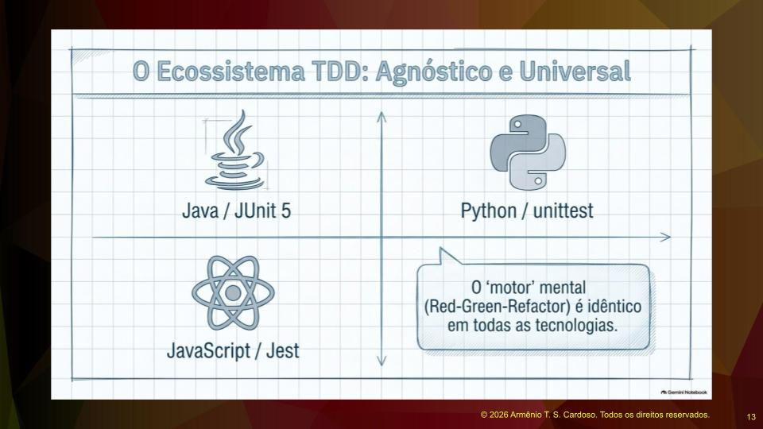

## Estudo de Caso Jogo da Forca

Vamos imaginar o desafio de construir um jogo da forca consumindo palavras reais da API do IBGE. O jogo bate na API, traz as unidades da federação, sorteia uma, busca os municípios e mostra o nome do município cifrado. O jogo possui blocos visuais, como as imagens da forca, um teclado virtual e a área da palavra cifrada.

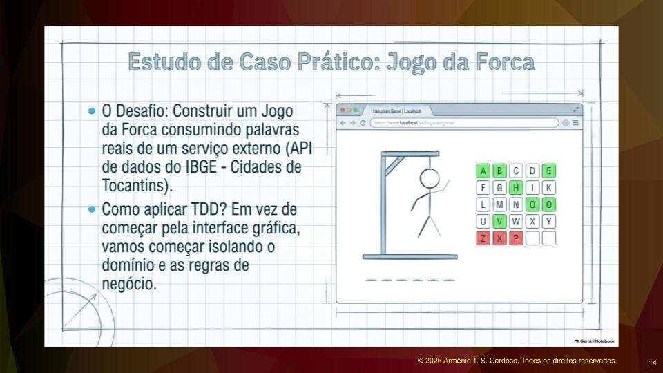

Para aplicar o TDD, alinhado com o ciclo de vida de desenvolvimento de software assistido por IA, passamos por uma etapa de especificação. Fazemos uma lista de passos de programação e tarefas. O tamanho ideal de uma tarefa é fazer um método ou função funcionar.

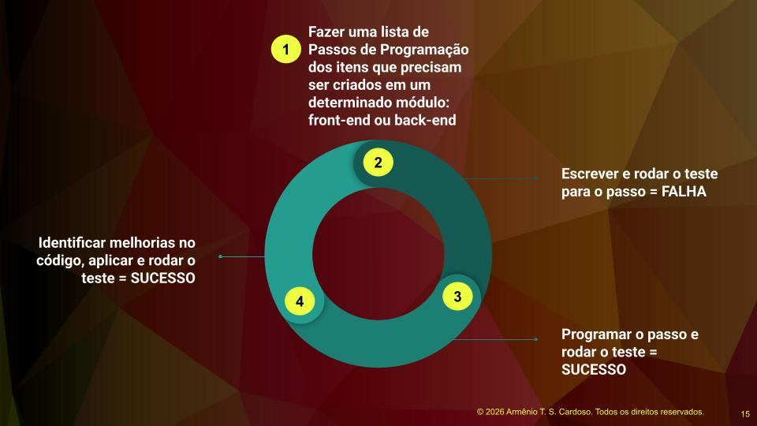

Com a lista pronta, entramos no ciclo. Primeiro, escrevemos o teste e vemos falhar. Segundo, escrevemos o código e vemos o teste funcionar. Terceiro, refinamos o código. A inteligência artificial ajuda muito nessa etapa de especificação, listando e dividindo as tarefas antes da codificação.

## Testando o Teclado Virtual

Ao olhar para o protótipo da tela, isolamos as tarefas. A criação do teclado virtual é uma delas. Usando o Jasmine como exemplo, temos o conceito de agrupador de testes, chamado describe, onde colocamos o título da tarefa.

Um conceito fundamental do teste unitário é o isolamento e a possibilidade de repetição com o mesmo resultado observável. O ambiente antes do teste tem que ser igual ao ambiente depois do teste. Se testamos um cadastro de alunos e inserimos dados, o banco deve voltar a ficar vazio ao final.

No front end, o teste simula um navegador. Usamos blocos de preparação antes de cada teste para criar os elementos em tela e blocos de finalização para remover esses elementos depois. O teste em si verifica se a função de montar o teclado cria os vinte e seis botões esperados.

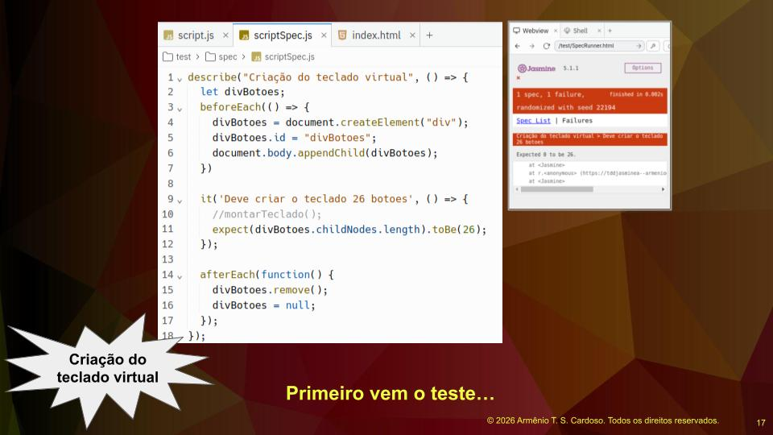

Inicialmente, a função não existe, então o teste falha, ficando na etapa Vermelha. Depois, escrevemos a função da forma mais simples, iterando pelas letras do alfabeto e criando os botões. O teste passa e fica Verde. Por fim, revisamos o código em busca de melhorias, entrando na etapa Azul. A experiência do programador dita a facilidade dessa etapa, e isso se adquire com tempo e prática.

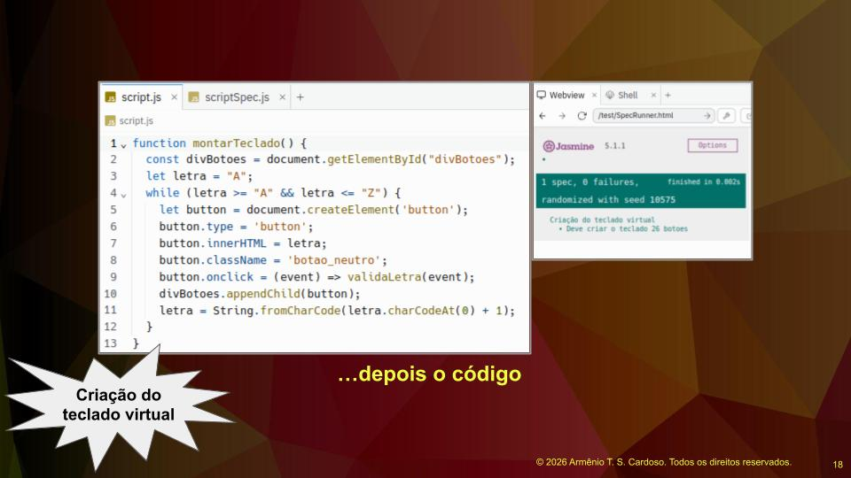

## Planejamento e Regras de Negócio

O ponto chave do TDD é a lista de tarefas. Não se deve começar a programar sem planejamento, batendo a cabeça e voltando atrás. O ideal é ter uma boa lista antes de colocar a mão na massa.

Não começamos pelo desenho na tela, mas por alguma regra ou método isolado que comporá a aplicação. Podemos testar se a letra inserida existe na palavra, se foi revelada na posição certa ou se o número de tentativas diminui após um erro.

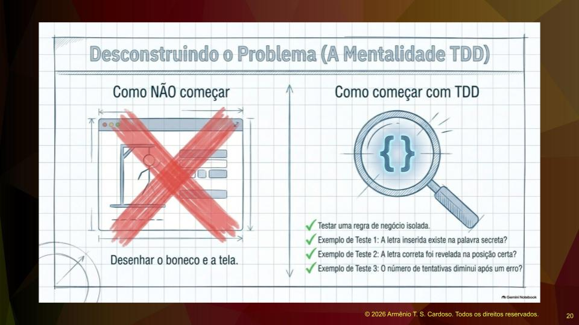

As regras de negócio podem evoluir. Em uma situação real, percebemos que mostrar uma quantidade fixa de letras como dica não funciona bem para palavras muito curtas ou muito longas. Criamos então a regra de revelar uma porcentagem da palavra, garantindo que o jogo seja prazeroso e equilibrado.

## Benefícios Reais do TDD

O TDD é um investimento em qualidade. O resultado esperado é a redução dos custos de manutenção, maior longevidade do software e aumento de valor, permitindo a inclusão de novas funcionalidades com confiança.

No livro de Kent Beck, há o caso do sistema financeiro WyCash, que operava apenas em dólares e precisou suportar múltiplas moedas em pouco tempo. A equipe adaptou a arquitetura sem pânico, guiada pela confiança gerada pelos testes abrangentes. O método cria oportunidades.

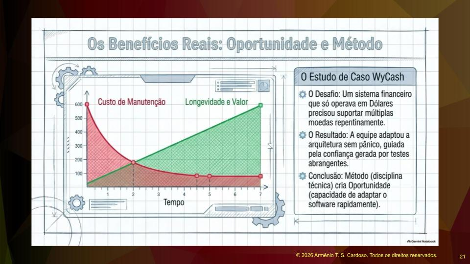

Hoje, em ciclos de desenvolvimento modernos, o teste vem antes e é inegociável. As ferramentas de IA trazem produtividade, mas a base do processo é o TDD.

## Limites do TDD e a Importância dos Fundamentos

O TDD não é uma bala de prata. Ele demonstra o funcionamento interno do código, mas não garante sozinho todos os objetivos de qualidade de um software complexo. Fazer cadastros simples é apenas o começo do aprendizado, o objetivo real é construir softwares complexos.

O julgamento e a experiência humana rigorosa nunca poderão ser substituídos. A teoria e os fundamentos são essenciais. Não é uma ferramenta poderosa de IA ou um computador de última geração que fará de você um bom programador, mas sim o estudo da teoria.

A bala de prata é colocada em perspectiva quando lidamos com segurança da informação, design de arquitetura, vulnerabilidades e processamento paralelo. Sem fundamentos, um desenvolvedor usando IA pode produzir uma montanha de código na direção errada, e o retrabalho será inevitável.

## A Escada do Mindset do TDD

Para fechar o entendimento, temos a escada do TDD. O primeiro degrau é começar de forma simples, sem antecipar complexidades desnecessárias ou tentar prever o futuro. O segundo degrau é escrever testes automatizados, sendo dono da sua confiança, gerenciando o medo e criando uma rede de proteção para futuras modificações. O terceiro degrau é utilizar o processo de refatoração, melhorando o código e o design da aplicação passo a passo.

Essa é a base conceitual do TDD. Nas próximas etapas, o foco será colocar a mão na massa e praticar a criação de testes utilizando ferramentas específicas.

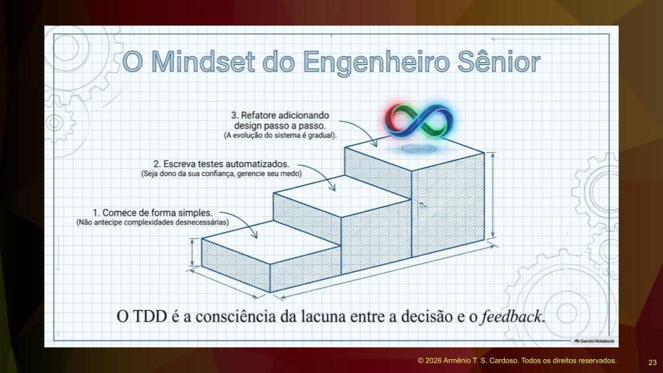