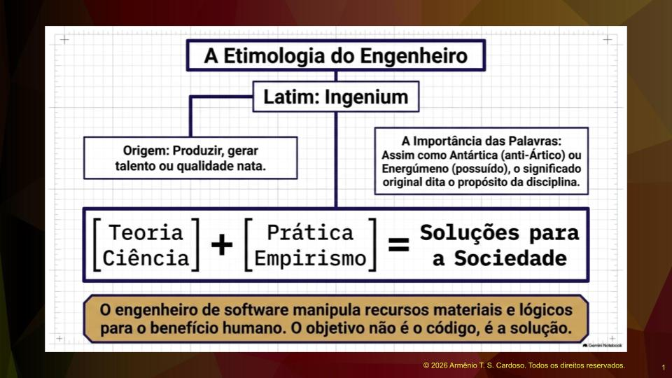
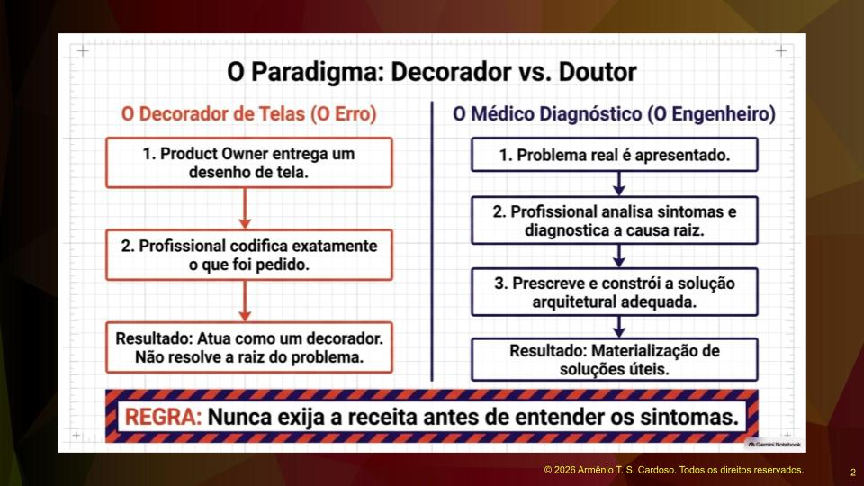
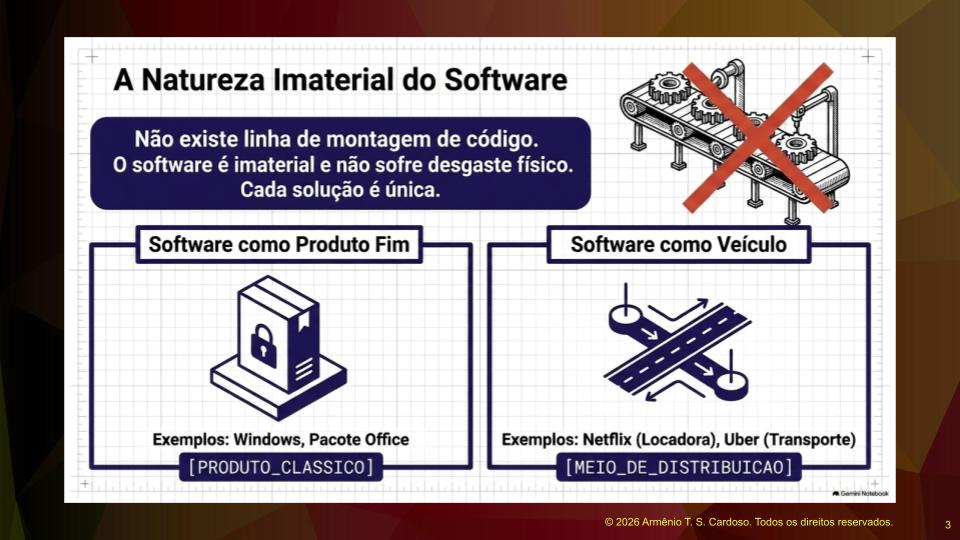
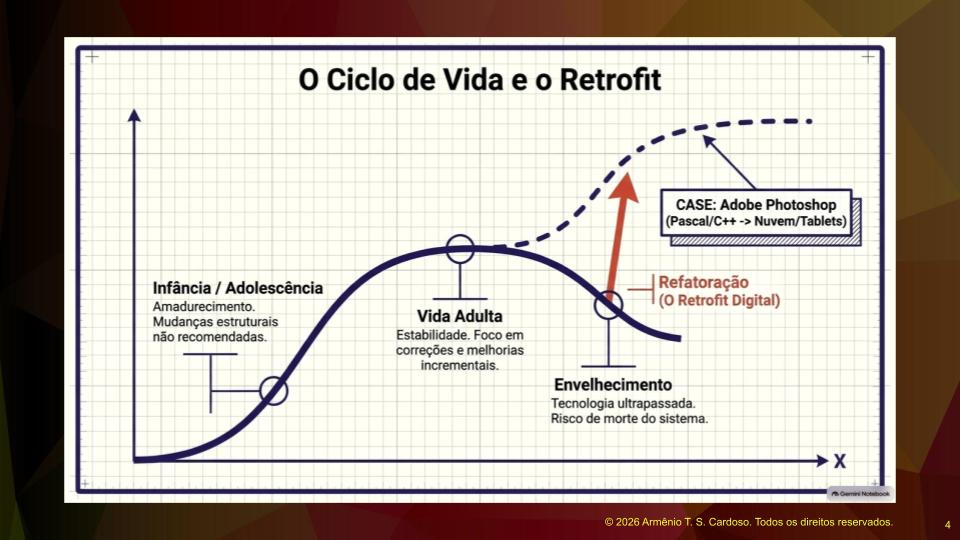
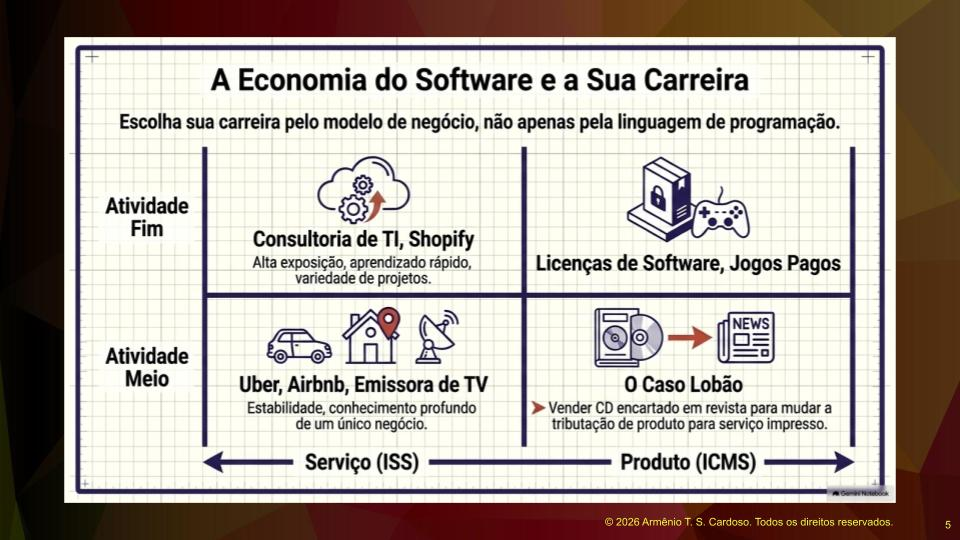
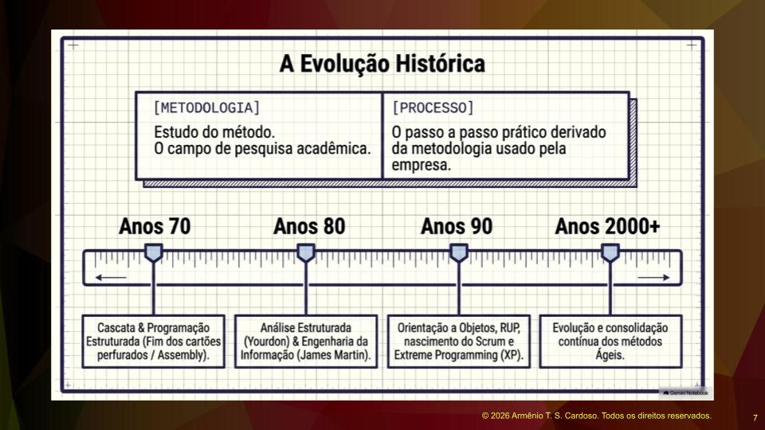
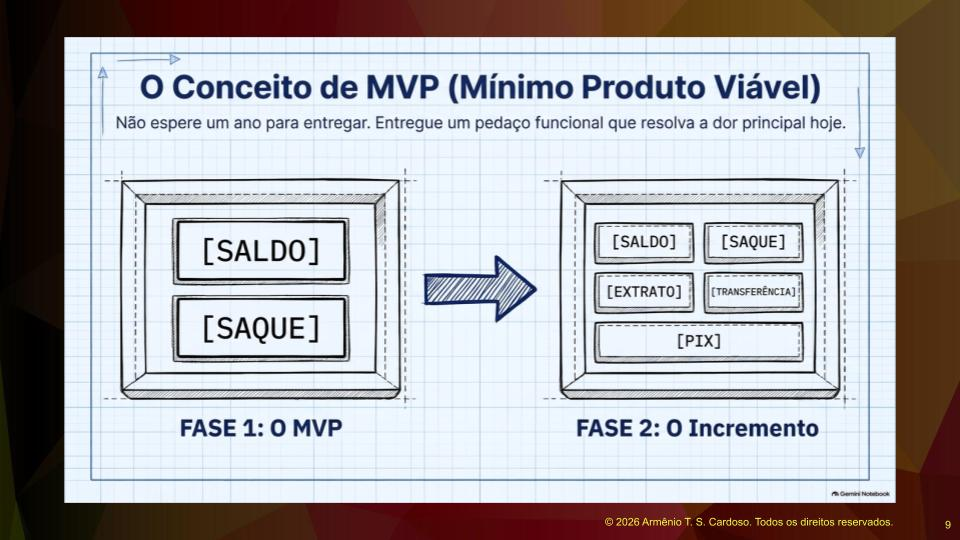
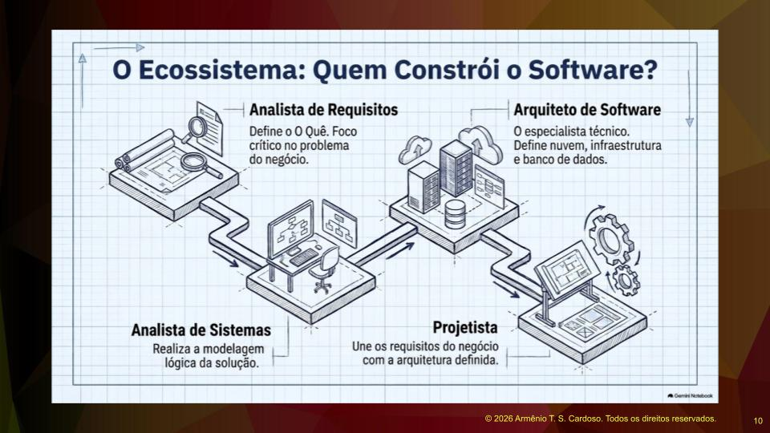
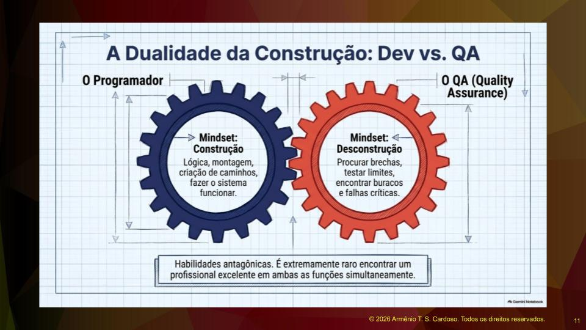
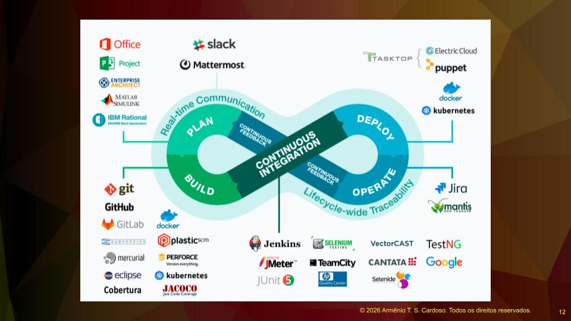

## Assista à explicação em vídeo
<iframe width="560" height="315" src="https://www.youtube.com/embed/-5J_Ib_dWIg?si=xgkfPJd8MzWYiIbf" title="YouTube video player" frameborder="0" allow="accelerometer; autoplay; clipboard-write; encrypted-media; gyroscope; picture-in-picture; web-share" referrerpolicy="strict-origin-when-cross-origin" allowfullscreen></iframe>## O Conceito de Engenharia

Mergulhando na teoria, a engenharia é a aplicação de métodos do conhecimento científico ou empírico, ou seja, a união da teoria e da prática, destinados à utilização de recursos materiais e naturais para o benefício do ser humano. É uma área do conhecimento que aborda os conceitos de projeção, desenvolvimento, construção, análise e manutenção de alternativas que auxiliem e facilitem a vida da sociedade nas atividades cotidianas.

A palavra engenharia tem origem no latim ingenium, que significa produzir ou gerar talento, ou uma qualidade nata. Conhecer a razão e a origem das palavras é fundamental. Por exemplo, a palavra Antártica recebe esse nome por estar no polo oposto ao Ártico, sendo o anti-Ártico. Outro exemplo é a palavra energúmeno, que muitas vezes é usada de forma equivocada por pessoas que desconhecem seu significado real, que remete a alguém possuído ou que veio do inferno. Compreender a origem do termo engenharia dá um peso diferente ao que está sendo estudado.

Inicialmente, a engenharia era aplicada a equipamentos mecânicos, sobretudo na área militar. Com o tempo, passou a ser a profissão na qual se adquire a formação técnica de conhecimentos científicos destinados à criação, aperfeiçoamento e implementação de utilidades. O engenheiro de software é o profissional que produz soluções úteis que fazem sentido e resolvem problemas reais.

## Foco na Resolução de Problemas

Muitas vezes, profissionais da área de produtos, como Product Owners, chegam à equipe de engenharia pedindo a construção de uma tela específica com determinados botões e funções. No entanto, o papel do engenheiro de software não é ser um decorador de telas: o foco deve ser sempre o problema que precisa ser resolvido.

Quando alguém já chega pedindo a solução pronta, é como ir ao médico e já exigir a receita de um remédio específico. O correto é o médico avaliar os sintomas, diagnosticar o problema e, então, prescrever a medicação mais adequada. Da mesma forma, o engenheiro de software deve analisar a raiz dos problemas para desenvolver o software que trará a solução correta. A função principal consiste na materialização de soluções.

## A Natureza do Software

Embora o interesse inicial de muitos seja aprender linguagens de programação como Kotlin, Java, C++ ou Python, a Engenharia de Software vai além do ato de programar. O software possui uma natureza específica e deve ser pensado como um produto.

Segundo o autor Roger Pressman, que possui livros fundamentais sobre o tema, o software é um produto e, ao mesmo tempo, o veículo para distribuir um produto.

Existem softwares que atuam como produtos clássicos, como o Windows ou o pacote Office. Por outro lado, existem softwares que atuam como serviços, onde o software é apenas o veículo. O Netflix e o Uber são exemplos disso. A atividade fim do Netflix é a locação de vídeos, e a do Uber é o transporte. O software é o meio que viabiliza essas atividades.

## O Ciclo de Vida e a Evolução do Software

É útil pensar no software como se fosse uma pessoa. O software tem infância, adolescência, vida adulta, envelhece e morre.

Se um software está na infância ou na adolescência, ele ainda está amadurecendo, então não faz sentido aplicar grandes melhorias estruturais. Quando ele atinge a fase adulta e ganha maturidade, faz sentido realizar melhorias e correções de defeitos. No entanto, quando o software começa a envelhecer e se aproxima do fim de sua vida útil, é o momento de substituí-lo por uma nova tecnologia.

Um software envelhece quando sua tecnologia se torna ultrapassada. O Photoshop é um exemplo de software super maduro. Originalmente, ele foi escrito em linguagens como Pascal e C++. Se a plataforma não tivesse evoluído e fosse mantida apenas em suas tecnologias iniciais, o software teria ficado estagnado, pois faltariam profissionais no mercado e ele não acompanharia as necessidades modernas. O Photoshop precisou evoluir para a nuvem e para dispositivos como tablets, que sequer existiam quando ele foi concebido.

O processo de melhorar e reestruturar um software maduro é chamado de refatoração. Fazendo uma analogia com a engenharia civil, quando uma construção antiga possui uma estrutura sólida, mas precisa ser modernizada, realiza-se um Retrofit. A refatoração é o Retrofit do software.

Diferente de um navio, de um carro ou de um prédio, o software é imaterial. Isso traz o benefício da flexibilidade. É possível trocar pedaços dele e lançar versões. Pode-se criar algo que funcione no momento e, posteriormente, incorporar melhorias, sem a necessidade de entregar uma obra de arte perfeita logo na primeira versão.

## Fabricação Personalizada vs Linha de Montagem

O software não é fabricado no sentido clássico de uma linha de montagem, como as criadas por Henry Ford. Em uma sala com vários computadores do mesmo modelo e fabricante, todos são idênticos, frutos de uma linha de montagem. O software não funciona assim.

Cada software é um produto totalmente especial e único. A versão de um editor de textos usada hoje é completamente diferente da versão de décadas atrás. Além disso, por ser imaterial, o software não sofre desgaste físico.

Mesmo utilizando frameworks padronizados, como a plataforma de desenvolvimento Android, projetos com o mesmo tema desenvolvidos por pessoas diferentes resultarão em softwares totalmente distintos, cada um com sua característica e implementação específica. Portanto, é muito difícil aplicar o conceito de linha de montagem na Engenharia de Software, pois os problemas e as soluções nunca são exatamente iguais.

## O Software na Economia

A Engenharia de Software está inserida em um contexto econômico. A economia é dividida em setores: primário, secundário e terciário. A indústria de software está localizada no setor terciário, que engloba comércio e serviços.

Uma empresa de fabricação de software é, na verdade, uma empresa de serviços, e o imposto recolhido geralmente é o ISS. O software só é considerado um produto, sujeito ao ICMS, se for vendido em uma mídia física, como uma caixa com um CD.

Tudo depende da forma como o produto é embalado e entregue. Um exemplo histórico de mudança de categoria de produto foi o do cantor Lobão, que, para evitar as gravadoras, passou a vender seus CDs encartados em revistas nas bancas de jornal. Ao fazer isso, ele transformou o produto e alterou a carga tributária, aproveitando as isenções aplicadas a revistas.

No mercado de aplicativos, um software vendido em uma loja virtual pode ser produto ou serviço dependendo da monetização. Se for uma licença comprada, atua como produto. Se for monetizado através de anúncios ou do modelo Freemium, onde o usuário paga para destravar funções, atua como serviço.

## Atividade Fim vs Atividade Meio

Ao buscar oportunidades no mercado de trabalho, é importante analisar se o desenvolvimento de software é a atividade fim ou a atividade meio da empresa.

Uma empresa de consultoria em TI tem o desenvolvimento de software como atividade fim. Trabalhar em um lugar assim no início da carreira proporciona um aprendizado intenso, pois o profissional é exposto a diversos projetos diferentes, como seguradoras, hospitais e comércio, em um curto período de tempo.

Por outro lado, em uma emissora de televisão, a atividade fim é o entretenimento, e o software é a atividade meio. O mesmo ocorre em empresas como Uber e Airbnb, onde o software viabiliza o negócio, mas não é o produto final comercializado. Já em plataformas de criação de lojas virtuais, como o Shopify, o software é a própria atividade fim.

Trabalhar em uma empresa onde o software é a atividade meio permite adquirir um conhecimento profundo sobre um negócio específico ao longo dos anos, trazendo mais estabilidade, embora o ritmo de aprendizado de novas tecnologias possa ser diferente. É fundamental avaliar o histórico da empresa e o potencial de aprendizado antes de aceitar uma vaga, priorizando o ganho de conhecimento sólido em vez de apenas o salário inicial.

## O Triângulo da Engenharia de Software

Para explicar o que é Engenharia de Software de forma simples, pode-se usar a imagem de um triângulo com lados iguais. A Engenharia de Software é o equilíbrio entre pessoas capacitadas, processos e ferramentas.

Uma engenharia que foca apenas nas ferramentas é manca e não funciona. É necessário integrar as pessoas, com suas diversas disciplinas, os processos de desenvolvimento e as ferramentas adequadas para construir software com eficiência e qualidade. Eficiência significa fazer mais gastando menos, o que é essencial para que a atividade seja comercialmente lucrativa.

## Processo vs Metodologia

Segundo Roger Pressman, a base para a Engenharia de Software é o processo. A teoria defende que um processo de desenvolvimento com qualidade resultará em um software com qualidade. A experiência prática demonstra que softwares desenvolvidos com disciplina e método tendem a ser superiores àqueles feitos sem planejamento e com prazos irreais.

É importante diferenciar processo de metodologia. Metodologia é o estudo do método de trabalho. As empresas não possuem metodologias próprias, elas possuem processos de desenvolvimento de software. O processo é derivado da metodologia e tem o objetivo de guiar o passo a passo para a construção do sistema. A metodologia é o campo de estudo que busca entender como implementar e melhorar esses processos.

## Evolução Histórica do Desenvolvimento

A história do desenvolvimento de software pode ser dividida em décadas para facilitar a compreensão.

Na década de 70, predominava o modelo em cascata e a programação estruturada. A programação recebeu esse nome porque as linguagens começaram a apresentar estruturas de controle, substituindo a programação direta na máquina com cartões perfurados e linguagem Assembly.

Na década de 80, houve um aperfeiçoamento com o surgimento da análise estruturada, criada por Edward Yourdon, seguida pela análise essencial e, no final da década, a engenharia da informação de James Martin.

A década de 90 trouxe a maturidade do desenvolvimento de software, impulsionada pela popularização dos microcomputadores nas empresas. Surgiram a análise orientada a objetos, o nascimento do Scrum, o Extreme Programming e o RUP.

A partir dos anos 2000, ocorreu a evolução e a consolidação dos processos ágeis, que continuam se transformando até os dias atuais.

## Cascata, RUP e Ágil

No desenvolvimento em cascata, as etapas de análise, projeto, construção e testes ocorrem de forma sequencial. O nome cascata, ou Waterfall, se dá porque o fluxo só anda para frente, não há como voltar. O cliente passa os requisitos no início e só recebe o software pronto meses ou anos depois.

O RUP difere do modelo em cascata por ser iterativo e incremental. O fluxo permite revisões constantes, e o cliente acompanha resultados parciais através de versões executáveis (incrementos) que são geradas e podem ser validadas ao longo do desenvolvimento, e não apenas no final.

No modelo ágil, o foco é o Mínimo Produto Viável, ou MVP. Não se entrega o software inteiro de uma vez, mas sim um pedaço funcional que já faz a diferença e é colocado em produção imediatamente.

Fazendo uma analogia com um caixa eletrônico, o MVP seria a capacidade de consultar o saldo e sacar dinheiro. Essas são as funções principais. O software é entregue rapidamente com essas funções e, com o tempo, é incrementado com novas funcionalidades, sem que o cliente precise esperar um ano inteiro para começar a usar o sistema.

## Papéis e Atividades na Engenharia de Software

O ciclo de vida do desenvolvimento envolve diversas atividades e profissionais específicos.

O levantamento de requisitos é feito pelo analista de requisitos, que determina quais funcionalidades o sistema precisa implementar e atender. Esta é a etapa mais crítica, pois define o foco do que será construído.

A análise de requisitos e a modelagem do sistema são feitas pelo analista de sistemas.

O arquiteto de software é o especialista em tecnologia. Ele domina as ferramentas, conhece infraestrutura em nuvem, bancos de dados e define como a solução técnica será estruturada.

O projetista une os requisitos com a arquitetura para desenhar o projeto do sistema.

O programador é o responsável pela construção. Ele possui um pensamento construtivo. Em contrapartida, o profissional de QA, responsável pela qualidade e testes, possui um pensamento focado em desconstruir. O QA procura brechas, buracos e falhas no sistema. São habilidades antagônicas, sendo raro encontrar um profissional que seja excelente em ambas simultaneamente.

## DevOps e Ferramentas

Atualmente, utiliza-se muito o termo DevOps, que é a união de desenvolvimento com operações. Historicamente, sempre houve atrito entre a equipe que desenvolve o software e a equipe de infraestrutura que mantém o sistema no ar, pois falhas no código impactam diretamente o ambiente de produção.

O DevOps é uma prática da Engenharia de Software que visa unificar e harmonizar essas áreas, defendendo a automação e o monitoramento em todas as fases de construção, implantação e gerenciamento da infraestrutura.

O ciclo do DevOps é representado por um fluxo contínuo e infinito que passa por planejamento, codificação, testes, empacotamento, liberação, implantação, configuração e monitoramento. Como o software possui versões, ele permanece rodando dentro desse ciclo de vida fechado.

Para que isso funcione, o DevOps não depende de uma única ferramenta, mas de um conjunto de ferramentas integradas. O ecossistema inclui tecnologias como Docker e Kubernetes. A título de curiosidade, a palavra Kubernetes vem do grego e significa timoneiro, motivo pelo qual seu logotipo é um timão de navio. Outras ferramentas comuns nesse fluxo contínuo incluem Eclipse, Mercurial, GitHub e GitLab, cada uma atuando em áreas específicas como codificação, controle de versão e integração contínua.

