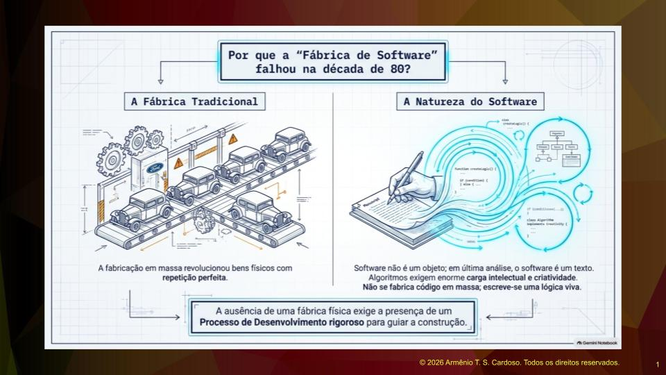
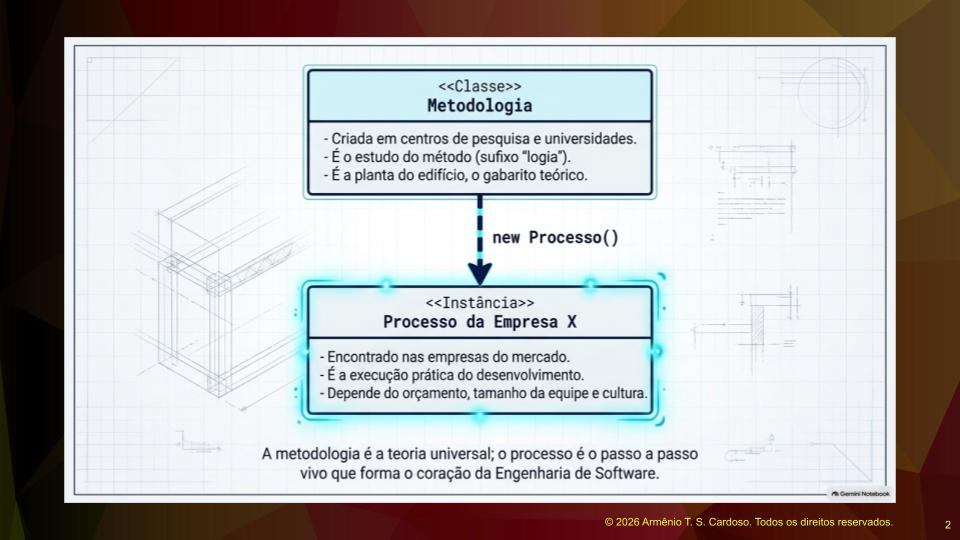
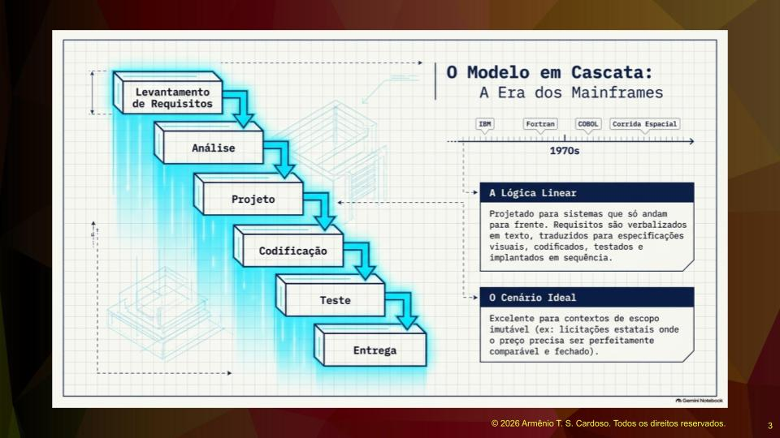
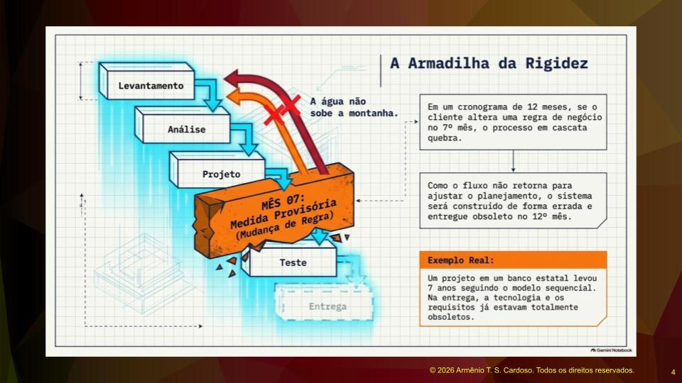
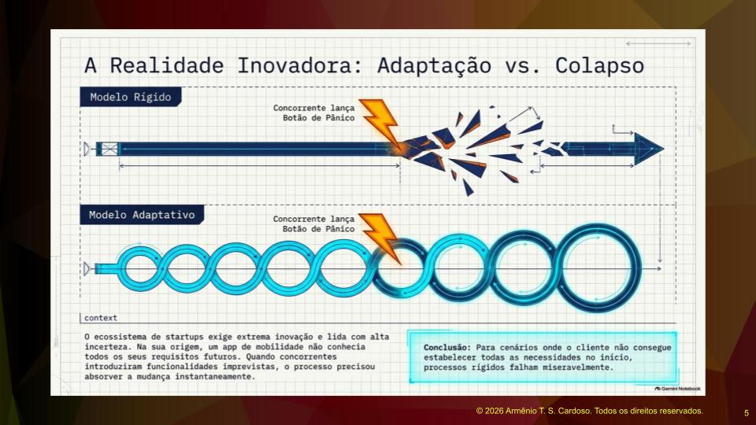
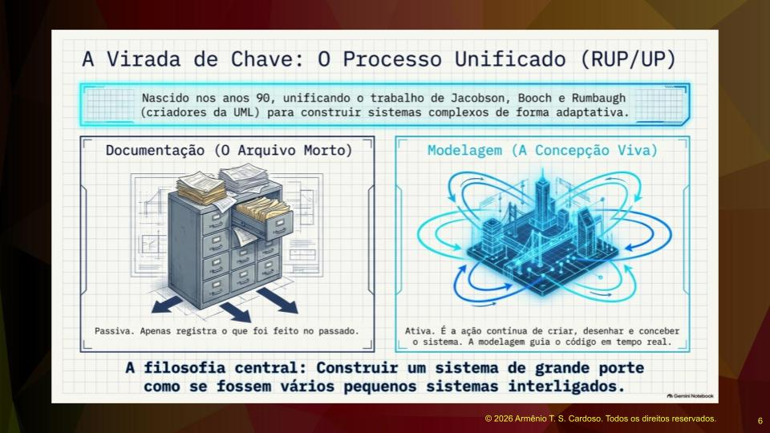
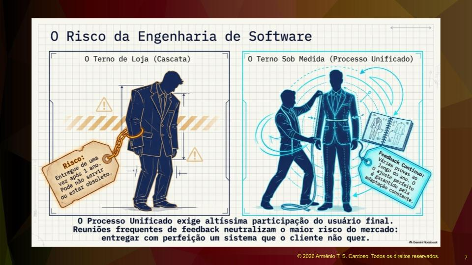
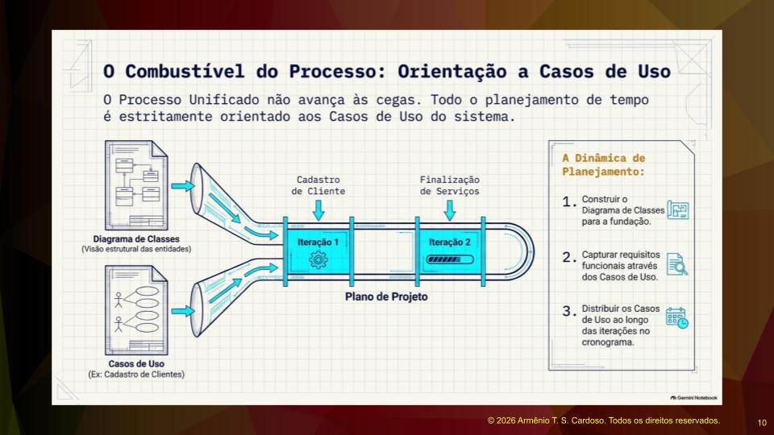
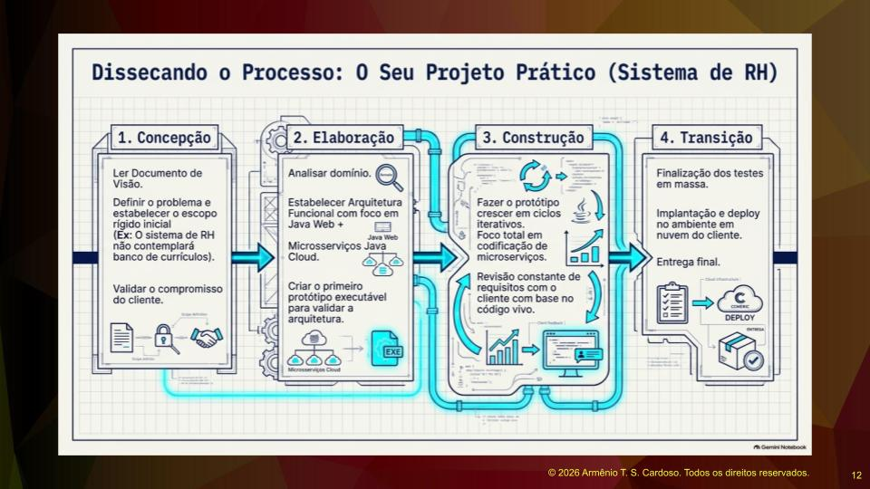

## Diferença entre Processo e Metodologia

Existe uma diferença muito importante entre processo e metodologia. A palavra metodologia carrega o sufixo "logia", que significa estudo, ou seja, estudo do método. As instituições comerciais dificilmente possuem um departamento de metodologia. Em geral, a metodologia existe dentro de faculdades, universidades e centros de pesquisa, onde os estudiosos geram ciência e desenvolvem o estudo do método.

A partir da metodologia, deriva-se o processo. O processo é o que você encontra nas empresas. O processo de desenvolvimento tem por objetivo guiar o passo a passo para a construção de um sistema e ele é o coração da Engenharia de Software.

Imagine que você está em uma festa de família, um churrasco, e uma tia pergunta o que você estuda em Engenharia de Software. Se você não souber responder, a situação fica complicada. O coração da Engenharia de Software é o processo.

Para extrapolar o conceito, imagine uma fábrica bem estruturada. Henry Ford inventou a linha de montagem no início do século vinte porque, através dela, era possível construir carros de maneira muito mais rápida e eficiente do ponto de vista econômico. Criou-se a fabricação em massa.

No entanto, é muito difícil fabricar software em massa. Em última análise, o software é um texto. É como se fosse um livro ou uma história que você vai escrever. Os algoritmos são escritos na linguagem de programação como um texto, exigindo uma carga intelectual muito grande, além de criatividade.

A ideia de fábrica de software, um conceito da década de oitenta, não prosperou exatamente por isso. O que sobrou dessas ideias foi a importância do processo, ou seja, ter o passo a passo do desenvolvimento bem definido, com especialistas muito capacitados em cada etapa.

Cada empresa tem o seu processo, o seu jeito de fazer software e o seu orçamento. Em uma empresa muito pequena, poucas pessoas farão atividades diferentes, acumulando tarefas. Em uma empresa muito grande, haverá especialistas fazendo partes específicas do processo. A metodologia de desenvolvimento de software é o estudo de como implementar e melhorar esses processos.

Fazendo uma analogia com os conceitos de orientação a objetos, a classe é o gabarito, a planta da casa ou do prédio. A metodologia é a planta do processo. Portanto, a metodologia é a classe e o processo de desenvolvimento de software é a instância da classe.

## Contexto Histórico da Engenharia de Software

Não é necessário ter um conhecimento enciclopédico para ser um excelente engenheiro de software, mas é muito bom conhecer um pouco da história para ter um mínimo de cultura na área.

Na década de setenta, o modelo em cascata era muito usado na programação de computadores de grande porte. A empresa que predominava nessa época era a IBM, que nasceu na segunda metade da década de sessenta e participou ativamente da corrida espacial, trazendo muita tecnologia para esse contexto. Surgiram linguagens como o Fortran, muito poderosa para cálculos científicos e o COBOL, muito usada pelas empresas na época.

Na década de noventa, surgiu o Rational Unified Process, criado junto com a UML. Rational é o nome da empresa onde Ivar Jacobson, Grady Booch e James Rumbaugh trabalharam juntos na década de noventa. Eles eram pesquisadores muito atuantes na área de metodologia e unificaram seus trabalhos para criar a UML e o RUP com o objetivo de simplificar os processos complicados da época, criando algo mais prático e voltado para o mercado.

## O Modelo em Cascata

A palavra cascata vem do inglês *waterfall*, que significa *queda d'água*. O processo recebe esse nome porque ele só anda para frente, como uma queda d'água, passando por fases como levantamento de requisitos, análise, projeto, codificação, teste e entrega.

Imagine o desenvolvimento de um sistema que vai durar doze meses. No primeiro e no segundo mês, é feita a iniciação e o levantamento de requisitos. No terceiro mês, faz-se a estimativa e o cronograma. Do quarto ao sexto mês, ocorre a análise e o projeto. No sétimo mês, começa a codificação.

Suponha que, no primeiro mês da codificação, o presidente da República emita uma medida provisória alterando a regra de negócio de um requisito do projeto. No processo em cascata, o fluxo continua em frente. O sistema será entregue após doze meses com um requisito obsoleto. Será necessário refazer o trabalho ou realizar um ajuste apenas no momento da entrega. O modelo em cascata nunca retorna, mesmo que um requisito tenha sido alterado.

Os requisitos representam a verbalização do que o sistema precisa fazer, escritos em texto corrido. A análise e o projeto traduzem esse texto para diagramas ou especificações gráficas. A fase de construção transforma a especificação gráfica em código Java. Depois, vêm os testes e a implantação.

O modelo em cascata apresenta uma grande vantagem quando o escopo do trabalho é claramente definido. Nas empresas estatais brasileiras, as compras de software são feitas através de licitações. O escopo precisa estar muito bem fechado para permitir a comparação de preços entre as empresas concorrentes.

A fragilidade desse modelo nos dias de hoje é a falta de flexibilidade. Essa rigidez gera um risco alto de não atender a todos os requisitos, pois eles podem mudar durante a construção. Projetos reais raramente seguem um fluxo sequencial perfeito. Frequentemente, é difícil para o cliente estabelecer explicitamente todas as necessidades logo no início.

Um exemplo claro disso é o ecossistema das startups, que traz uma forte carga de inovação. A empresa Uber quebrou paradigmas na forma de lidar com o transporte de pessoas. Nas versões iniciais, eles provavelmente não sabiam todos os requisitos futuros. Quando a empresa 99 trouxe funcionalidades de segurança, como botão de pânico e compartilhamento de rota, o aplicativo concorrente precisou se adaptar. O processo em cascata não seria adequado para esse tipo de desenvolvimento incerto e inovador.

Em um projeto real em um banco estatal, o desenvolvimento levou sete anos. Nos últimos anos do projeto, o software já estava totalmente obsoleto. É muito crítico utilizar o processo em cascata sem ter as coisas muito bem definidas.

## O Processo Unificado

O Processo Unificado surgiu como sucessor e como uma solução aos problemas do modelo em cascata. É fundamental entender a diferença entre o processo em cascata, o processo unificado e os processos ágeis.

O Processo Unificado combina o conceito de iterações, que são ciclos, com o conceito de incrementos sucessivos. A cada ciclo, adicionam-se novas funcionalidades e o sistema vai crescendo. O avanço do projeto é baseado na construção de artefatos de software.

É importante não confundir modelagem com documentação. A documentação é um conceito passivo, de arquivo. A modelagem é um conceito vivo, focado na concepção e criação do sistema. A modelagem pode ser guardada como documentação no futuro, mas sua missão principal é conceber o sistema.

O modelo iterativo e adaptativo consegue produzir um sistema de grande porte como se fossem vários pequenos sistemas, o que diminui os riscos. O tempo do projeto é dividido em quatro grandes fases: Concepção, Elaboração, Construção e Transição.

A fase de concepção é iniciada com o documento de visão e o entendimento dos requisitos principais do projeto. A fase de elaboração é coberta pelas próximas etapas, focando na modelagem do sistema. A fase de construção envolverá a codificação, e a fase de transição será a entrega final do projeto.

Existe uma imagem clássica nos estudos de UML que mostra as fases na horizontal e as disciplinas na vertical, com curvas representando o volume de horas empregadas. A modelagem de negócio toma bastante tempo na iniciação e declina depois. A programação começa de forma discreta com protótipos na elaboração e atinge seu pico na construção. Os testes acompanham a codificação em ondas, e a implantação ocorre no final.

Cada fase pode ter várias iterações. Cada iteração resulta em um incremento, que é uma versão do sistema com funcionalidades adicionais em comparação com a versão anterior.

No processo em cascata, você contrata a empresa, espera um ano e recebe o sistema pronto. No Processo Unificado, a empresa também passa um ano construindo, mas a cada período curto você vê um pedaço do sistema funcionando. O feedback a partir de uma iteração leva ao refinamento dos requisitos na iteração seguinte.

O Processo Unificado exige uma participação enorme do usuário final, que atua em reuniões de feedback frequentemente. No processo em cascata, o risco de o desenvolvedor não entender o cliente e entregar um sistema inadequado é altíssimo.

Podemos fazer uma analogia com a aquisição de um terno. Você pode comprar um terno pronto na loja, o que representa o processo em cascata. Você pega o produto finalizado, correndo o risco de as medidas não ficarem boas. A outra opção é fazer um terno sob medida, o que representa o Processo Unificado. Você fará várias provas ao longo do tempo, acompanhando a construção e ajustando conforme a necessidade.

## Orientação a Casos de Uso

O Processo Unificado é orientado a casos de uso. É imprescindível dominar os conceitos de orientação a objetos, diagrama de casos de uso e diagrama de classes. Todo o nosso projeto é baseado nisso.

O primeiro passo na concepção e na elaboração é construir um bom diagrama de classes com a visão geral das entidades do sistema. Os casos de uso são utilizados para capturar os requisitos funcionais e refinar o conteúdo das iterações. Cada iteração foca em um conjunto específico de casos de uso. Em uma iteração, você pode implementar o cadastro de clientes. Na seguinte, a finalização de serviços, e assim por diante.

É necessário desenhar o diagrama de casos de uso e fazer um plano de projeto distribuindo esses casos ao longo do tempo, pois não é possível construir tudo de uma vez.

## Detalhamento das Fases do Processo Unificado

Na fase de iniciação ou concepção, o objetivo é identificar necessidades de novos produtos e serviços. Lemos o documento de visão do sistema para entender o básico do que ele faz. Definimos o problema, delimitamos o escopo e listamos os requisitos.

Por exemplo, ao analisar o escopo do nosso sistema de recursos humanos, é preciso notar que ele não contempla o cadastro de currículos de candidatos. A essência do sistema é justamente não manter um banco de dados de currículos. Entender o escopo corretamente evita que o projeto siga na direção errada. É preciso obter o comprometimento do cliente, validar o escopo e avaliar os riscos.

Na fase de elaboração, o objetivo é analisar o domínio do problema e estabelecer uma arquitetura funcional. Nossa arquitetura será baseada em Java Web e Java Cloud. Vamos implementar o sistema com um módulo web e módulos de microsserviços para praticar as tecnologias estudadas. Serão fornecidos exemplos de código para guiar o desenvolvimento.

Ainda na elaboração, revisamos o plano do projeto, minimizamos riscos e construímos um protótipo que teste a arquitetura. Esse protótipo marcará o final da fase de elaboração.

Na fase de construção, pegaremos o protótipo e o faremos crescer, acrescentando novas funcionalidades a cada ciclo e revendo os requisitos constantemente. Por fim, a fase de transição será o momento da entrega do sistema.

