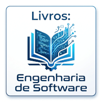

Um canal sobre Engenharia de Software, programação, tecnologia e formação profissional, criado para transformar conhecimento técnico em pensamento prático.

Aqui você encontra conceitos fundamentais, explicações objetivas, experiências de projetos e reflexões sobre o trabalho de quem desenvolve software.

Da programação aos fundamentos da Engenharia de Software. De Design Patterns e Arquitetura a DDD, sistemas escaláveis, IA e novas formas de desenvolver software.

CulturaTEC: Porque tecnologia não é apenas aprender ferramentas. É construir repertório para fazer escolhas melhores.

Aprenda. Pense. Construa.

## Canais nas Redes Sociais

|   |   |   |   |
|:---|:---|:---|:---|
|  |  |  |  |
|   |   |   |   |
|  |  |  |   |
|   |   |   |   |

