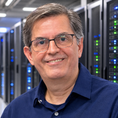

## Instiotucional
Um canal sobre Engenharia de Software, programação, tecnologia e formação profissional, criado para transformar conhecimento técnico em pensamento prático.

Aqui você encontra conceitos fundamentais, explicações objetivas, experiências de projetos e reflexões sobre o trabalho de quem desenvolve software.

Da programação aos fundamentos da Engenharia de Software. De Design Patterns e Arquitetura a DDD, sistemas escaláveis, IA e novas formas de desenvolver software.

CulturaTEC: Porque tecnologia não é apenas aprender ferramentas. É construir repertório para fazer escolhas melhores.

**Aprenda. Pense. Construa.**

## Presença Digital

|  |  |  |  |
|:---|:---|:---|:---|
|  |  |  |   |

## Quem está por trás do CulturaTEC?

Meu nome é Armênio Cardoso, sou Staff Software Engineer e Tech Leader, com mais de 40 anos de experiência em Engenharia de Software e uma trajetória profissional construída na interseção entre tecnologia, arquitetura de sistemas e educação.

Atualmente, sou responsável pela liderança técnica do Gliese, sistema de atendimento da Dasa, atuando em um ambiente de alta complexidade, no qual disponibilidade, desempenho, escalabilidade e evolução tecnológica são desafios permanentes.

Ao longo da minha carreira, acumulei experiência em arquitetura de sistemas complexos, JVM/Java, sistemas distribuídos, integração de aplicações, modernização de sistemas legados, requisitos não funcionais e liderança técnica transversal. Tenho especial interesse por problemas tecnicamente difíceis, especialmente aqueles que exigem compreender sistemas em profundidade, equilibrar decisões arquiteturais e construir soluções sustentáveis.

Minha relação com a tecnologia também sempre esteve ligada à educação. Há mais de 36 anos atuo como professor de Engenharia de Software, compartilhando conhecimentos e experiências com diferentes gerações de profissionais.

Em 1996, fui pioneiro no ensino e na disseminação da linguagem Java no Brasil. Participei de uma época em que a comunidade Java começava a se formar, levando conhecimento a milhares de desenvolvedores por meio dos primeiros road-shows, cursos e Java Users Groups (JUGs).

Acima de tudo, acredito no poder da educação para transformar vidas. Construí minha trajetória conciliando a carreira de desenvolvedor com a de professor, porque acredito que compartilhar conhecimento é também uma maneira de contribuir para a evolução das pessoas e do ecossistema tecnológico brasileiro.

### **CulturaTEC nasce dessa experiência.**

É um espaço para organizar, aprofundar e compartilhar conhecimentos construídos ao longo de décadas de prática profissional, ensino, estudos e experimentação. Aqui, procuro conectar fundamentos da Engenharia de Software com os desafios reais do desenvolvimento de sistemas, sem perder de vista a importância do pensamento crítico e da aprendizagem contínua.

A tecnologia evolui, ferramentas surgem e desaparecem, paradigmas se transformam. Por isso, acredito que a formação de um bom profissional não pode depender apenas do domínio das ferramentas do momento. É preciso construir fundamentos, desenvolver capacidade de análise e aprender continuamente.

Não procuro desacelerar: continuo buscando novos desafios, problemas tecnicamente difíceis e oportunidades nas quais minha experiência possa produzir mais impacto.

**Continuar aprendendo, construir soluções e compartilhar conhecimento: essa é a essência do CulturaTEC.**

## Como o CulturaTEC é Construído

O CulturaTEC é um **projeto independente** de produção e compartilhamento de conhecimento sobre Engenharia de Software, programação e tecnologia.

Seu conteúdo nasce da combinação de experiência profissional, atividade acadêmica, estudos contínuos, pesquisa e experimentação. A tecnologia, incluindo ferramentas de Inteligência Artificial, desempenha um papel importante nesse processo, ajudando a organizar conhecimentos, ampliar a capacidade de produção e explorar novas formas de compartilhar informação.

Mais do que publicar artigos, a proposta é construir um acervo de conhecimento que possa ser consultado, estudado e utilizado por desenvolvedores em diferentes momentos de suas carreiras.

### De onde vem o conhecimento?

A principal matéria-prima do CulturaTEC é o conhecimento acumulado ao longo de décadas de desenvolvimento de software e ensino de tecnologia.

Esse conhecimento é alimentado continuamente por diferentes fontes:

- **Experiência profissional:** projetos de software, arquitetura de sistemas, desafios técnicos e decisões de engenharia.
- **Experiência acadêmica:** aulas, exemplos didáticos, exercícios, explicações e dúvidas recorrentes dos alunos.
- **Estudos e pesquisas:** livros, artigos técnicos, documentação oficial, novas tecnologias e tendências da indústria.
- **Experimentação:** protótipos, exemplos de código, testes de ferramentas e aplicação prática de conceitos.

A combinação dessas fontes permite abordar a tecnologia tanto do ponto de vista conceitual quanto de sua aplicação em situações reais.

### Da experiência ao conteúdo

Transformar conhecimento em material didático exige mais do que escrever sobre um determinado assunto. É necessário organizar ideias, estabelecer relações entre conceitos, selecionar exemplos e construir uma narrativa que facilite a compreensão.

O processo editorial do CulturaTEC segue algumas etapas:

#### 1. Captura do conhecimento

Aulas, explicações, experiências profissionais, anotações e estudos constituem fontes importantes de conteúdo.

Sempre que possível, esses materiais são registrados e organizados para que possam ser reutilizados, aprofundados e transformados em novos materiais didáticos.

#### 2. Transcrição e organização

Gravações e materiais de referência podem ser transformados em transcrições e documentos estruturados.

Ferramentas de processamento de áudio e Inteligência Artificial ajudam a identificar assuntos, organizar informações e recuperar exemplos relevantes.

#### 3. Pesquisa e curadoria

Os assuntos são aprofundados por meio de livros, artigos, documentação técnica e outras fontes confiáveis.

Essa etapa é importante para confrontar ideias, atualizar informações, identificar possíveis inconsistências e estabelecer conexões com outros conceitos da Engenharia de Software.

#### 4. Produção editorial

O conhecimento organizado é transformado em diferentes formatos:

- Artigos técnicos e didáticos;
- Exemplos de código;
- Diagramas e representações arquiteturais;
- Roteiros de aulas e materiais de estudo;
- Publicações para redes sociais e newsletters.

A preocupação principal é preservar a clareza, a precisão técnica e a utilidade prática do conteúdo.

#### 5. Revisão e publicação

Antes da publicação, o material passa por revisão de conteúdo, organização, referências e apresentação.

Os artigos são publicados no CulturaTEC, que funciona como repositório central do conhecimento produzido.

A partir deles, outros formatos de conteúdo podem ser desenvolvidos e distribuídos pelos diferentes canais do projeto.

## Um projeto em constante evolução

O CulturaTEC não é um projeto estático. Sua estrutura editorial, suas ferramentas e seus processos evoluem continuamente.

Novas tecnologias são experimentadas, conteúdos são revisados e conhecimentos são ampliados. O próprio processo de construção do site é uma oportunidade de aplicar conceitos de Engenharia de Software, automação, arquitetura e desenvolvimento web.

O objetivo é construir, gradualmente, uma base de conhecimento consistente, acessível e duradoura.

**Porque compartilhar conhecimento também é uma forma de continuar aprendendo.**

   

