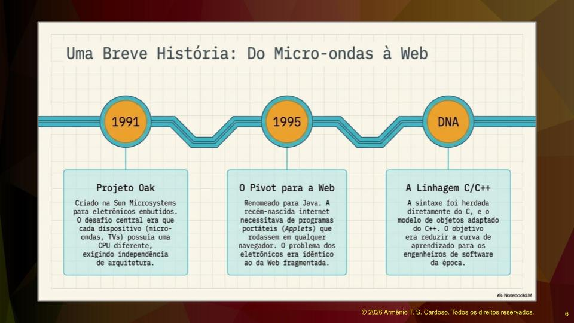
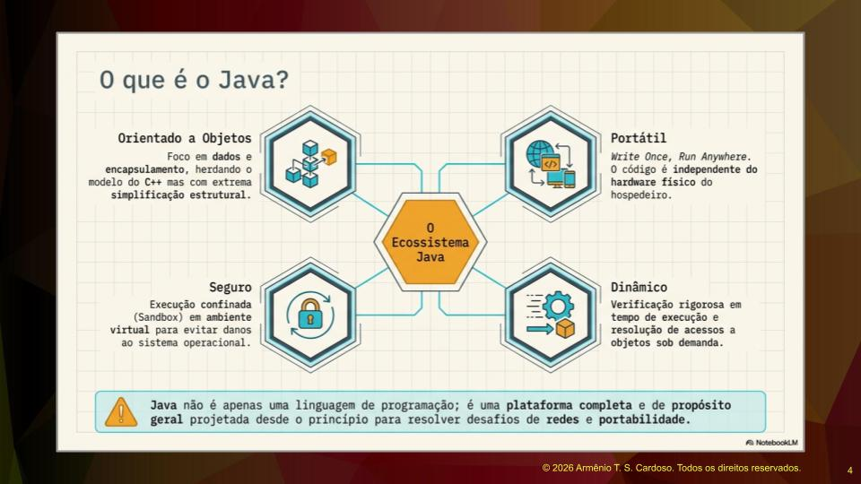
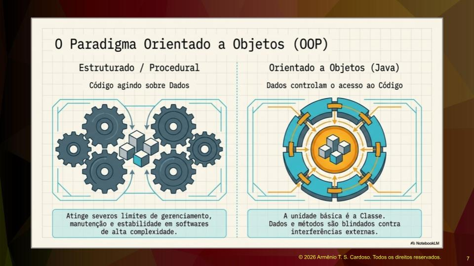
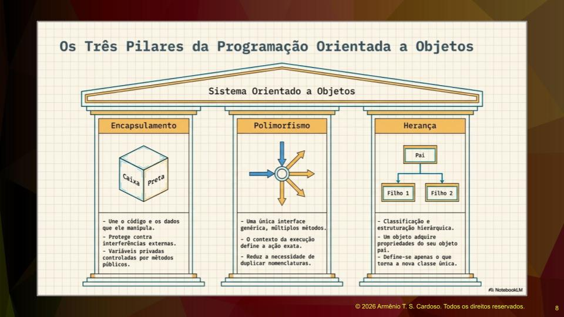
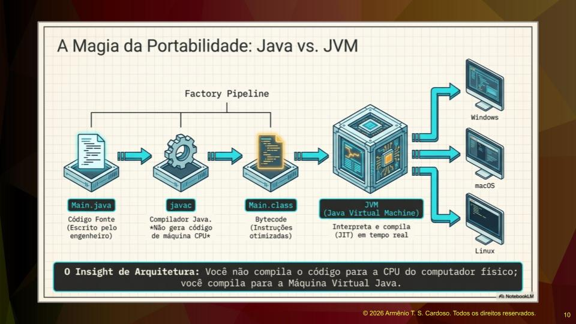

# Introdução e História da Linguagem Java

A linguagem Java surgiu na década de noventa, mais especificamente entre os anos de mil novecentos e noventa e cinco e mil novecentos e noventa e seis. Esse foi um período muito rico para a tecnologia, marcando também o surgimento de linguagens como Python, PHP e JavaScript.

Existe uma expressão depreciativa e desnecessária de que Java seria uma linguagem obsoleta ou ultrapassada. Ao observar a base instalada da linguagem, nota-se que ela é muito extensa. Dificilmente um profissional que trabalha com Java hoje considerará a linguagem ultrapassada. Tanto Java quanto C# são linguagens de programação bastante requisitadas no meio corporativo, garantindo alta empregabilidade. O conhecimento em SQL, complementado com uma dessas linguagens, coloca o profissional em uma excelente posição no mercado de trabalho.

O projeto original começou em mil novecentos e noventa e um, liderado por James Gosling na Sun Microsystems, empresa que posteriormente foi adquirida pela Oracle. Inicialmente, o projeto se chamava Oak, que significa carvalho, remetendo à ideia de robustez e tradição. O objetivo original era criar uma linguagem para eletrônicos embutidos, especialmente decodificadores de TV.

Entre mil novecentos e noventa e quatro e mil novecentos e noventa e cinco, com o início da expansão da internet, a equipe teve um momento de grande iluminação. Eles perceberam que a linguagem poderia servir perfeitamente para a web, o que gerou o grande crescimento e a base instalada gigantesca que existe hoje.

A linguagem Java possui o DNA das linguagens C e C++. O criador da linguagem C, Dennis Ritchie, era matemático e trouxe muitos elementos da matemática para a programação, especialmente a pontuação. Java herdou essa sintaxe e essas características matemáticas, algo que muitas vezes os programadores utilizam sem perceber a origem.

A linguagem está em constante evolução. O Java de hoje é totalmente diferente da versão um ponto zero de mil novecentos e noventa e seis. É uma plataforma completa e de propósito geral, projetada desde o princípio para resolver desafios de rede e portabilidade, evoluindo sempre de acordo com as demandas da comunidade de desenvolvedores.

# Características Principais do Java

O Java nasceu com características muito importantes. A primeira delas é ser uma linguagem orientada a objetos. A orientação a objetos é um paradigma de programação focado em modularizar o sistema, criando partes coesas e completas, com foco em dados e conceitos como encapsulamento e herança.

Outra característica fundamental é a segurança em termos de tipos de dados e execução de código. Isso se deve ao conceito de Sandbox. O Sandbox pode ser comparado a um parquinho infantil cercado, onde as crianças brincam de forma segura, com proteção periférica e supervisão. Na programação, a ideia é ter o código rodando em um ambiente fechado que não interfira no sistema operacional, não aloque memória indevidamente, não perca ponteiros e não cause lentidão ou travamentos. O ambiente seguro de execução é um ponto chave do Java.

A portabilidade é outro pilar da linguagem. Como o Java foi criado originalmente para rodadores em decodificadores de TV de diversos fabricantes, era necessário que o código funcionasse em qualquer hardware físico. O projeto já nasceu com o conceito de escrever o código uma vez e rodá-lo em qualquer ambiente.

# O Paradigma Orientado a Objetos

Um paradigma é um modelo, um padrão ou um direcionamento. O paradigma orientado a objetos direciona a forma de escrever o código com o objetivo de permitir uma melhor modularização e compartimentalização dos sistemas. É possível criar blocos de código que interagem entre si, possuem responsabilidades, aspectos funcionais e se relacionam.

Antes da orientação a objetos, o paradigma vigente era a programação procedural. Na programação procedural, o código é executado cronologicamente e age sobre os dados, mas não é necessariamente dividido em partes bem definidas. Isso frequentemente resulta em módulos de sistema com milhares de linhas, onde a manutenção é cara, difícil e o gerenciamento é limitado, especialmente em softwares de alta complexidade.

O código orientado a objetos busca resolver isso criando módulos, chamados de classes, que contêm os dados dentro deles. A unidade básica é menor, o que facilita a organização do sistema. Evidentemente, um sistema orientado a objetos também pode ser desorganizado se for mal escrito, mas a proposta do paradigma é justamente facilitar essa estruturação.

Existem três pilares fundamentais na implementação da orientação a objetos, que são o encapsulamento, a herança e o polimorfismo.

É comum surgir a dúvida sobre a abstração ser ou não um pilar. A abstração é um princípio e uma prática de análise, não algo que se implementa diretamente no código da mesma forma que os outros três. Abstrair significa retirar o que não interessa e manter apenas o que é importante. A abstração é comum a vários aspectos do desenvolvimento de software, existindo até mesmo em bancos de dados com SQL, enquanto o encapsulamento, a herança e o polimorfismo são mecanismos específicos e concretos da orientação a objetos. Algumas literaturas utilizam a sigla APIE para agrupar Abstração, Polimorfismo, Herança e Encapsulamento, mas na prática da implementação, o foco recai sobre os três últimos.

O encapsulamento é o aspecto que dá identidade aos módulos. Ao nomear um módulo como professor, aluno ou turma, define-se o papel daquele módulo, os dados que ele possui e as funcionalidades envolvidas. O encapsulamento garante que o módulo tenha um significado claro e responsabilidades bem definidas.

O polimorfismo é a possibilidade de ter funcionalidades que, na teoria, são as mesmas, mas que na prática se adequam conforme o objeto onde estão sendo executadas. Um exemplo prático ocorre nas contas de uma instituição financeira. Existem contas correntes, contas de investimento e contas especiais. A função de sacar dinheiro muda conforme o tipo de conta. O saque em uma conta de investimento pode envolver o cálculo de impostos sobre o rendimento. O saque em uma conta corrente comum tem a restrição do saldo disponível. Já o saque em uma conta especial permite retirar mais dinheiro do que o disponível, associando um empréstimo à operação. A ação de sacar é a mesma, mas o comportamento varia dependendo do objeto.

# Java e Inteligência Artificial

Assim como ocorre em Python e outras linguagens, o Java está muito presente na implementação de modelos de inteligência artificial e LLMs. Muitos desses modelos oferecem APIs para a execução de operações, o que facilita o desenvolvimento em Java para acessar esses recursos.

Além do uso de APIs, o ecossistema Java possui ferramentas avançadas para esse fim. O framework Spring, por exemplo, possui o Spring AI, que é um conjunto de bibliotecas voltadas para o processamento de inteligência artificial e integração com modelos como o Llama. A plataforma Java está muito bem preparada e avançada para lidar com as demandas atuais de inteligência artificial.

# Versões do Java e o Mercado de Trabalho

No mercado de trabalho, é comum encontrar vagas que exigem versões específicas do Java. Para entender como isso funciona, pode-se imaginar a linguagem de programação como círculos concêntricos. O centro do círculo representa o núcleo principal da linguagem, que é comum a todas as versões. Conforme a linguagem ganha novas versões, novos círculos externos são adicionados com novos recursos e características.

O objetivo principal do aprendizado é dominar esse círculo central. Ao dominar os fundamentos e o núcleo da linguagem, o profissional estará preparado para trabalhar com qualquer versão.

As versões mais antigas, como o Java 7 e o Java 8, estão entrando em desuso. Por outro lado, versões recém-lançadas ainda não possuem adoção massiva nas empresas. Por isso, o foco ideal para o mercado atual fica no meio termo, trabalhando com versões consolidadas e modernas, como o Java 17 e o Java 21. Dominando essas versões, o profissional terá total capacidade de atender às exigências das vagas de emprego.

Existem também diferentes distribuições do kit de desenvolvimento Java. Após a aquisição da Sun Microsystems pela Oracle, parte do código foi tornado open source. Hoje existem versões oficiais fechadas da Oracle e versões abertas mantidas por outras entidades, conhecidas como OpenJDK.

# Compilação e a Máquina Virtual Java

Diferente das linguagens de programação que são compiladas diretamente para o código nativo do sistema operacional, o Java é compilado para um código intermediário chamado Bytecode. Esse termo é uma marca registrada, um nome comercial dado a esse código intermediário.

O processo de desenvolvimento funciona da seguinte maneira. O programador escreve o código fonte em arquivos com a extensão ponto java. Esse código é legível por humanos, contendo letras, chaves e pontos e vírgulas. Em seguida, esse código passa por um compilador chamado javac.

Em vez de gerar um arquivo executável específico para Windows, Linux ou macOS, o compilador gera o Bytecode, que é armazenado em um arquivo com a extensão ponto class. Esse arquivo é então interpretado por uma Máquina Virtual Java, conhecida como JVM.

A grande sacada da equipe criadora do Java foi desenvolver uma máquina virtual específica para cada sistema operacional, mas que aceitasse rodar exatamente o mesmo código intermediário. Existe uma máquina virtual para Windows, outra para Mac, outra para Linux e até para Mainframes. O código executável gerado pelo programador é o mesmo para todas elas. Essa arquitetura é o que garante a verdadeira portabilidade da linguagem, permitindo escrever o código uma única vez e rodá-lo em qualquer hardware.

