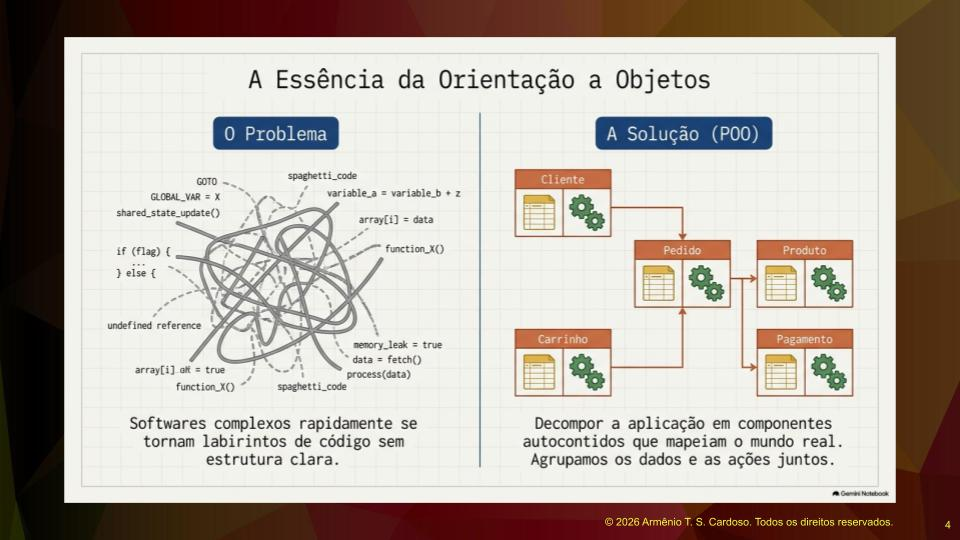
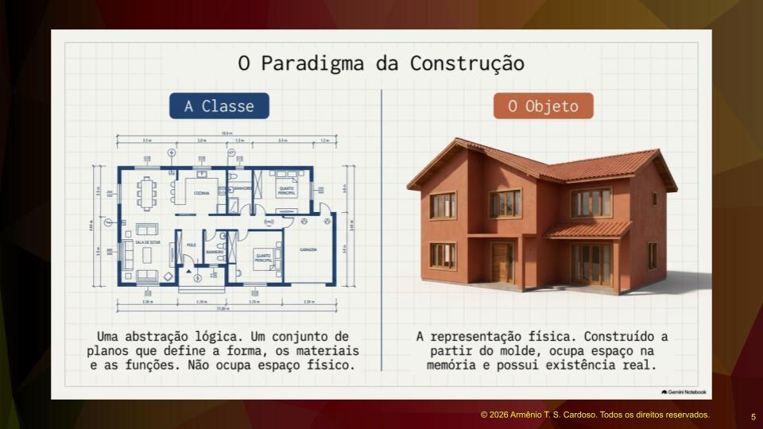
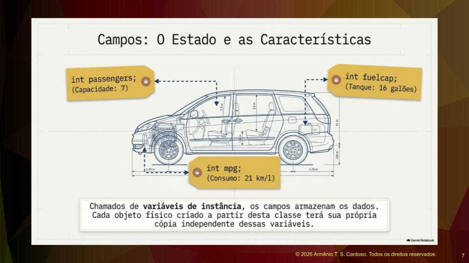
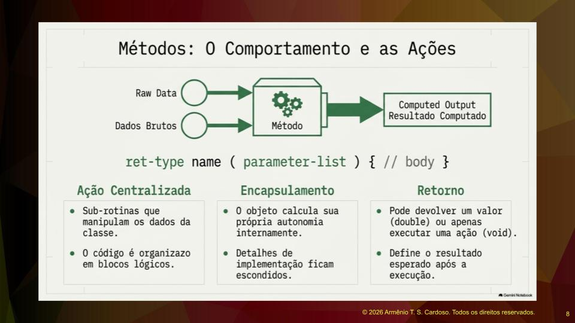
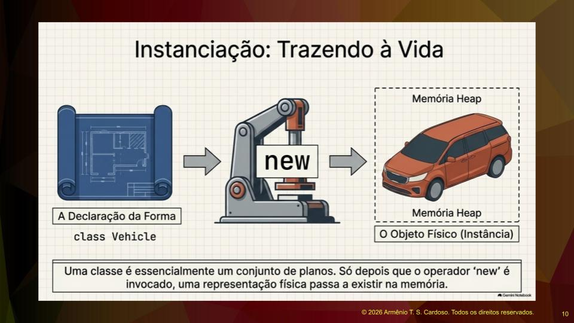
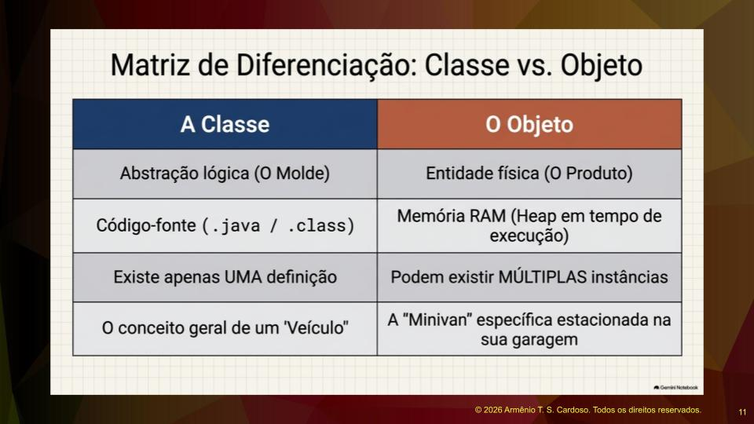
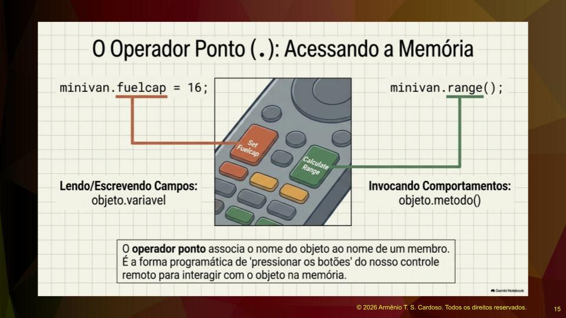
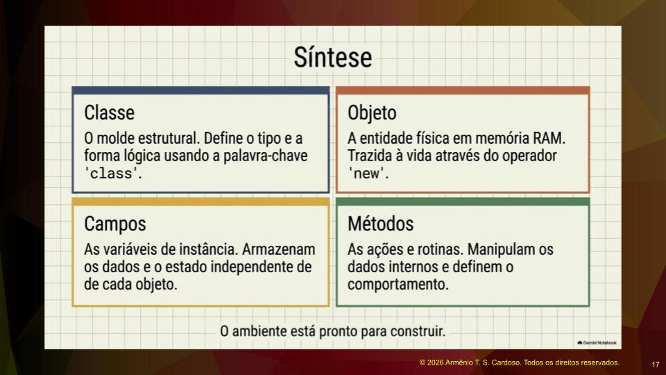

A programação orientada a objetos é uma técnica de engenharia de software com origens na década de sessenta, tendo florescido na década de setenta. Trata-se de um assunto estável, com raízes profundas, que foi amplamente experimentado, evoluído e discutido ao longo de mais de sessenta anos.

O problema que essa técnica visa resolver é que softwares complexos rapidamente se tornam labirintos de código sem uma estrutura clara. A principal dificuldade na área de programação é a modularização, que significa conseguir enxergar e dividir o software em partes menores, chamadas de módulos. É perfeitamente possível fazer uma boa modularização em linguagens que não são orientadas a objetos, como JavaScript ou Python. No entanto, com a programação orientada a objetos, é muito mais provável que a modularização seja bem-sucedida. Ela funciona como uma ferramenta facilitadora para ajudar a modularizar melhor os softwares, decompondo a aplicação em componentes autocontidos que mapeiam o mundo real e agrupando dados e ações.

## O Jogo de Imitação e a Analogia da Construção

Quando falamos de programas de computador e orientação a objetos, estamos falando de um jogo de imitação. O programador simplifica um dado externo usando códigos internos do programa para criar analogias. Por exemplo, ao criar um array, o programador pode definir que zero representa domingo, um representa segunda-feira, e assim por diante, armazenando os dias da semana. Isso depende da imaginação e da criatividade na hora de criar o sistema.

Na orientação a objetos, podemos usar a analogia da construção civil. A classe é representada pelas plantas do imóvel, o blueprint. É o desenho feito pelo arquiteto que indica onde há tomadas, pias, portas e paredes. A classe nasce como uma abstração lógica, um conjunto de planos que definem a forma, os materiais e as funções, ocupando basicamente o espaço físico do papel.

Através desse desenho, o engenheiro civil é capaz de construir o imóvel. O objeto é essa representação física. Ele é construído a partir das plantas, ocupa espaço na memória e possui existência real. Essa é a maneira ideal de começar a encarar os conceitos de classe e objeto.

## Classes e Modificadores de Acesso

A classe passa a ser o nosso tipo de dado. Através dela, cria-se um novo tipo. Para isso, utilizamos modificadores de acesso como public, private e protected. Neste primeiro momento, todas as classes nascerão como públicas. A palavra-chave class define a classe, seguida por um identificador que deve começar com letra maiúscula.

Através desse identificador, conseguimos encontrar os elementos e ver lógica no projeto do sistema. Não devemos usar nomes de classes muito abreviados ou distantes do domínio do negócio. A recomendação é evitar classes em inglês inicialmente, aproximando o código do nosso idioma para facilitar o entendimento e dar nomes sugestivos aos identificadores. As chaves da classe representam o conceito de encapsulamento, funcionando como um invólucro que vai empacotar propriedades e métodos.

## Propriedades e Estado do Objeto

A classe possui campos, também chamados de propriedades ou variáveis de instância. Esses campos definem o estado e as características do objeto. Em um veículo, as características podem ser a quantidade de passageiros que ele suporta, o consumo de combustível e a capacidade total do tanque.

Além das características fixas, existe o estado, que pode ser o volume atual do tanque de combustível. Esse conteúdo varia ao longo do tempo conforme o carro consome gasolina. Os campos armazenam esses dados. Cada objeto físico criado a partir da classe terá sua própria cópia independente dessas variáveis. Se a classe veículo for usada para instanciar dois carros diferentes, cada carro terá seu próprio ciclo de vida, características e estado independente.

## Métodos e Comportamento

Enquanto a modelagem de banco de dados foca apenas em dados, a orientação a objetos foca em dados e comportamento. Existem funcionalidades relacionadas às classes, que são subrotinas que manipulam os dados internos. O código é organizado em blocos lógicos dentro da classe.

Os detalhes de implementação ficam ocultos do mundo externo. Assim como não é necessário entender como funciona o seletor interno de canais de uma televisão para poder trocar de canal, o programador que usa a classe não precisa se preocupar com o funcionamento interno dela. Ele apenas precisa usá-la para atingir o objetivo do programa. Os métodos podem devolver um valor ou apenas executar uma ação, definindo o resultado esperado após a execução.

## Encapsulamento na Prática

Juntando todas as partes, temos a declaração da classe, a lista de propriedades e a lista de métodos. Em geral, as propriedades são privadas e os métodos são públicos. Essa é a prática mais comum: restringir o acesso às propriedades e liberar o acesso aos métodos.

Ao colocar as propriedades como privadas, força-se o acesso a elas através da execução de métodos. Não há como acessar a propriedade diretamente de fora da classe. Para saber o valor atual do tanque de combustível, por exemplo, é necessário executar um método medidor que acessa a propriedade e retorna o valor armazenado.

## O Papel do Programador e o Operador New

O papel do programador na programação orientada a objetos é escrever o código da classe. O nome do paradigma visa a construção de objetos, mas o que o programador realmente escreve são as classes. Após construir o código que define a classe, utiliza-se a instrução new para instanciar o objeto na memória.

Usando a analogia do carro, o projeto do carro é a classe, a linha de montagem é o operador new, e o carro pronto é o objeto. A classe é essencialmente um conjunto de planos de projetos. Somente depois que o operador new é invocado, uma representação física passa a existir na memória. O operador new aloca espaço em memória para a construção do objeto, da mesma forma que é usado para alocar espaço para um array.

## Diferenças Fundamentais entre Classe e Objeto

Para aprofundar o tema, recomenda-se a leitura de autores como Herbert Schildt e o livro Learn Java. É fundamental diferenciar classe de objeto. A classe é a abstração lógica ou molde. O objeto é a entidade física ou produto.

A classe define como o objeto deve ser, sendo o código-fonte Java que, após compilado, torna-se um arquivo ponto class. O objeto é o espaço alocado, o código instanciado na memória RAM. Existe apenas uma definição de classe, mas podem existir múltiplas instâncias de objetos. A classe é o conceito geral de um veículo, enquanto o objeto é a minivan específica estacionada na garagem.

## Variáveis de Referência e o Controle Remoto

Ao instanciar um objeto e atribuí-lo a uma variável, essa variável funciona como um mecanismo de acesso, semelhante a um controle remoto. A variável de referência armazena o endereço de memória, não o objeto em si. Ela atua como um ponteiro para o objeto real localizado na área de memória. O operador new constrói o objeto e o aloca na memória, e a variável apenas aponta para ele.

Quando vários objetos são instanciados, eles são totalmente independentes entre si. Uma minivan pode ter capacidade para sete passageiros, tanque de 60 litros e consumo de 10 kilômetros por litro. Um carro esportivo instanciado a partir da mesma classe pode ter espaço para dois passageiros, tanque de 40 litros e consumo de 7 kilômetros por litro. Cada instância cria uma cópia própria de cada variável. Alterar o tanque da minivan não afeta o carro esportivo, pois seus dados são completamente separados.

Existe uma armadilha comum relacionada às referências. Se uma variável que contém a referência de um objeto for atribuída a outra variável, a referência é duplicada, não o objeto. O resultado são dois controles remotos apontando para a mesma televisão. Para criar dois objetos distintos, o operador new deve ser utilizado duas vezes.

## O Operador Ponto

O operador ponto funciona como um conector lógico entre a referência e o membro da classe, seja ele propriedade ou método. Ele associa o nome do objeto ao nome do membro que será acessado. É a forma programática de pressionar os botões do controle remoto para interagir com o objeto na memória. O ponto permite acessar os dados e comportamentos da instância específica.

## Ciclo de Vida do Objeto e Garbage Collector

Todos os objetos têm um ciclo de vida limitado às chaves onde foram criados. O objeto estará disponível dentro do bloco de código em que foi instanciado. Quando o programa encontra o fechamento da chave, a referência do objeto é marcada para remoção e reciclagem.

O Java possui um sistema de bastidores transparente chamado Garbage Collector, ou coletor de lixo. Quando um objeto perde todas as suas referências e nenhum controle remoto aponta para ele, a memória ocupada é reciclada automaticamente. Isso difere de linguagens como C e C++, onde o programador precisa fazer a alocação e a desalocação manual da memória. Em Java, a alocação é dinâmica e a destruição do objeto não precisa ser feita manualmente.

## Resumo dos Quatro Conceitos Principais

O primeiro conceito é a classe como um molde estrutural, definindo o tipo e a forma lógica usando a palavra-chave class. O segundo conceito são os objetos, que são as entidades físicas na memória RAM, trazidas à vida através do operador new. O terceiro conceito são os campos ou variáveis de instância, que armazenam os dados e o estado independente de cada objeto. O quarto conceito são os métodos, que representam as ações e rotinas responsáveis por manipular os dados internos e definir o comportamento da classe.

