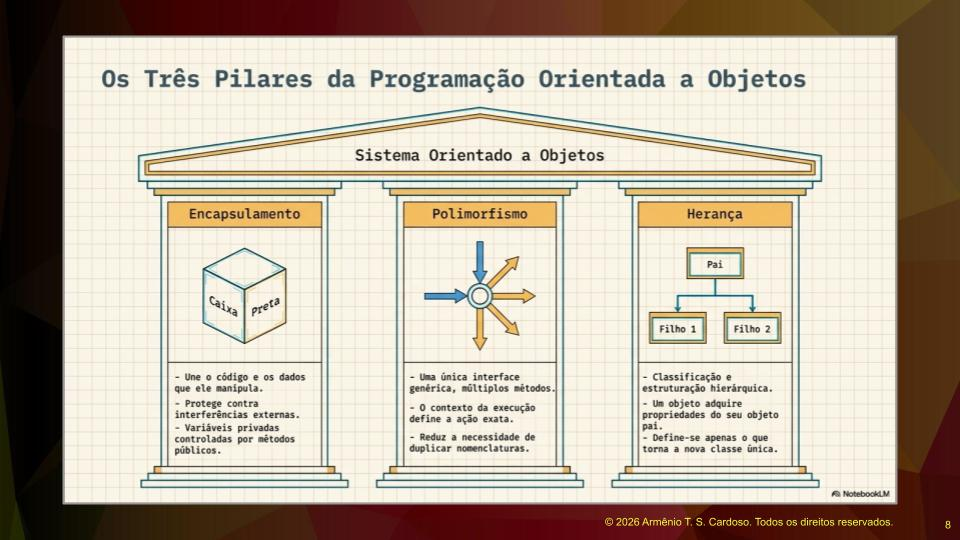
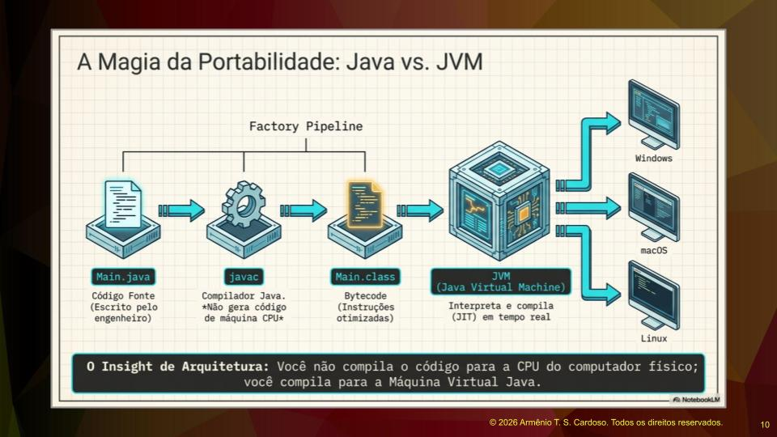

**Java: Dos Decodificadores de TV à Inteligência Artificial – Por Que a Linguagem Continua Dominando o Mercado**

Se você acompanha fóruns de tecnologia ou redes sociais focadas em programação, provavelmente já esbarrou na velha frase: *"O Java está morrendo"*. Como professor e profissional da área, sinto a necessidade de começar este artigo desmistificando essa ideia. Afirmar que o Java é uma linguagem obsoleta ou ultrapassada é uma expressão não apenas depreciativa, mas desconectada da realidade. 

O Java surgiu na década de 1990 — um período de ouro que também deu à luz linguagens como Python, PHP e JavaScript. Hoje, a base instalada de sistemas em Java pelo mundo é gigantesca. No meio corporativo, linguagens como Java e C# são extremamente requisitadas e sinônimo de alta empregabilidade. Se você aliar o domínio de uma dessas linguagens a um bom conhecimento em bancos de dados (SQL), seu posicionamento no mercado de trabalho será excelente.

Mas o que faz o Java ser tão resiliente e continuar evoluindo após quase 30 anos? Vamos mergulhar nos fundamentos, na história e na arquitetura dessa tecnologia fascinante.

### O DNA do Java: De "Carvalho" à Internet

A história do Java começa em 1991, dentro da Sun Microsystems (hoje adquirida pela Oracle), sob a liderança de James Gosling. O projeto original chamava-se **Oak** (carvalho, em inglês, remetendo à ideia de robustez e tradição) e tinha um propósito bem diferente do atual: rodar em dispositivos eletrônicos embutidos. 

A linguagem carrega em seu DNA características do C e do C++. Dennis Ritchie, criador da linguagem C e matemático de formação, trouxe muitos conceitos da matemática para a programação, especialmente na sintaxe e pontuação. O Java herdou essa estrutura rigorosa e elegante.

Entre 1994 e 1995, com a explosão da internet, a equipe da Sun percebeu que a linguagem que haviam criado era perfeita para a rede mundial de computadores. Foi esse "pivô" que gerou a adoção massiva que conhecemos hoje.

### A Mágica da Portabilidade e a Segurança do "Sandbox"

O Java foi concebido originalmente para decodificadores de TV. Como existiam dezenas de fabricantes de hardware diferentes, a Sun precisava de uma linguagem que rodasse em qualquer aparelho. Assim nasceu o lema clássico do Java: *"Escreva uma vez, rode em qualquer lugar"*. 

Além da portabilidade, a **segurança** é um dos grandes trunfos da linguagem, garantida pelo conceito de **Sandbox**. Imagine um parquinho infantil cercado: as crianças podem brincar livremente lá dentro, sem correr os perigos da rua. Na programação, o Sandbox significa que o código Java roda em um ambiente isolado. Ele não interfere no sistema operacional, não aloca memória indevidamente, não perde ponteiros e evita travamentos severos na máquina do usuário. 

### O Paradigma Orientado a Objetos: Colocando Ordem na Casa

Antes do Java se popularizar, o paradigma dominante era a programação procedural. Nesse modelo, o código é executado de forma cronológica e age diretamente sobre os dados. O resultado? Módulos de sistema com milhares de linhas, difíceis de ler, caros para manter e altamente propensos a falhas.

O Java resolve isso sendo uma linguagem essencialmente **Orientada a Objetos (OO)**. A grande motivação da OO é modularizar o sistema, criando partes coesas e completas. A unidade básica passa a ser a **classe**, que agrupa dados e comportamentos. Embora seja possível escrever código ruim em qualquer linguagem, a orientação a objetos torna o "inchaço" do sistema muito mais difícil de acontecer, pois facilita a organização lógica.

Para entender a OO, precisamos olhar para seus três pilares fundamentais (lembrando que a *abstração* é um princípio de análise — o ato de extrair apenas o que importa para o sistema — e não algo implementado diretamente na sintaxe):

**1. Encapsulamento:** É o que dá identidade e fronteiras aos módulos. Quando criamos uma classe chamada "Professor" ou "Aluno", definimos seu papel, os dados que ela protege e as funcionalidades que ela expõe.
**2. Herança:** Permite o reaproveitamento de código e a criação de hierarquias lógicas entre as classes.
**3. Polimorfismo:** É a capacidade de uma funcionalidade se adequar ao objeto que a está executando. Imagine um banco com contas Corrente, Investimento e Especial. A ação de "sacar" é a mesma para todas, mas o comportamento muda: na conta investimento há cálculo de imposto; na corrente, verifica-se apenas o saldo; na especial, o saque pode acionar o limite do cheque especial. 

### Como o Java Funciona por Baixo dos Panos?

Diferente de linguagens que são compiladas diretamente para o código nativo da máquina, o Java utiliza uma abordagem híbrida muito inteligente. 

Quando você escreve seu código (em um arquivo `.java`), ele passa por um compilador chamado `javac`. Porém, em vez de gerar um executável para Windows, Mac ou Linux, o compilador gera um código intermediário chamado **Bytecode** (salvo em um arquivo `.class`).

É aqui que entra a estrela do show: a **JVM (Máquina Virtual Java)**. A inovação de Gosling foi criar uma máquina virtual específica para cada sistema operacional, capaz de ler esse mesmo Bytecode. É por isso que você compila o código apenas uma vez e ele roda em qualquer lugar que tenha uma JVM instalada.

### O Java Hoje: Versões, Ferramentas e Inteligência Artificial

Aprender Java hoje é como olhar para círculos concêntricos. O núcleo central é a base da linguagem, imutável e essencial. Conforme novas versões são lançadas, novas camadas de recursos são adicionadas. Meu conselho para quem está estudando é: foque nas versões de longo suporte (LTS), como o **Java 17 e o Java 21**, que são amplamente adotadas pela indústria, evitando versões muito antigas ou aquelas recém-lançadas que ainda estão em fase de adoção.

E se você acha que o Java parou no tempo, saiba que ele está muito presente na era da Inteligência Artificial. Ecossistemas modernos, como o Spring, possuem bibliotecas poderosas como o **Spring AI**, que facilitam a integração de aplicações corporativas com LLMs (Large Language Models) modernos, como o Llama e integrações via API.

Para entrar nesse mundo, seu ambiente de trabalho precisará de duas coisas fundamentais: o **JDK (Java SE)**, que é o kit de desenvolvimento, e uma boa **IDE** (Ambiente de Desenvolvimento Integrado). O mercado hoje tem o *IntelliJ IDEA* como grande padrão da indústria, embora *Eclipse* e *NetBeans* ainda sejam opções válidas. Além disso, o uso de gerenciadores de dependências, como o **Maven**, é indispensável para manter seus projetos padronizados e profissionais.

### Conclusão

O Java não é apenas uma linguagem que sobreviveu ao teste do tempo; é uma plataforma completa e de propósito geral que soube se adaptar. Desde a portabilidade pensada para decodificadores de TV, passando pela robustez da orientação a objetos, até chegar à integração com Inteligência Artificial moderna, o Java prova diariamente por que é o alicerce de milhares de sistemas corporativos ao redor do mundo.

Dominar seus fundamentos, entender a JVM e aplicar os conceitos de Orientação a Objetos fará de você um profissional preparado para resolver desafios complexos e de alto nível no mercado.