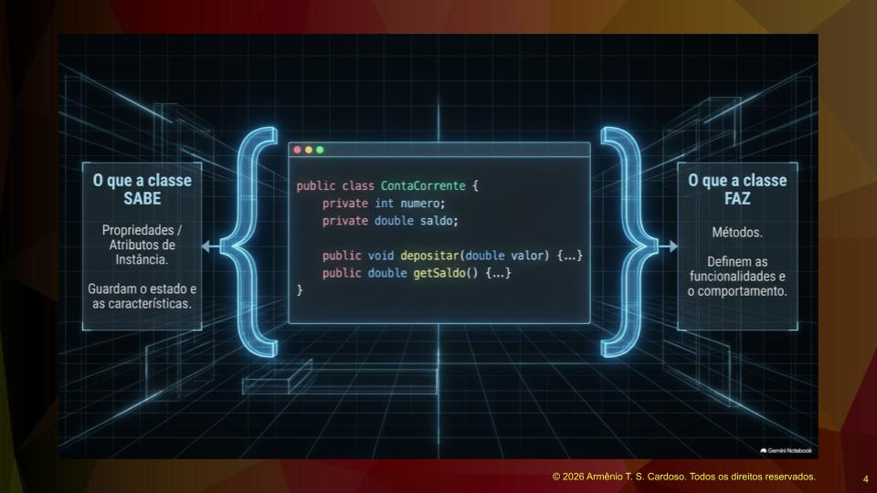
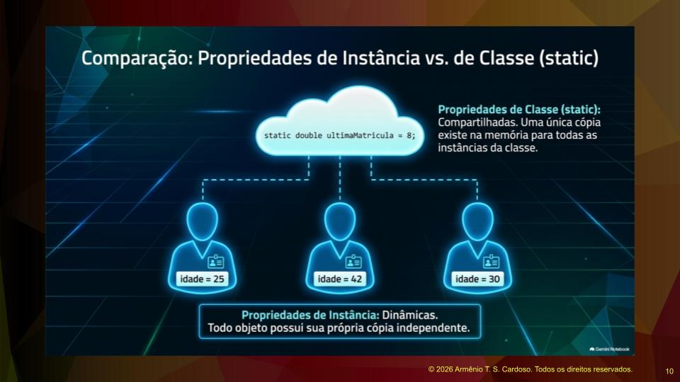
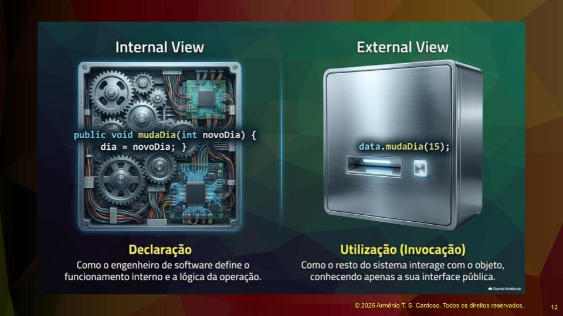
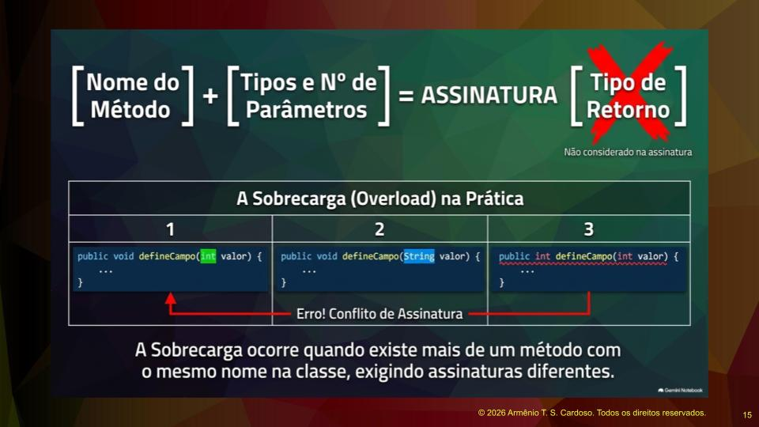
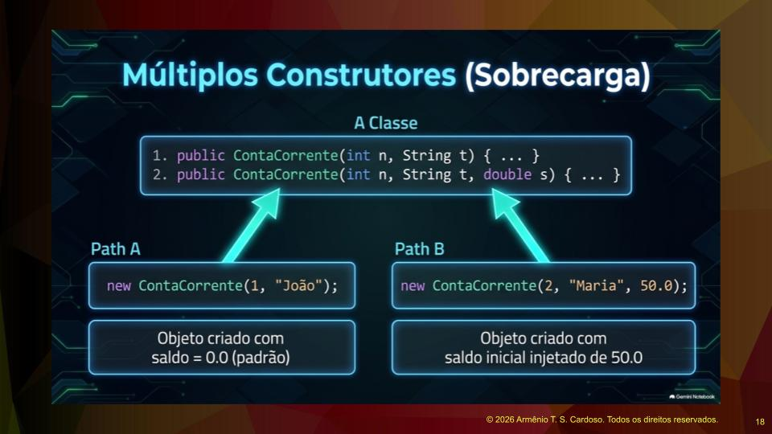
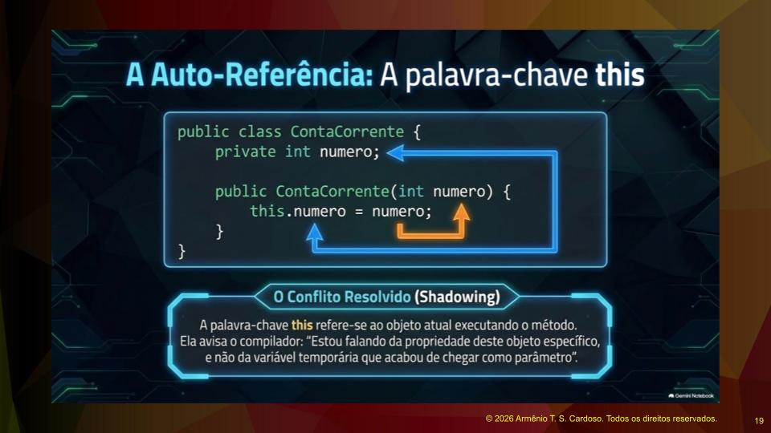
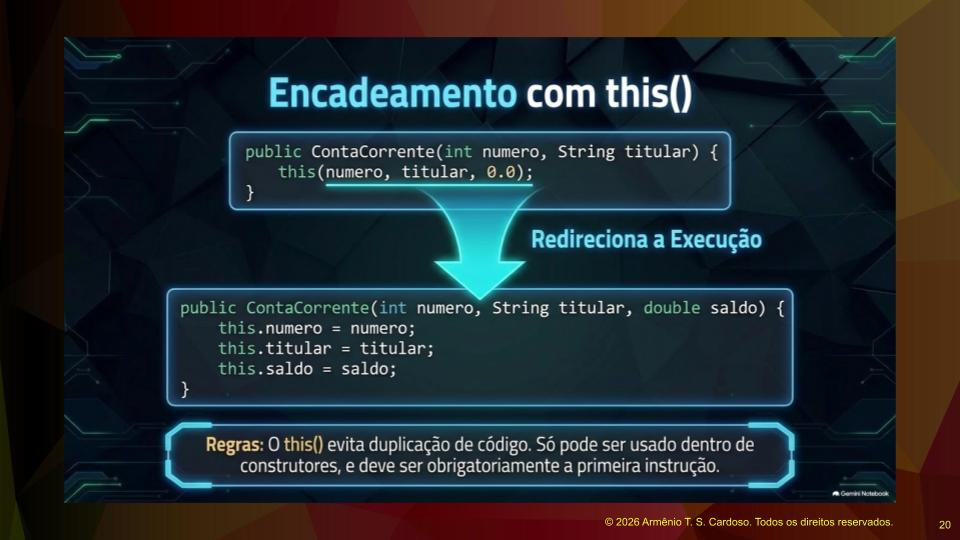
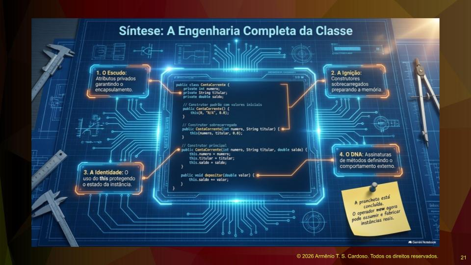

## Estrutura Básica da Classe
Inspirado na matemática, Dennis Richie introduziu na linguagem C, que depois passou para a linguagem Java, o uso das chaves para representar um conjunto, um agrupamento de coisas. Em geral, declaramos na parte de cima da classe as propriedades e na parte de baixo os métodos. É muito pouco provável que alguém inverta isso: são convenções que todo mundo segue. Alguém pode dizer que fez ao contrário, compilou e funcionou. Sim, vai compilar e funcionar, mas não vai passar na revisão de código, porque não é o comum a ser feito. As convenções da linguagem Java são muito fortes.

Separei o que é propriedade do que é método. Propriedade é o que a classe sabe, é o que você pergunta para ela e ela responde. O método é o que a classe faz, são as ações que a classe executa. O principal conceito deste artigo, e o mais importante de todos, é entender o que a classe sabe e o que a classe faz. É muito importante praticar o conceito de responsabilidade. A classe deve ter preferencialmente uma única responsabilidade. O ideal é que a classe, quando for criada, tenha um único propósito. Baseado nesse modelo, criamos propriedades e métodos para cumprir esse propósito.

## Propriedades e Encapsulamento
Propriedades, que representam o que a classe sabe, também são chamadas de atributos de instância. Elas guardam o estado e as características dos objetos. Algumas palavras são sinônimas, como atributo e propriedade, que significam a mesma coisa. Em relação aos métodos, eles representam o que a classe faz, definindo a funcionalidade e o comportamento da classe. Como exemplo, podemos ter as propriedades número e saldo, e os métodos depositar e getSaldo.

Uma prática fundamental é que as propriedades devem ser privadas e os métodos públicos. As propriedades precisam estar protegidas e ocultas, forçando quem for usar a classe a passar pelo método. Quando você oculta a propriedade e força o uso do método, você pode incluir as validações necessárias dentro do método, utilizando os ifs necessários para que as propriedades mantenham sua lógica estável. A ideia original é ter propriedades privadas e métodos públicos.

Fazendo uma analogia com o mundo real, a palavra propriedade remete a algo que não é público. Uma propriedade tem porta, cadeado, corrente, cerca, janela. Não é algo em que se possa entrar e sair facilmente. Se é propriedade, é algo próprio, fechado, oculto, que terá algum nível de proteção.

## Validação e Ocultamento de Dados
Imagine um exemplo de uma classe chamada Data com propriedades públicas. A consequência disso é que, ao instanciar um objeto da classe Data, seria possível colocar qualquer valor no dia ou no mês. Poderíamos ter um dia cinquenta e seis ou um mês quarenta e nove. Alguém poderia sugerir colocar a validação no código que usa a classe. O problema é que toda vez que esse código for utilizado, será necessário validar novamente. O bom programador não deve ter que instanciar o objeto e validar os valores vindos de fora toda vez que usar a classe.

Se colocarmos as propriedades como privadas e forçarmos a passagem pelos métodos, colocando as validações dentro deles, o trabalho será feito apenas uma vez e já estará disponível em todas as instâncias. O encapsulamento é um conceito de orientação a objetos que anda de mãos dadas com o princípio do ocultamento de dados. Não faz sentido ter o encapsulamento e não ter a proteção. O uso do modificador private protege a integridade do objeto, impedindo alterações externas não rastreáveis ou contraintuitivas, como o caso de um dia cinquenta e seis.

## Modelagem e Relacionamento entre Classes
Trazendo algumas modelagens de classes um pouco mais avançadas, podemos imaginar duas classes relacionadas: Pessoa, que tem nome, sobrenome e data de nascimento, e Telefone, que tem DDD e número. O relacionamento entre Pessoa e Telefone pode ser pensado com base em conceitos de banco de dados SQL. Uma pessoa pode ter zero ou vários telefones. Para representar os telefones dentro da classe Pessoa, será necessário colocar uma lista, um array ou alguma estrutura que represente essa multiplicidade.

Propriedades também aparecem como representação do relacionamento entre classes. Quando duas classes estão relacionadas, é provável que em uma delas apareçam objetos da outra classe. Nesse exemplo, a Pessoa conhece os telefones dela, mas o Telefone não precisa enxergar a Pessoa. O telefone aparece como uma entidade mais fraca e a pessoa como a entidade principal. É uma forma de simplificar a codificação. Na modelagem visual, o sinal de menos ao lado das propriedades significa private, e o sinal de mais significa public.

Outro exemplo é um protótipo de modelagem de um sistema de controle de compras. Empresas precisam controlar seus gastos. O sistema registra quem é o fornecedor, quando o produto foi comprado, qual foi a cotação e quanto foi pago. Isso é necessário porque há rotatividade na empresa. Se o Edmilson, chefe do setor de compras, for promovido e a Carolina for para o lugar dele, o show tem que continuar. O sistema garante que o histórico de negociações não se perca. O sistema de compras possui entidades como Fornecedor, Produto, Contato e Cotações. Na orientação a objetos, utilizamos o termo multiplicidade para definir esses relacionamentos, diferentemente do banco de dados relacional, onde usamos o termo cardinalidade. Como a orientação a objetos não é relacional, não é possível fazer produto cartesiano. É importante ajustar os termos para o contexto correto da orientação a objetos.

## Propriedades de Instância e Propriedades de Classe
Existem dois tipos de propriedades: de instância e de classe. Propriedades de instância são aquelas declaradas dentro da definição da classe, onde todo objeto possui uma propriedade particular própria. Elas são dinâmicas e não utilizam a palavra static. Em uma classe Empregado, propriedades como idade, nome, matrícula e departamento são de instância. Se instanciarmos dois empregados diferentes, cada um terá seus próprios dados separadamente.

Já as propriedades de classe são compartilhadas. Existem situações em que é necessário que a propriedade seja a mesma para todas as instâncias. Por exemplo, em uma classe que representa os vendedores de uma empresa, para manter a isonomia, o percentual de comissão pode ser estático. Assim, toda vez que um vendedor for instanciado, o percentual será o mesmo para todos.

Outro exemplo é uma propriedade última matrícula definida como estática. Toda vez que um empregado for instanciado, a última matrícula será compartilhada por todas as instâncias. A lógica é instanciar o empregado, pegar a última matrícula, incrementar de um e atribuir essa matrícula ao empregado. Se a propriedade deve ser compartilhada por ter essa lógica, ela será estática. Se não faz sentido ser compartilhada, como o nome ou a idade, ela será dinâmica. Na memória, a propriedade estática é única, não existem cópias.

## Métodos e Interface Pública
A palavra método vem do grego e significa caminho para chegar a um fim. A lógica da orientação a objetos é esconder as propriedades e forçar a passagem pelos métodos para alterá-las. Na classe Data, as propriedades dia, mês e ano ficam privadas. O método público mudaDia recebe um valor e faz a validação. A validação completa de uma data envolve verificar se o mês está inicializado, se o ano é bissexto, entre outras regras. A função do método é criar um caminho seguro para a alteração dos dados, filtrando as possibilidades e impedindo valores inválidos.

Existem dois papéis diferentes para o programador. O primeiro é atuar na declaração do método, escrevendo a lógica interna, os algoritmos e as estruturas de repetição. O segundo papel é o do desenvolvedor que vai utilizar a classe criada por outra pessoa. Quem utiliza a classe não precisa se preocupar com a implementação interna, assumindo que o código foi revisado e testado. A declaração define o funcionamento interno, enquanto a utilização interage com o objeto conhecendo apenas sua interface pública. O conceito de interface pública refere-se à declaração dos métodos públicos da classe, e não à interface gráfica com o usuário. É a interface pública que permite a interação com a classe.

## Métodos de Instância e Métodos de Classe
Assim como as propriedades, existem métodos de instância e métodos de classe. Métodos de instância são dinâmicos e interagem com propriedades de instância. Métodos de classe são estáticos e interagem com propriedades estáticas ou prestam algum tipo de serviço.

Podemos criar uma classe utilitária, por exemplo, no pacote br ponto infinity ponto util, chamada Validador. Essa classe pode ter um método público e estático que retorna um boolean, chamado validarInteiro. O método verifica se a string é diferente de nulo, se não está vazia usando isBlank, e se corresponde a uma expressão regular usando matches. Como o método é estático, é possível utilizá-lo sem instanciar a classe Validador, passando o valor lido por um nextLine e convertendo com Integer ponto parseInt.

Podemos adicionar outros métodos estáticos, como validarReal, validarCPF e validarEmail, criando uma biblioteca de métodos de validação. Expressões regulares são como animais selvagens, o ideal é que fiquem controladas dentro da jaula delas, dentro da classe, e que você possa testar bastante. Embora uma biblioteca de métodos não seja estritamente orientada a objetos, é uma solução prática para problemas comuns de programação. A própria linguagem Java possui classes projetadas dessa forma, como a classe Math com os métodos random e round.

## Sobrecarga e Assinatura de Método
A sobrecarga ocorre quando existe mais de um método com o mesmo nome na classe, exigindo assinaturas diferentes. A assinatura de um método é composta pelo seu nome e pelos tipos e números de parâmetros. O tipo de retorno não é considerado na assinatura. Se tentarmos criar dois métodos com o mesmo nome e os mesmos parâmetros, mas com retornos diferentes, haverá colisão.

A sobrecarga serve para atender ao conceito de extensibilidade. Extensibilidade é a capacidade de incluir novas funcionalidades no software sem quebrar o que já estava funcionando. Com o passar do tempo, os requisitos do software mudam. Uma regra de ouro na engenharia de software é evitar tocar em um código que já foi revisado, testado e está em produção. A sobrecarga é a maneira de acrescentar novas funcionalidades sem alterar as que já estão funcionando.

## Construtores e o Operador New
A criação de um objeto envolve três passos. Primeiro, declarar uma variável com o tipo do objeto. Segundo, usar o operador new para alocar espaço físico de memória. Terceiro, chamar o construtor para inicializar o objeto. O operador new cria o objeto e retorna o endereço desse bloco de memória para a variável.

Quando uma classe é criada sem um construtor explícito, a linguagem Java fornece um construtor default invisível e sem parâmetros. Se o programador criar um construtor personalizado, o construtor default deixa de existir. O construtor possui regras estritas: sua função exclusiva é inicializar o objeto, seu nome deve ser idêntico ao nome da classe, ele nunca possui tipo de retorno, e toda classe possui pelo menos um construtor.

A sobrecarga também se aplica aos construtores. Se um sistema bancário inicialmente exigia um depósito para abrir uma conta, o construtor recebia o saldo inicial. Se posteriormente surgir o requisito de uma conta salário, que inicia com saldo zero, basta criar um novo construtor sobrecarregado para atender a esse requisito, mantendo o construtor original intacto.

## O Uso da Palavra Chave This
Na linguagem Java, utilizamos a palavra chave this como referência para as propriedades e métodos da própria instância da classe. Existe uma situação chamada shadowing, que ocorre quando criamos uma variável ou parâmetro com o mesmo nome de uma propriedade da classe, ocultando essa propriedade. Para diferenciar o parâmetro da propriedade, usamos o this. Por exemplo, this ponto número refere-se à propriedade do objeto, enquanto apenas número refere-se ao parâmetro recebido.

Os nomes das variáveis são muito importantes, e usar os mesmos nomes das propriedades para os parâmetros do construtor é uma boa prática, desde que o this seja utilizado para desambiguação. O this também pode ser usado na sobrecarga de construtores. Quando usado apenas com parênteses, ele atua como uma chamada para outro construtor da mesma classe. Isso evita a duplicação de código. O uso do this como chamada de construtor só pode ser feito dentro de outro construtor e deve ser obrigatoriamente a primeira instrução do bloco.

## Resumo dos Conceitos Fundamentais
Para ter uma visão geral, podemos resumir os conceitos aprendidos em quatro passos. O primeiro passo é o escudo, representado pelos atributos privados que garantem o encapsulamento. O segundo passo é a ignição, que são os construtores sobrecarregados responsáveis por inicializar os objetos. O terceiro passo é a identidade, com o uso do this para proteger o estado da instância e promover a desambiguação. O quarto passo é o DNA, que são as assinaturas de métodos definindo o comportamento externo e a interface pública da classe.

