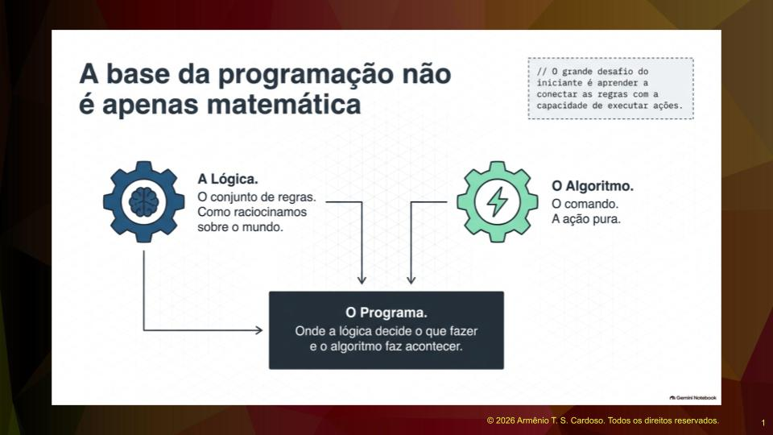
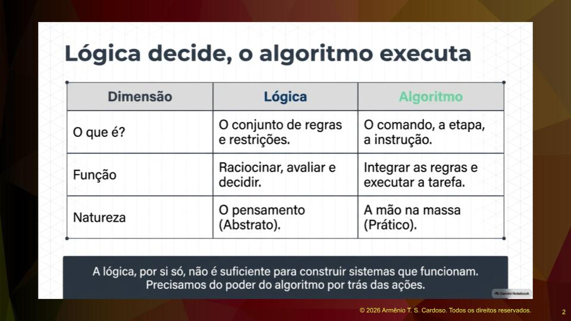
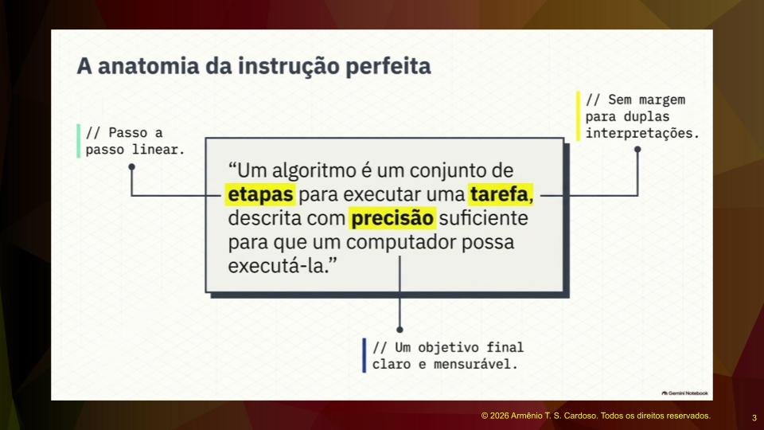
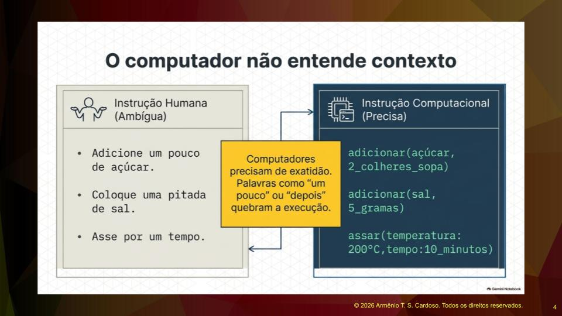
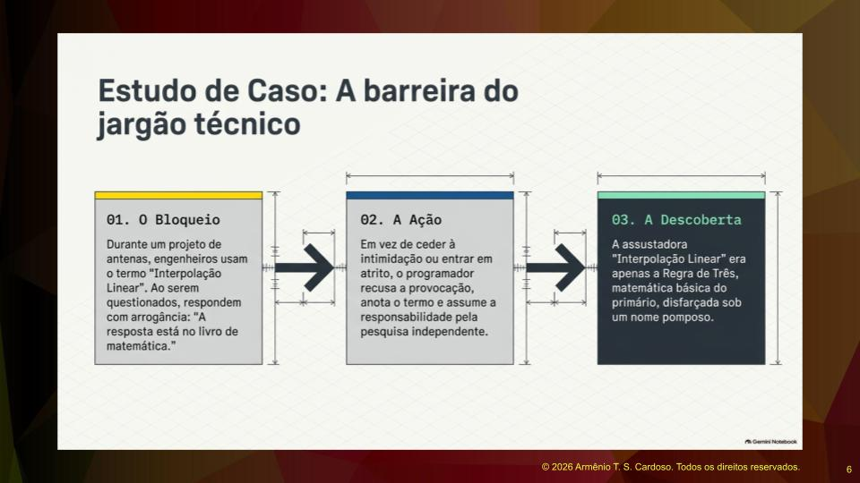
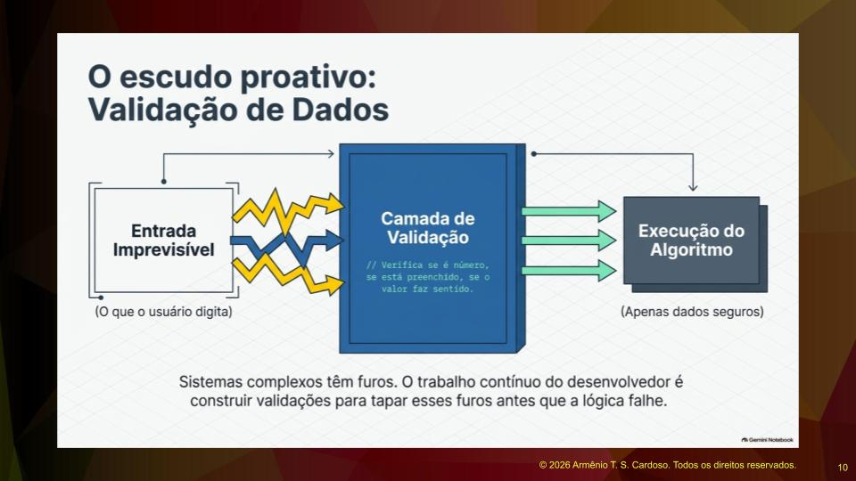
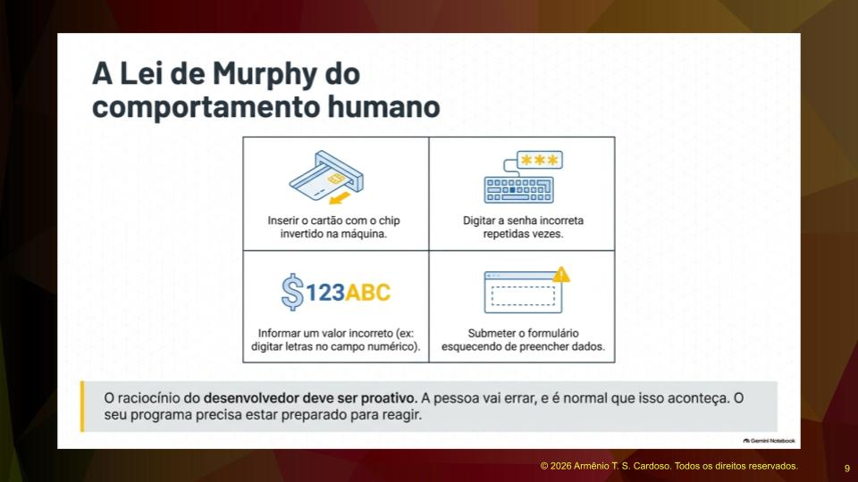

## Diferença entre Lógica e Algoritmo

Lógica e algoritmos não são a mesma coisa, são conceitos diferentes. O algoritmo é uma coisa, a lógica é outra, e eles se casam para formar o programa. Como parte do seu trabalho, eles tomam decisões lógicas. A lógica fornece o conjunto de regras que permite raciocinar sobre alguns aspectos do mundo.

Mas se quisermos ir mais longe, se quisermos construir sistemas que funcionam realmente, a lógica por si só não é suficiente. Precisamos de algo que possa integrar todas essas regras e executar ações. O algoritmo é comando, ele é ação. Os algoritmos são o poder por trás de todos os sistemas computacionais.

O que é um algoritmo? É um conjunto de etapas para executar uma tarefa, descrita com precisão suficiente para que um computador possa executá-la.

## Precisão e Clareza nas Instruções

Quando vamos interagir com nosso usuário ou com nosso cliente, buscando dados para a construção do sistema, vamos procurar ser o mais precisos possível. Isso garante que a lógica da aplicação, junto com o algoritmo, consiga executar a tarefa que se espera.

A primeira propriedade a ser mencionada reafirma que o algoritmo é uma coleção de etapas individuais, uma coleção de instruções. Uma receita culinária se encaixa nessa analogia de forma bastante simples. Por exemplo, pré-aqueça o forno a duzentos graus Celsius. É uma instrução clara. Você vai lá, procura graduar e liga o forno. Adicione duas colheres de sopa de açúcar. São instruções bem definidas, não ambíguas, de maneira que você consiga executar a receita.

Da mesma forma, precisamos usar medidas precisas na programação. Em vez de escrever coisas como um pouco de açúcar, uma pitada de sal ou cozinhe por um tempo, precisamos de exatidão. Esse tipo de instrução tem um significado muito ambíguo e difícil para um leigo, e ainda mais para um computador. A partir dessa propriedade, temos a definição de que cada etapa deve ser definida com clareza.

## A Importância do Domínio da Linguagem

Aqui voltamos àquela questão que já falamos sobre o português. O português é o nosso idioma, nossa língua mãe, e é através dele que nos comunicamos. Antes de qualquer coisa, eu preciso dominar o significado das palavras.

Vou dar um exemplo de uma situação que aconteceu comigo. Eu fui trabalhar em um projeto onde existia todo um algoritmo, um cálculo que era feito para evitar que as antenas sofressem interferência. No bate-papo com os engenheiros, surgiu o termo *interpolação linear*. Eu perguntei na hora o que era uma interpolação linear. O engenheiro estava a fim de curtir com a minha cara, pegou um livro de matemática e disse que a resposta estava lá.

Eu não entrei na onda dele. Foi uma situação de muito atrito, bem difícil de lidar com o pessoal daquela empresa. Eu falei para ele deixar o livro para lá, que eu iria anotar e pesquisar. Pessoal, interpolação linear é um nome que se dá à regra de três. A pessoa resolveu colocar um nome sofisticado e pomposo para uma coisa popular que aprendemos na quarta série do primário. Ele resolveu usar essa expressão para me afastar, para forçar uma barreira. Mas quando a gente está com vontade de fazer, a gente vai e faz.

Eu descobri o significado, implementei, entreguei o software e avisei que estava implementado com a interpolação linear que ele havia falado. Tratei o profissional com respeito, mesmo não tendo sido tratado da mesma forma. Foi uma situação que vocês podem passar na profissão de vocês, de ter uma pessoa invejosa, brincalhona ou que possa colocar alguns obstáculos na construção do projeto.

Quando eu falo sobre significado, não é só uma frase escrita num slide de uma aula. É algo muito poderoso e importante. É você realmente dominar o português e as palavras envolvidas nos vários negócios que existem.

## Validação de Dados e Comportamento do Usuário

Quando escrevemos um programa e precisamos fornecer dados ao computador, surge a questão de como saber se os dados inseridos são realmente confiáveis. A verdade é que não vamos saber. Temos que assumir que os dados nunca são confiáveis e que, toda vez que alguém digitar alguma coisa no sistema, teremos que verificar.

O raciocínio deve ser proativo. Eu não posso considerar que o usuário vai digitar dados sempre válidos. Eu tenho que considerar a possibilidade do usuário errar, e a pessoa vai errar. O usuário vai inserir o cartão com o chip invertido, vai digitar a senha errada, vai informar um valor incorreto. É normal que isso aconteça. Portanto, quando construímos o programa, temos que considerar que os dados podem não estar corretos e criar as devidas validações. Sistemas complexos têm furos, e o trabalho contínuo do desenvolvedor é justamente ir tapando esses furos à medida que os problemas vão acontecendo.

