Lógica é uma área de conhecimento bem antiga, que dialoga com a filosofia, a matemática e a física. Nos últimos anos, nós a associamos diretamente à computação e à programação. Não estamos falando de uma ciência nova, mas de algo que existe desde que o ser humano começou a pensar e a questionar.

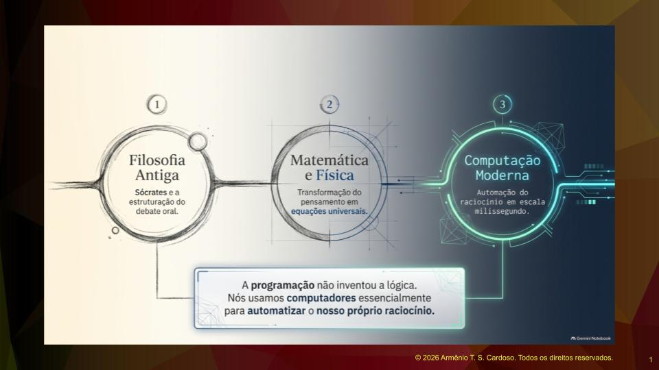

Um dos primeiros pensadores da era antiga a tratar a lógica de forma mais metódica foi Sócrates: ele passava o conhecimento oralmente para seus discípulos,caminhando pelas ruas, praças e jardins. A lógica é um sistema usado para distinguir entre argumentos corretos e incorretos. Em um debate ou troca de informações, buscamos a argumentação nas frases. A lógica inclui o conjunto de princípios que, quando aplicados a argumentos, nos permitem demonstrar algo verdadeiro.

Um exemplo clássico de sequência de ideias relacionadas é o seguinte: a primeira ideia é que Sócrates é um homem. A segunda ideia é que todos os homens são mortais. Consequentemente, Sócrates é mortal. Se ele é um homem e todos os homens são mortais, ele também é mortal. Esse é o princípio da lógica.

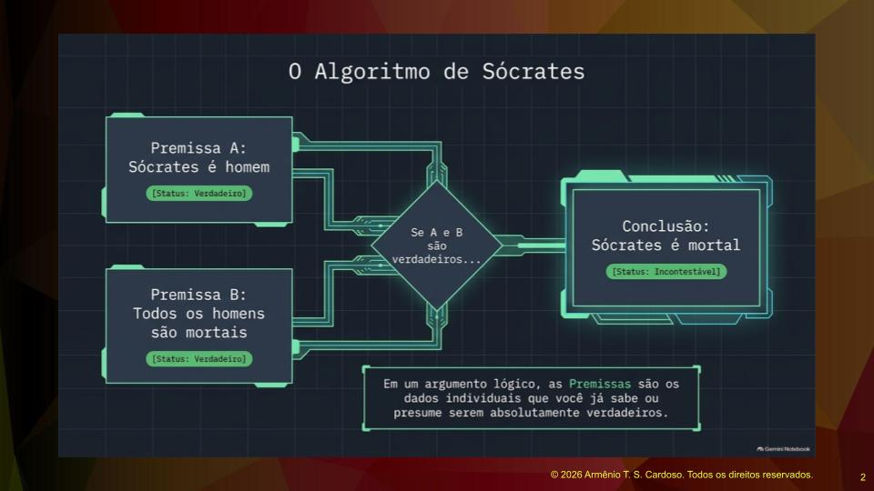

## A Lógica na Programação

Como usamos computadores essencialmente para automatizar o nosso raciocínio, devemos aprender a executar a lógica corretamente antes de escrever uma solução de software: vamos praticar o exercício da lógica o tempo todo na nossa profissão.

Muitas vezes, os dados chegam para nós truncados, pela metade ou errados. Uma atividade comum na vida de um programador é corrigir falhas de software, pois é comum descobrir que os dados passados pelos usuários não estão totalmente corretos. É possível que a pessoa possa ter se distraído e passado dados incompletos ou errados e por isso, é necessário questionar, filtrar e juntar os dados de maneira que consigamos produzir um resultado observável e correto para quem vai usar o sistema.

## Premissas

Em um argumento lógico, cada coisa individual que você já sabe ou presume ser verdadeira é chamada de premissa. Se você observar o seu ambiente agora, pode notar que está com uma camisa de uma determinada cor, ou que está sentado em uma cadeira confortável ou que a iluminação está apropriada. São várias ideias relacionadas que levam ao conceito de verdade.

Uma premissa é como qualquer afirmação comum, exceto que pode ser avaliada para obter uma resposta verdadeira ou falsa. Uma premissa tem o valor de verdadeiro ou falso. É verdade ou não que todos os homens são mortais. O mesmo se aplica ao fato de Sócrates ser um homem ou não. Sendo as duas primeiras frases verdadeiras, elas levam à dedução de que a terceira frase também é verdadeira.

Outras formas de expressão, como perguntas ou comandos, não podem ser consideradas premissas. Comandos imperativos como "leve o lixo para fora" ou "lave a louça" e perguntas como "que horas são" não possuem valor de verdadeiro ou falso. As premissas sempre estarão ligadas a afirmações.

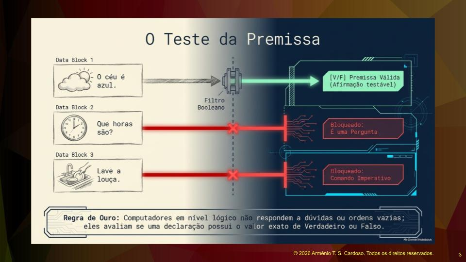

Ao desenvolver um sistema, você vai entrevistar os usuários interessados, relacionar os problemas a serem resolvidos e as necessidades dessas pessoas. Você terá uma atenção especial a essas afirmações. Em um sistema acadêmico, podemos relacionar algumas regras de negócio que são consideradas afirmações verdadeiras e como Engenheiro de Software você precisa validar essas regras.

A instituição de ensino pode pedir para desenvolver um sistema de matrículas e estabelecer que menores de quinze anos não podem fazer cursos à noite. Essa é uma afirmação que será considerada verdadeira. Na hora de fazer a matrícula, o sistema deve verificar se a data de nascimento do aluno, comparada com o dia de hoje, faz com que ele seja menor de quinze anos. Se ele for maior de quinze anos e o curso for noturno, a matrícula é permitida. Caso contrário, o sistema deve exibir uma mensagem informando a regra de negócio.

## Argumentos Dedutivos e Indutivos

Temos também o conceito de argumentos indutivos e dedutivos. Um argumento dedutivo é a forma mais forte de raciocínio, porque sua conclusão necessariamente segue as suas premissas, desde que tenha sido construída apropriadamente e as premissas sejam incontestavelmente verdadeiras.

Existe uma arte chamada **dialética**, que é a arte do debate. Uma pessoa pode ser tão habilidosa no debate que, usando argumentos falsos, consegue convencer os outros. Na economia e em outras áreas, a argumentação que usa premissas falsas é chamada de **falácia**. Um argumento dedutivo pode falhar se as premissas forem falsas.

Um exemplo caricato para ilustrar isso: Kika é o nome de uma cachorrinha caramelo. Todos os cães são marrons. Portanto, Kika é marrom. A premissa de que todos os cães são marrons é falsa, o que torna a conclusão totalmente errada, mesmo sendo Kika uma cachorrinha caramelo. Precisamos ficar muito atentos a esse tipo de construção.

Outro exemplo prático ocorreu em um laboratório de análises clínicas. Alguém afirmou que terça-feira era o dia de maior movimento. A chefia questionou e pediu dados que comprovassem essa afirmação. A afirmação era falsa, pois os dados mostraram que os dias de maior movimento variavam entre quarta-feira e sábado. A premissa inicial estava errada. O primeiro ponto importante é que precisamos questionar a grande maioria das premissas e buscar dados que apoiem as afirmações.

A segunda maneira pela qual o argumento dedutivo falha é quando a conclusão não decorre necessariamente das premissas. É quando é feita uma aproximação forçada. Por exemplo: todas as bolas de tênis são redondas. A Terra é redonda. Portanto, a Terra é uma bola de tênis. Não há ligação lógica que sustente essa conclusão.

Os argumentos dedutivos são bastante raros, pois normalmente você os encontra apenas quando o conhecimento com o qual está lidando é incontestável. O mundo real muitas vezes nos apresenta um conhecimento irregular, confuso ou provisório. Os problemas da vida real costumam ter nuances, e para isso temos o raciocínio indutivo.

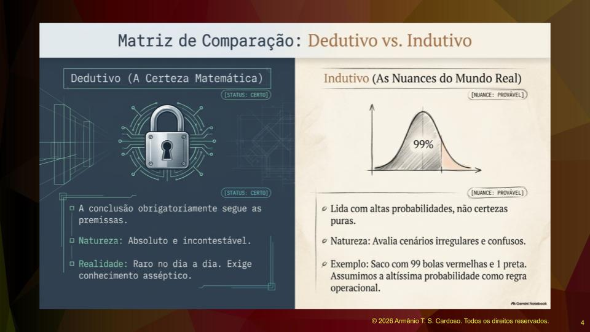

O raciocínio indutivo é tolerante e lida com probabilidade em vez de certeza. Quando desenvolvemos software e coletamos dados, assumimos que as afirmações feitas têm alta probabilidade de serem verdadeiras. As premissas em um argumento indutivo não são inquestionavelmente verdadeiras. Se um saco contém cem bolas vermelhas e uma única bola preta, a probabilidade de tirar a bola preta é de um por cento. Eu tenho noventa e nove por cento de chance de tirar uma bola vermelha. O raciocínio indutivo lida com essa alta probabilidade de estar certo, baseando-se na lógica de eventos passados ou em estatísticas.

## A Responsabilidade do Programador

Esses aspectos do raciocínio são importantes no Pensamento Computacional. A missão deste site é ensinar técnicas de raciocínio para resolver problemas computacionais, utilizando abstração, decomposição, algoritmos e reconhecimento de padrões.

A resposta que um computador dá é tão confiável quanto o raciocínio embutido nele. É sua responsabilidade garantir que o raciocínio esteja correto e válido. Se você criar um programa para calcular a gorjeta do garçom, dividindo a conta entre as pessoas na mesa, o cálculo final não pode resultar em um valor negativo. O raciocínio deve levar a um resultado válido.

Você também deve garantir que os dados fornecidos ao computador sejam confiáveis. Para isso, é necessário fazer a validação dos dados de entrada. Se um caixa de banco for depositar dinheiro na sua conta, a aplicação deve validar a faixa de valores aceitáveis. O sistema só pode aceitar valores positivos maiores que zero, impedindo que o operador digite um valor negativo.

Além disso, você precisa saber interpretar a conclusão que o computador reporta, verificando se o resultado é verdadeiro através de exaustivos testes de software. Durante o levantamento de requisitos, criamos casos de uso que preveem o caminho ideal, onde tudo funciona perfeitamente, e os fluxos alternativos, onde o programa deve emitir mensagens orientando o usuário sobre o que fazer em caso de erro.

Programas de computador não são inteligentes. Quem é inteligente é o programador que constrói a aplicação e faz previsões de uso corretas e o computador apenas executa o que foi programado. É um trabalho que exige técnica, paciência e capricho.

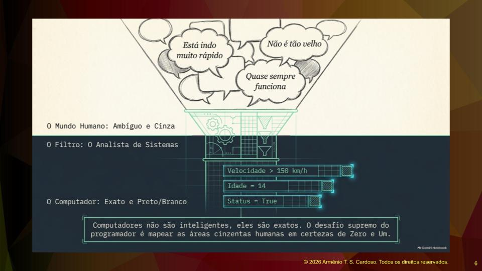

## Lógica Booleana

A lógica booleana é a base do funcionamento das máquinas e dos circuitos eletrônicos. É uma lógica binária, de liga e desliga, sem meios-termos. Sua natureza binária a torna apta a lidar com questões absolutas, representadas por zero ou um.

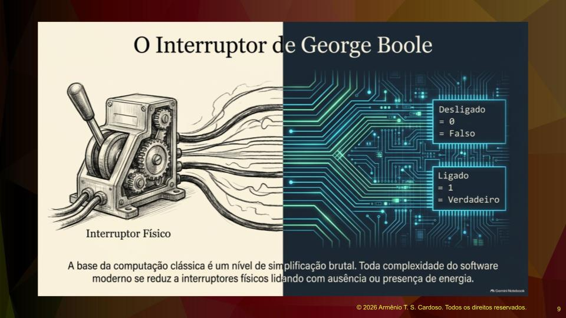

A álgebra booleana foi criada pelo matemático e filósofo britânico George Boole, sendo fundamental para o desenvolvimento da computação moderna. Ela lida com declarações que possuem apenas dois valores: verdadeiro ou falso, fazendo analogia ao interruptor que só pode estar ligado ou desligado. Com milhões de interruptores em um circuito integrado, conseguimos formar várias combinações e fazer um programa funcionar.

As declarações da lógica booleana são conhecidas como proposições e possuem três propriedades básicas.

A primeira propriedade é que uma proposição só pode ter um valor por vez. Ela não pode ser verdadeira e falsa ao mesmo tempo. Enquanto os problemas da vida real apresentam probabilidades, o mundo booleano lida com certezas. O principal desafio do analista de sistemas é mapear as áreas cinzentas do mundo real e transformá-las no preto e branco da lógica booleana. Quando a regra de negócio diz que um aluno menor de quinze anos não pode ser matriculado no turno noturno, o computador calculará a idade exata. Não importa se o aluno tem quatorze anos e onze meses, a regra é absoluta e o computador a seguirá à risca.

A segunda propriedade é que as proposições devem ter um significado claro e inequívoco. Para programar, **é fundamental entender perfeitamente o problema**. Se o enunciado de um projeto menciona termos específicos, como aportes mensais ou descomissionamento de plataformas, o programador precisa pesquisar e entender a linguagem usada naquela área de negócio, seja logística, medicina diagnóstica ou engenharia. **A programação começa na compreensão clara da linguagem natural**. Uma afirmação ambígua, como dizer que algo está viajando rápido, não serve para a lógica computacional, pois a percepção de velocidade de um carro é totalmente diferente da velocidade de uma espaçonave.

A terceira propriedade é que é possível combinar proposições individuais para construir uma expressão maior e mais complexa. Se dizemos que uma pessoa está vestindo uma camisa e a camisa é vermelha, estamos conectando duas afirmações verdadeiras para formar uma expressão composta. Fazemos isso usando operadores lógicos.

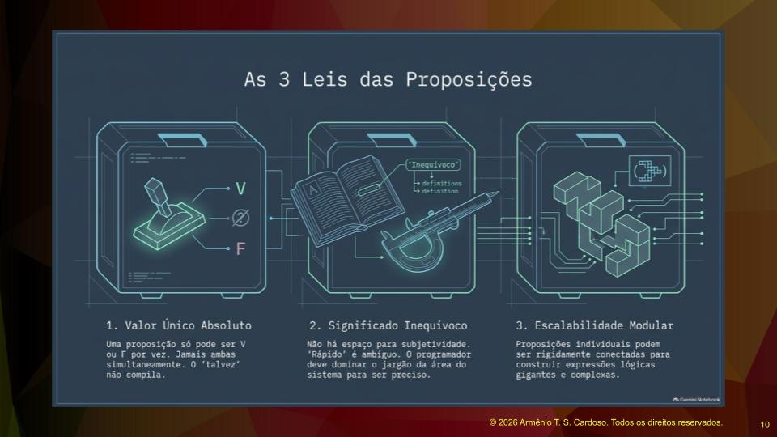

## Operadores Lógicos

Os operadores lógicos conectam proposições simples para avaliar várias declarações antes de chegar a uma conclusão.

O operador AND é o termo técnico para a conjunção. Ele encadeia proposições de maneira que todas devem ser verdadeiras para que a conclusão seja verdadeira. Se qualquer uma das proposições for falsa, a conclusão será falsa. Na computação, a presença desse operador deve ser explícita no código.

O operador OR é o termo técnico para a disjunção. Ele encadeia proposições de maneira que pelo menos uma delas deve ser verdadeira para que a conclusão seja verdadeira. A única maneira de a conclusão ser falsa é se todas as proposições envolvidas forem falsas.

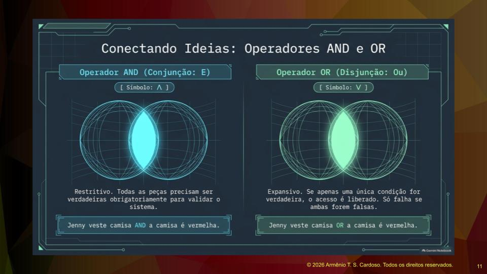

O operador NOT representa a negação. A missão dele não é encadear proposições, mas sim inverter o valor de uma proposição. Negar uma proposição pode facilitar a expressão de uma cadeia de raciocínio, transformando um estado verdadeiro em falso e vice-versa.

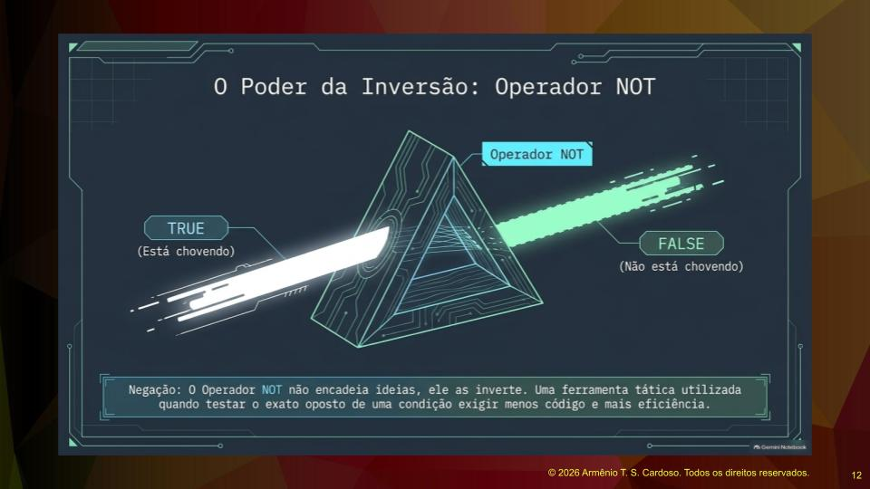

O operador IMPLIES é a implicação ou condicional. Ele afirma que há uma correlação entre duas declarações, funcionando como a palavra **logo** em português. Se afirmamos que uma pessoa é engenheira química, **logo** ela pode fazer uma pós-graduação, estamos criando uma consequência. A segunda proposição é consequência da primeira. Essa é uma correlação unidirecional, o que significa que não podemos inverter a ordem lógica a partir da conclusão.

O operador de equivalência, conhecido como **se e somente se**, é o operador bicondicional. Ele se comporta de maneira semelhante à implicação, mas atua de forma bidirecional. Isso significa que a segunda proposição é influenciada apenas pela primeira, e vice-versa. Se a primeira for verdadeira, a segunda é verdadeira. Se a primeira for falsa, a segunda será falsa, sem exceções.

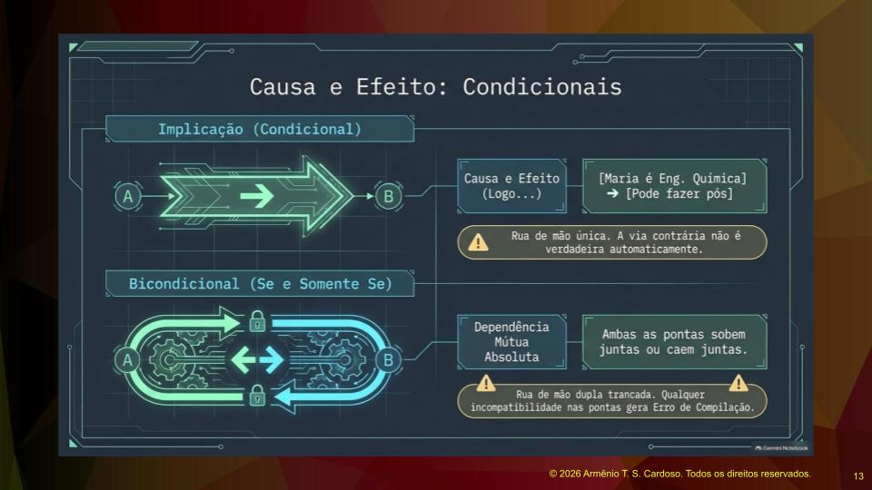

## Conclusão

A proposta deste artigo é apresentar conceitos fundamentais para o estudo sistemático de programação e Engenharia de Software, entendendo a base necessária para a construção de bons algoritmos. Há a motivação e necessidade de compreender claramente os problemas a serem resolvidos, mapeando e validando as premissas, formulando proposições e dominando a linguagem natural de cada ramo dos negócios.

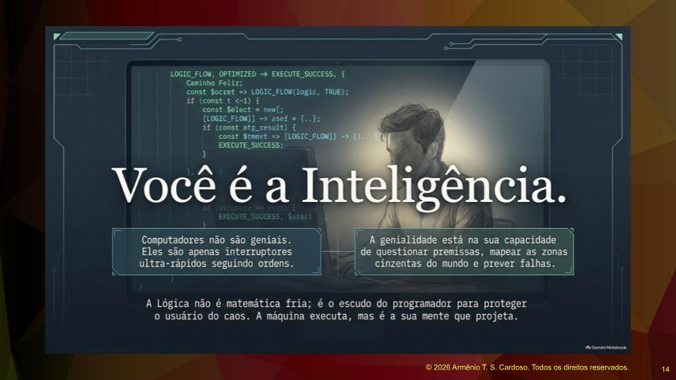

## Referências

1. **MORTARI, Cezar A.** Introdução à lógica. 2. ed. São Paulo: Editora UNESP, 2017. Disponível em: [Editora UNESP](https://editoraunesp.com.br/). 

2. **KUDO, Taciana Novo et al.** Introdução à Lógica de Programação. Goiânia: Universidade Federal de Goiás (UFG), 2024. Disponível em: [Publicação e material didático](https://www.inf.ufg.br/).

3. **POZZER, Cesar Tadeu; ASSUNÇÃO, Joaquim Vinicius Carvalho; NUNES, Raul Ceretta.** Algoritmos e lógica de programação. Santa Maria: Editora UFSM, 2025. Disponível em: [Editora UFSM](https://www.ufsm.br/editoras/ufsm).

4. **IEPSEN, Edécio Fernando.** Lógica de Programação e Algoritmos com JavaScript. 2. ed. São Paulo: Novatec, 2022. Disponível em: [Novatec](https://novatec.com.br/).

5. **STEINMETZ, Ernesto Henrique Radis; FONTES, Roberto Duarte.** Cartilha Lógica de Programação. Brasília: Instituto Federal de Brasília (IFB), 2013. Disponível em: [Repositório do IFB](https://repositorio.ifb.edu.br/).
