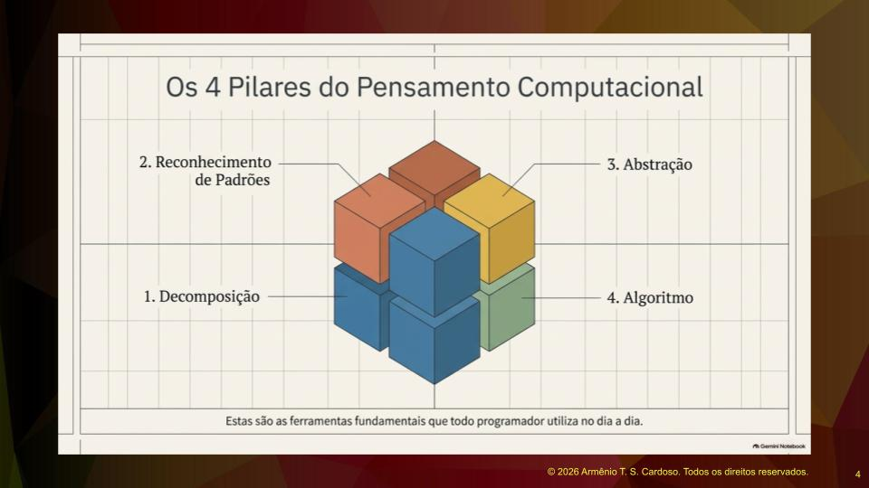
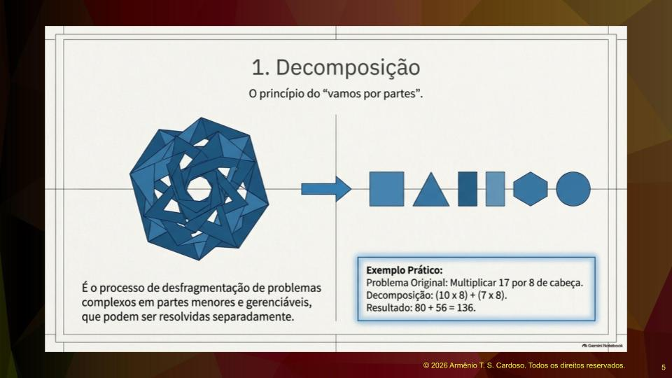
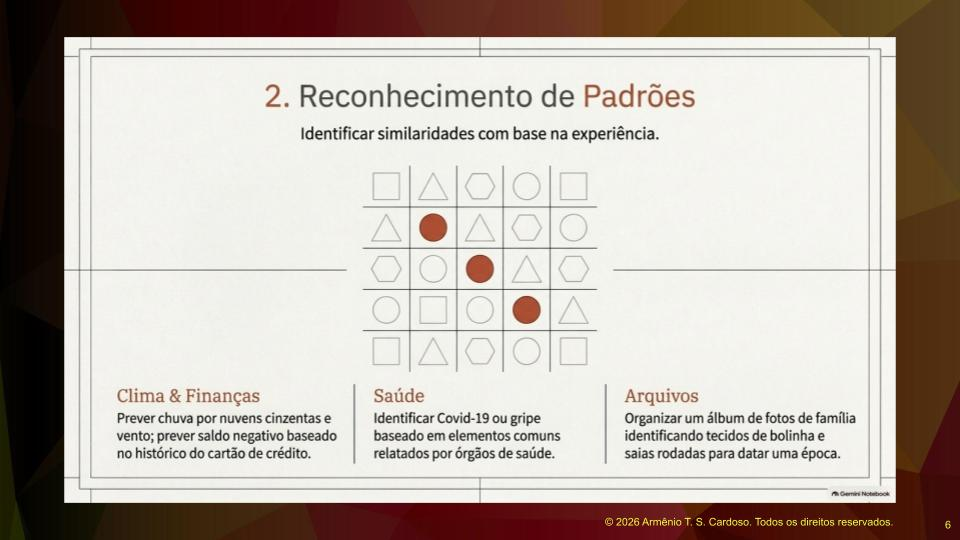
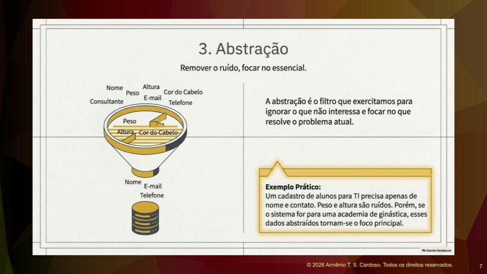
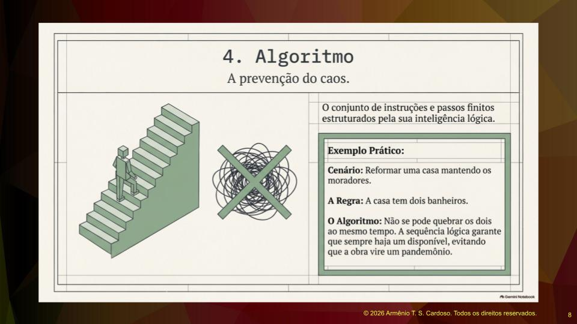
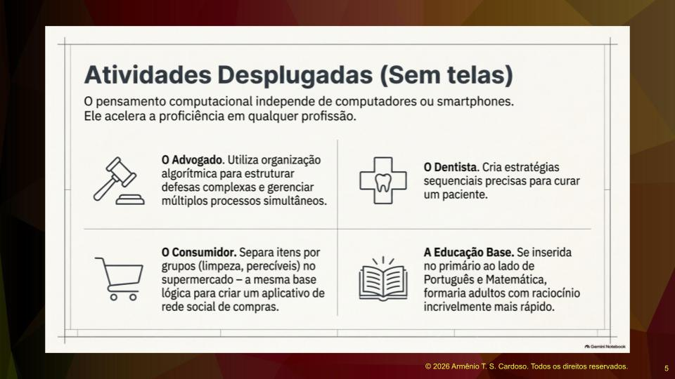
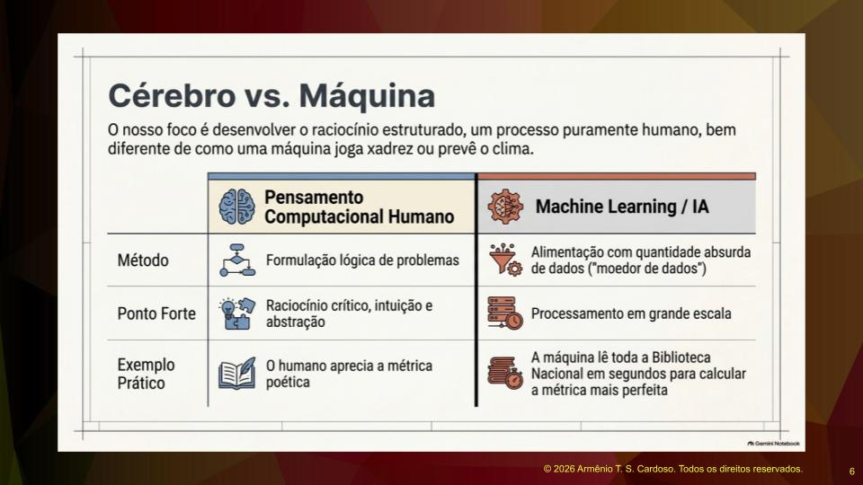

# O poder do Pensamento Computacional na carreira de Engenharia de Software

Você já reparou como alguns profissionais parecem desatar nós e resolver problemas complexos com uma facilidade quase irritante? Durante muito tempo, até o final da década de 90, acreditava-se que essa habilidade na área de tecnologia era um dom restrito a "superdotados" da computação. A programação era ensinada de forma puramente instrucional, baseada na intuição.

Porém, a partir dos anos 2000, a ciência provou o contrário: a forma como um excelente engenheiro de software pensa pode ser mapeada, extraída e ensinada a *qualquer pessoa*. Essa revolução tem nome: **Pensamento Computacional**.

Hoje, vamos mergulhar nas técnicas que separam o profissional que age por intuição daquele que age com método. Se você quer elevar o nível da sua Engenharia de Software (ou até mesmo otimizar sua vida pessoal), pegue seu caderno e vamos ao artigo de hoje.

---

## O que é o Pensamento Computacional?

A primeira regra do Pensamento Computacional é: **esqueça as máquinas**. Não estamos falando de computadores, mas de *pessoas*.

Como definiu a cientista Jeannette Wing, o Pensamento Computacional é o processo mental envolvido na formulação de um problema e na expressão de suas soluções de forma que possam ser executadas de maneira eficiente. Trata-se de usar os fundamentos da Ciência da Computação para entender o comportamento humano e projetar sistemas.

Não queremos transformar você em um robô. A ideia é pegar o método de trabalho de um programador e aplicá-lo no dia a dia. Um advogado montando uma tese de defesa ou um dentista planejando um tratamento complexo podem (e devem) usar o **Pensamento Computacional**.

Quem domina essa técnica desenvolve um perfil cognitivo poderoso, caracterizado por:
- **Confiança diante da complexidade:** Olhar friamente para o caos e começar a organizá-lo.
- **Persistência:** Não desistir no primeiro erro de compilação ou barreira lógica.
- **Tolerância à ambiguidade:** Saber analisar o contexto antes de tomar decisões precipitadas.

---

## Os 4 Pilares do Pensamento Computacional

Existem quatro ferramentas fundamentais que todo bom programador usa. Alguns usam sem saber, mas quando você toma consciência delas, seu poder de resolução de problemas se multiplica.

### 1. Decomposição
É a arte de dividir para conquistar. Consiste em quebrar um problema gigante e intimidador em partes menores e gerenciáveis.

*Exemplo prático:* Se eu pedir para você multiplicar 17 por 8 de cabeça, pode parecer difícil de imediato. Mas, se você **decompor** o problema, fará: (10 x 8) + (7 x 8). Você resolve 80 + 56 e chega rapidamente aos 136. Na Engenharia de Software, é exatamente assim que construímos arquiteturas de microsserviços.

### 2. Reconhecimento de Padrões
É a aplicação inteligente da sua experiência. Significa identificar similaridades e características comuns para resolver problemas de forma eficiente.

Na programação Orientada a Objetos, chamamos isso de *Design Patterns* (Padrões de Projeto). Na vida real, é você olhar para o céu, ver nuvens cinzentas, sentir o vento forte e deduzir: "vai chover". Ou então, olhar para o orçamento familiar, reconhecer o padrão de que compras grandes no cartão de crédito geram juros no longo prazo, e decidir pagar à vista. Você já viveu isso; você reconhece o padrão e age.

### 3. Abstração
Abstrair é filtrar. É o processo de separar os detalhes essenciais e ignorar a complexidade inútil para aquele contexto.

*Exemplo prático:* Imagine que você precisa criar um banco de dados de alunos para uma escola de tecnologia. Nome, e-mail e telefone são essenciais. Cor do cabelo e altura? Não importam. **Mas**, se o sistema fosse para uma escola de modelos ou de cabeleireiros, a cor do cabelo e a altura passariam a ser dados críticos. A abstração é a lente que foca apenas no que resolve o problema atual, criando uma "espinha dorsal" para a sua solução.

### 4. Algoritmos
Um algoritmo nada mais é do que um conjunto de instruções lógicas, finitas e passo a passo para resolver um problema. É a inteligência e a estratégia que você emprega.

Se você vai reformar sua casa e tem dois banheiros, a lógica algorítmica diz que você não pode quebrar os dois ao mesmo tempo. Um precisa ficar operante. Se você é motorista de aplicativo, cria um algoritmo mental de posicionamento em bairros específicos em horários de pico para não gastar gasolina à toa.

Na programação, todo algoritmo exige que você organize os dados em três etapas:

1. **Entrada (Input):** Quais dados eu tenho? (ex: R$ 10.000 de investimento inicial, aportes mensais, taxa de juros).
2. **Processamento:** Quais são as fórmulas matemáticas e regras de negócio?
3. **Saída (Output):** Qual é o resultado esperado na tela do usuário?
4. 

## O Mito do Computador: Atividades "Desplugadas"

Um erro comum é achar que Pensamento Computacional é saber usar o TikTok ou mexer bem no smartphone. Não é. É sobre raciocínio lógico e crítico: **não aceitar tudo o que se ouve, mas refletir, questionar e estruturar.**

Você sequer precisa de um computador para treinar isso. Chamamos isso de *atividades desplugadas*.
Organizar uma festa de aniversário exige **decomposição** (lanche, convidados, música) e **abstração** (focar no tema principal). Fazer compras no supermercado e separar os itens na esteira por categorias (perecíveis, limpeza, matinais) é puro **reconhecimento de padrões**. A lógica está em tudo.

## E a Inteligência Artificial nisso tudo?

Com o boom do ChatGPT e do *Machine Learning*, é vital separarmos as coisas.
A Inteligência Artificial atua como um gigantesco "moedor de dados". Se pedirmos para uma IA ler todos os livros da Biblioteca Nacional e identificar quais poemas são de Luís de Camões ou de Fernando Pessoa, ela fará isso em segundos. Ela encontra padrões através de força bruta computacional e bases de dados colossais.

O Pensamento Computacional, por outro lado, é a nossa missão humana. É a capacidade de ter raciocínio crítico, de formular a pergunta certa e de desenhar a arquitetura da solução que, eventualmente, a máquina irá executar. A IA executa; o humano *pensa computacionalmente*.

## Conclusão: A Transformação do Olhar

O grande diferencial do Engenheiro de Software sênior para o júnior não está apenas na quantidade de linguagens de programação que ele conhece, mas na sua capacidade de olhar para um cenário caótico e aplicar Decomposição, Reconhecimento de Padrões, Abstração e Algoritmos.

A proposta do nosso artigo de hoje é clara: **abandone a execução puramente intuitiva e abrace a resolução sistemática e técnica.** O Pensamento Computacional não é apenas sobre escrever código melhor; é sobre pensar melhor.

