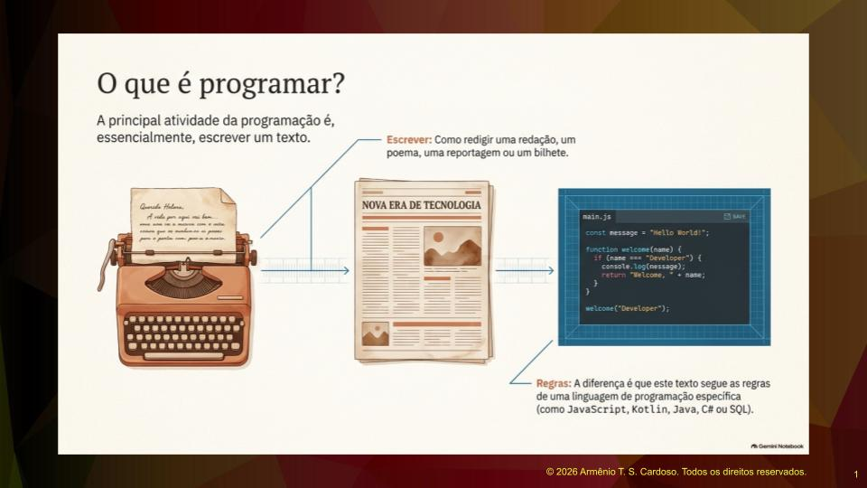
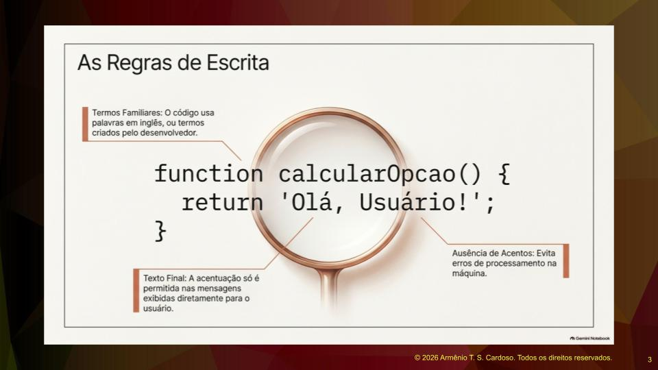
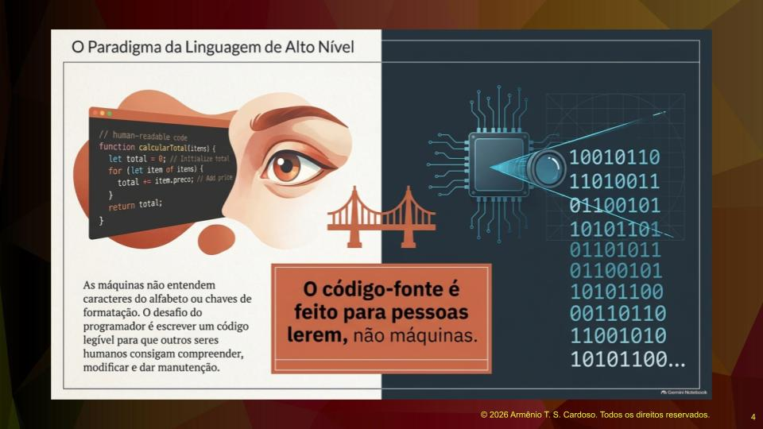
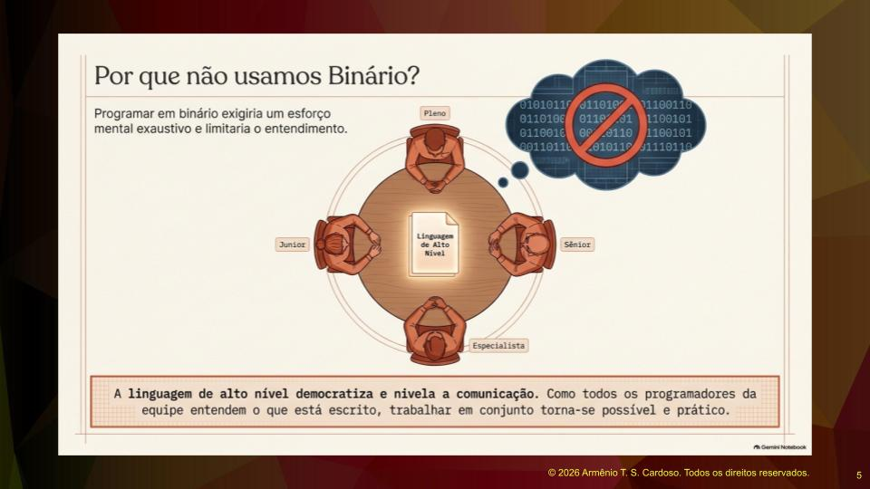
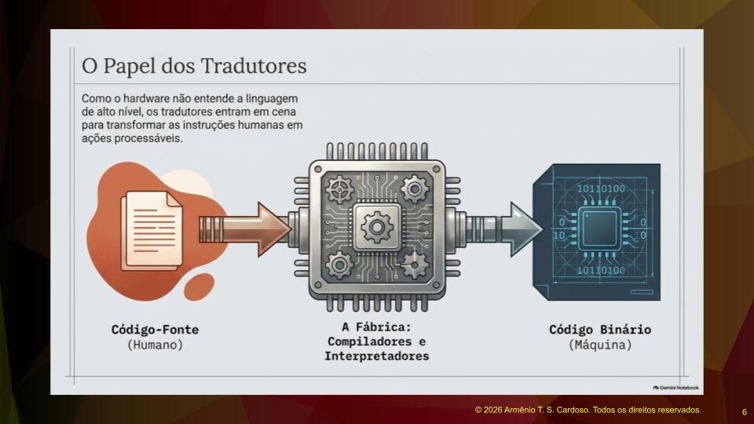
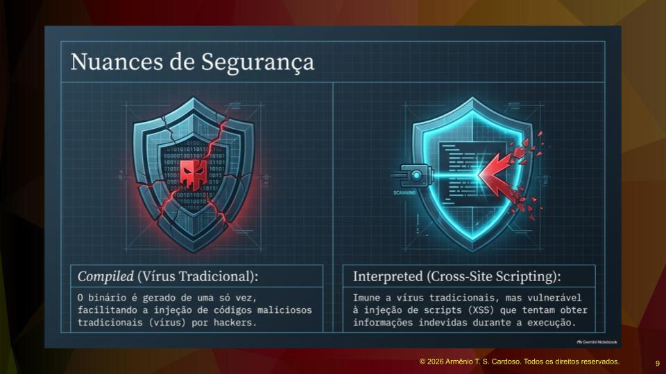
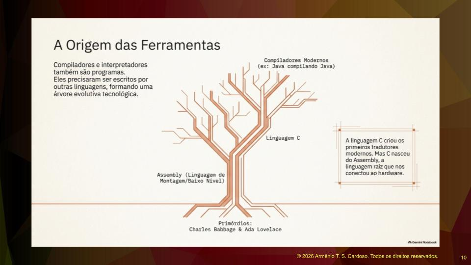
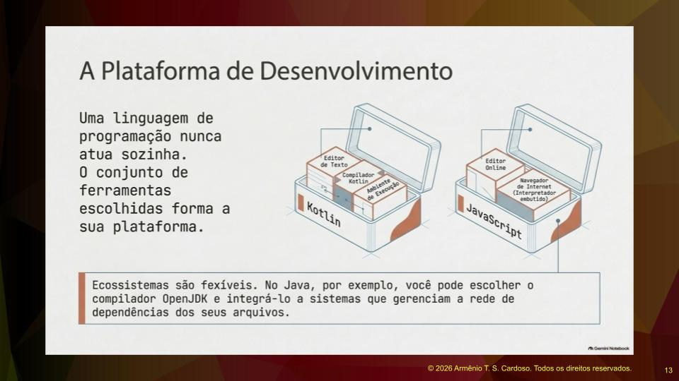

## O Que é Programação
O desafio inicial para quem está entrando na área de tecnologia é entender como explicar o que é a programação. A principal atividade quando estamos programando é escrever um texto. É como se fosse uma redação, um poema, uma reportagem ou um bilhete. A diferença é que esse texto possui uma linguagem de programação ditando como as coisas devem ser escritas. Esse processo de escrita está sempre associado a uma linguagem específica.

 

Neste primeiro momento, é necessário aprender os fundamentos do que é programar e qual é o resultado esperado dessa atividade. Uma vez compreendida essa base, o próximo passo é aprender as linguagens de programação. O termo é utilizado no plural porque, ao longo da jornada, o programador é exposto a diversas tecnologias, como JavaScript, Kotlin, Java, C# e SQL. Essa base teórica inicial é fundamental para facilitar o aprendizado de qualquer outra linguagem no futuro.

## O Programa de Computador e o Código-Fonte
Um programa de computador é um conjunto de instruções que descreve uma tarefa a ser realizada pela máquina. É uma espécie de receita, um passo a passo escrito com o objetivo de o computador executar linha após linha. O termo geral para isso é código-fonte, que é o texto criado pelo programador e que dá origem ao que o computador vai executar.

O ciclo básico de desenvolvimento funciona da seguinte maneira: o programador abre um editor de texto especial voltado para programação, escreve o código, esse código passa por um processo de tradução para a linguagem de máquina e finalmente, o computador o executa.

Ao observar um código-fonte, mesmo sem conhecer a linguagem a fundo, é possível distinguir palavras em inglês, como a palavra function, ou termos familiares criados pelo desenvolvedor. Uma regra importante na escrita do código-fonte é evitar o uso de acentuação nas instruções para prevenir erros de processamento. A acentuação só é utilizada nas mensagens de texto que serão exibidas diretamente para o usuário final.

## Linguagem de Alto Nível e a Comunicação da Equipe
Ao olhar para um código-fonte estruturado em blocos e parágrafos, surge a reflexão: esse texto foi feito para pessoas ou para máquinas? A resposta é que o código-fonte é feito para pessoas lerem. Isso é o que chamamos de linguagem de alto nível, ou seja, uma linguagem que os seres humanos conseguem compreender.

O grande desafio do programador é escrever um código legível, que outros colegas de equipe consigam entender, modificar e dar manutenção. As máquinas não entendem caracteres do alfabeto ou chaves de formatação. Tudo o que é digitado no editor é para leitura humana.

Pode surgir a dúvida do porquê não programamos diretamente em código binário ou linguagem de máquina. A resposta está na dinâmica da nossa profissão. Uma equipe de desenvolvimento envolve profissionais de vários níveis de experiência: juniores, plenos, seniores e especialistas. A linguagem de alto nível democratiza e nivela a comunicação. Como todos os programadores da equipe entendem o que está escrito, fica muito mais fácil trabalhar em conjunto. Se programássemos em código binário, limitaríamos o entendimento, exigindo um esforço enorme de conversão mental, o que traria dificuldades até para os programadores mais experientes. O código binário simplesmente não é prático nem necessário para o dia a dia da programação.

## Compiladores e Interpretadores
Como a máquina não entende a linguagem de alto nível, entram em cena os compiladores e interpretadores. Eles funcionam como uma fábrica que recebe o código-fonte de um lado e o transforma em código binário do outro, permitindo que o computador processe as instruções.

Existe uma diferença fundamental entre compilador e interpretador. Para ilustrar, imagine uma pessoa que trabalha como tradutora fazendo dois papéis diferentes. Quando ela atua como um compilador, ela pega um livro inteiro escrito em um idioma e o traduz completamente para outro idioma. No final, você tem a obra inteira traduzida de uma só vez.

Já quando ela atua como um interpretador, a dinâmica muda. Imagine que um estrangeiro fala uma frase, a tradutora ouve, traduz e repassa para você. Ele fala a segunda frase, ela ouve, traduz e repassa. Ou seja, no compilador, a tradução do texto é completa e imediata. No interpretador, a tradução é feita por partes, linha por linha.

Linguagens como C++ e Java utilizam compiladores, enquanto Python e JavaScript utilizam interpretadores. É importante ressaltar que não há adaptação ou omissão na tradução normal de nenhum dos dois métodos. A tradução é sempre fiel ao código original. No entanto, como o interpretador executa o código linha por linha, ele é capaz de interromper a execução caso encontre um erro ou um risco de segurança no meio do processo. Já no código compilado, o binário é gerado de uma vez, o que pode facilitar a injeção de códigos maliciosos por hackers. Em linguagens interpretadas, não é possível inserir um vírus tradicional, embora existam outras vulnerabilidades, como o Cross-Site Scripting, onde scripts são injetados para tentar obter informações indevidas.

## A Origem das Ferramentas de Tradução
Tanto o compilador quanto o interpretador também são programas de computador e, portanto, foram escritos em alguma linguagem de programação. Filosoficamente, existe uma linguagem raiz que permitiu a criação das primeiras ferramentas de tradução. Essa linguagem é o Assembly, uma linguagem de montagem de baixo nível que permite programar e gerar código binário diretamente. Historicamente, os primeiros conceitos de linguagem de montagem remetem aos primórdios da computação com Charles Babbage e a primeira programadora da história, Ada Lovelace.

Através de linguagens de baixo nível, criamos as de alto nível. Por exemplo, os primeiros compiladores e interpretadores de linguagens modernas foram escritos na linguagem C. A linguagem C, por sua vez, foi criada originalmente em Assembly. Hoje em dia, é comum que o compilador de uma linguagem seja escrito na própria linguagem, como é o caso das versões atuais do compilador Java, que são escritas em Java.

Atualmente, tratamos as principais linguagens de programação como linguagens de uso geral. É como se fossem idiomas diferentes: você pode pedir um pão em inglês, alemão ou italiano, e o significado final será o mesmo. Consequentemente, as máquinas também são de uso geral. Um notebook, um computador de mesa ou um tablet são capazes de rodar os programas criados, independentemente da linguagem escolhida, assumindo que não estamos lidando com hardwares extremamente específicos, como sistemas embarcados de aviões.

## Os Cinco Passos para Criar um Programa
Para construir um programa, é necessário seguir cinco passos fundamentais.

1. O primeiro passo é identificar o problema. O programador deve reconhecer a necessidade da criação do software e entender profundamente qual é a questão que precisa ser resolvida.

2. O segundo passo é planejar o programa e selecionar as ferramentas necessárias. É fundamental ter um bom repertório de conhecimentos para escolher a melhor abordagem e montar a caixa de ferramentas ideal para aquele projeto.

3. O terceiro passo é escrever o programa na linguagem escolhida. Como nem sempre é possível resolver todos os problemas com uma única tecnologia, é importante conhecer mais de uma linguagem. Certas tarefas são mais adequadas para Java, outras para JavaScript ou Kotlin. O repertório do programador é o que permite construir soluções eficientes.

4. O quarto passo é traduzir o código-fonte legível por pessoas em código executável pela máquina. Isso envolve utilizar o compilador ou interpretador adequado para a linguagem escolhida, garantindo que o computador consiga processar as instruções.

5. O quinto e último passo é testar o programa. É essencial verificar o funcionamento do software para ter certeza de que ele resolve o problema inicial corretamente, assegurando a qualidade da entrega.

## Plataformas de Desenvolvimento
O conjunto de ferramentas escolhidas no processo de desenvolvimento forma o que chamamos de plataforma. Uma linguagem de programação está sempre atrelada a essas ferramentas. Por exemplo, se a escolha for trabalhar com Kotlin, será necessário um editor de texto, um compilador Kotlin e um ambiente de execução. Tudo isso compõe a plataforma de desenvolvimento para aquela aplicação.

No caso do JavaScript, a plataforma pode ser formada pela própria linguagem, por um editor de código online e pelo navegador de internet, que possui um interpretador embutido para executar os scripts.

É importante destacar que existem vários fabricantes e opções de ferramentas no mercado. No ecossistema Java, por exemplo, o programador pode escolher utilizar o compilador OpenJDK em vez de outros disponíveis, além de selecionar o editor de texto de sua preferência. Ferramentas de construção de código também podem ser integradas a essa plataforma para gerenciar quais arquivos precisam ser compilados em conjunto, já que um arquivo de código frequentemente faz referência a vários outros, formando uma rede de dependências que o compilador precisa rastrear e traduzir.

